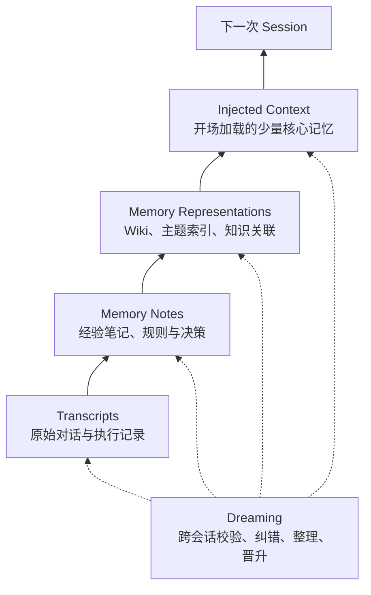
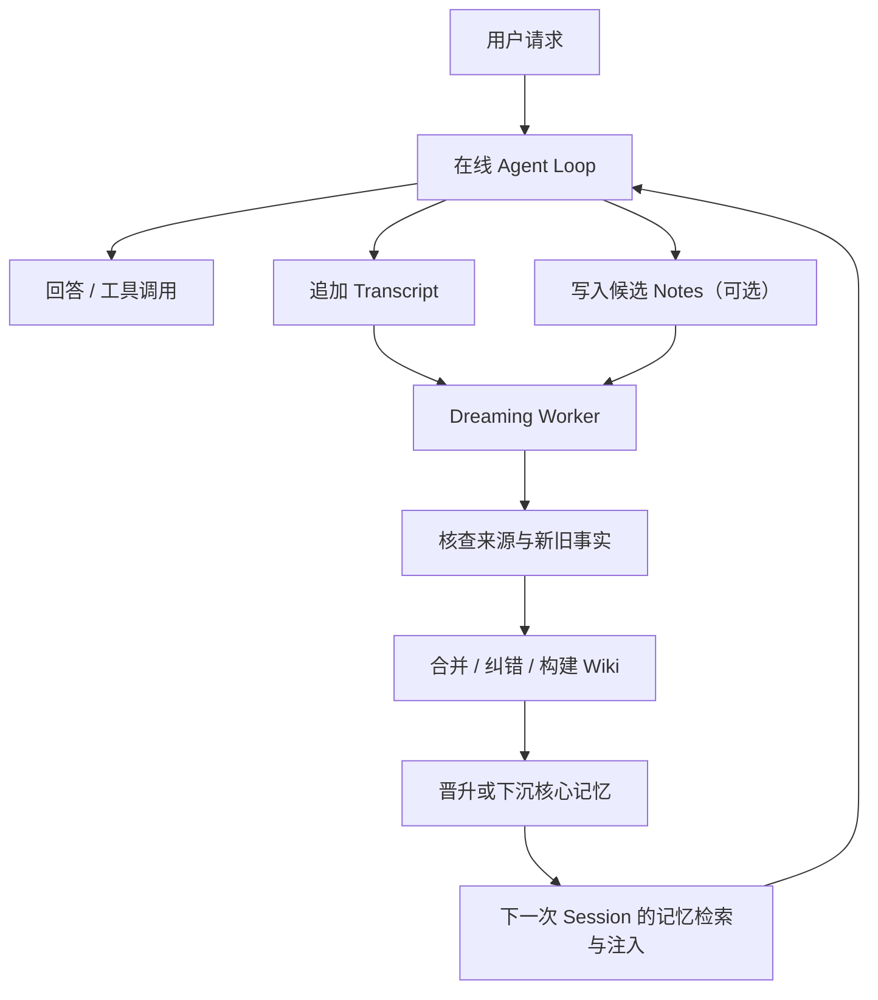
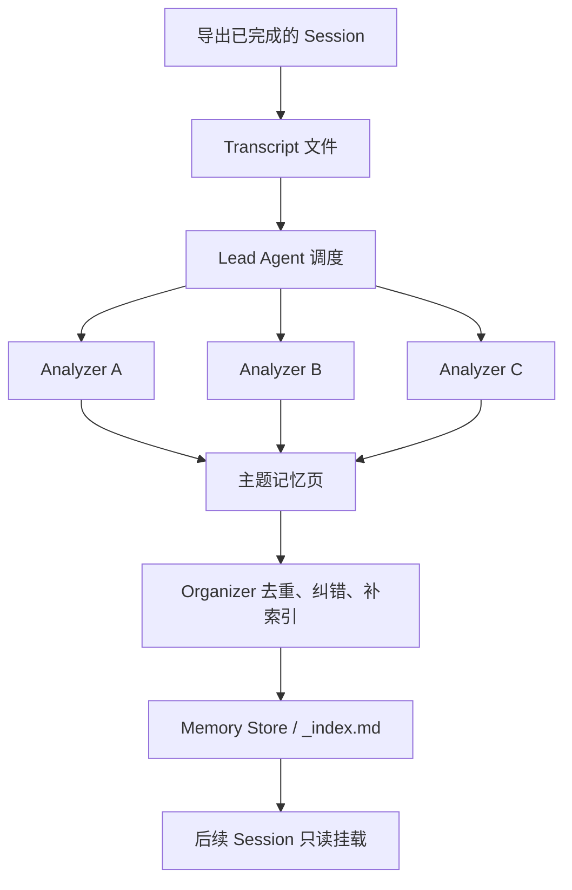
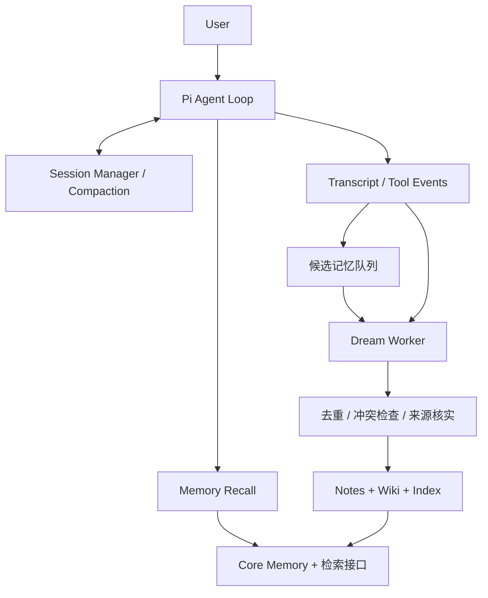
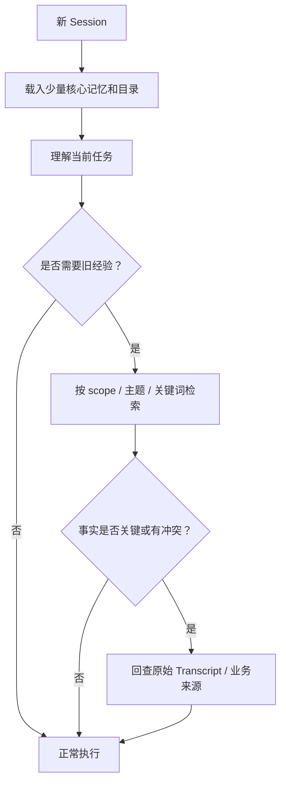

# Agent 长期记忆架构深度解析：从开源方案到 Anthropic 的 Dreaming

> **一句话概括**：Agent 的长期记忆不是把聊天记录永久保存下来，而是从执行经历中提炼未来有用的知识，并让这些知识能够被检索、验证、更新和淘汰。
>
> 本文以 Anthropic 2026 年 11 月 6 日发布的 [*The components of agent memory*][anthropic-memory] 为主线。先横向比较开源 Agent 的实现，再拆解四层记忆与 Dreaming（离线记忆巩固），最后讨论如何在 Pi Agent 中落地一套可维护的记忆系统。

## 1. 为什么 Agent 需要记忆？

设想一个编程 Agent：你今天让它处理 SSE 流式消息，明天修复断线重连，后天继续开发会话恢复。

这几个任务其实相关。它在第一天可能已经弄清楚项目的事件协议，在第二天排查过旧请求覆盖新状态的竞态问题。如果第三天开启新会话时，Agent 又要从头读代码、重新踩坑，它虽然能完成任务，却没有真正积累经验。

于是我们自然会想到：**把之前的聊天记录保存下来不就行了吗？**

问题在于，几百次会话以后，历史记录可能包含大量临时状态、过时结论、失败尝试和互相矛盾的信息。全部放进 Prompt 不现实，全部放进向量数据库也不等于能用对。

因此，真正需要解决的是一个完整链路：

> [!STEPS]
>
> 1. **捕获**
>
>    过去发生了什么？
>
> 2. **选择**
>
>    哪些内容值得跨会话保存？
>
> 3. **组织**
>
>    如何找到相关内容，以及它与其他知识的关系？
>
> 4. **维护**
>
>    记忆错误、过时或者重复时怎么办？
>
> 5. **使用**
>
>    下一次 Session 应在什么时候、以什么形式看到这些信息？

Anthropic 的文章值得研究，恰恰因为它把这五个问题放到同一个系统里讨论。

### 1.1 先把 Context、Session、Compaction、Memory 分清楚

这是阅读记忆架构之前最重要的前置知识。

| 概念 | 解决的问题 | 常见实现 |
|---|---|---|
| **Context（上下文）** | 模型当前能够看到什么 | System Prompt、Messages、Tool Results |
| **Session State（会话状态）** | 当前任务做到哪一步，能否中断恢复 | 会话消息、运行状态、Checkpoint |
| **Compaction（上下文压缩）** | 对话过长时，怎么继续当前任务 | 用摘要替换部分旧消息，保留近期内容 |
| **Long-term Memory（长期记忆）** | 新会话如何使用过去的经验 | 事实笔记、项目规则、经验库、知识索引 |

以 Pi Agent 为例：

- 会话管理器保存用户消息、工具事件和分支信息，这是**会话状态**。
- Context 构建阶段从这些记录中选出当前交给模型的消息，这是**上下文**。
- Token 快用尽时，把较早的内容压缩为摘要，这是**Compaction**。
- 新开一个 Session 后，依然能读到上周调试出来的 SSE 协议约定，这才是**长期记忆**。

注意：**压缩历史不等于长期记忆**。Compaction 的主要目标是帮助当前任务继续执行；长期记忆的目标是让未来不同任务也能复用经验。两者可以协作，但职责不同。[[1]](https://github.com/earendil-works/pi/blob/main/packages/coding-agent/docs/sessions.md)[[2]](https://github.com/earendil-works/pi/blob/main/packages/coding-agent/docs/compaction.md)

## 2. 开源 Agent 的记忆方案：它们究竟在解决什么？

先看全局对比。下面这些项目都与记忆相关，但处在不同层次，不能简单用“谁最先进”来排序。

| 项目 | 主要设计 | 优点 | 需要注意的边界 |
|---|---|---|---|
| **Pi** | Session、分支历史、Compaction、文件/扩展 | 简单、透明，适合学习 Agent 运行链路 | 核心 Compaction 不自动等于跨会话知识管理 |
| **OpenHands** | Event Log + Condenser | 保留执行事件，构建可供模型消费的压缩视图 | 更偏长任务上下文连续性 |
| **LangGraph** | Checkpointer + Store | 清楚区分 Thread 状态和跨 Thread 数据 | 提供存储原语，不替应用决定记忆策略 |
| **Letta / MemGPT** | Core Memory + Archival Memory | 让 Agent 主动修改常驻记忆、搜索外部记忆 | 写错记忆、常驻内容膨胀仍需治理 |
| **Mem0** | 事实提取 + 结构化存储 + 混合检索 | 把记忆作为可集成服务，接入门槛低 | 抽取质量、冲突、生命周期依然关键 |
| **Zep / Graphiti** | 时序知识图谱 | 擅长实体关系、事实变化和时间查询 | 构图、关系维护和运维更复杂 |
| **OpenClaw** | 分层文件 + 索引 + Provenance + Dreaming | 关注来源可信度、晋升规则和记忆维护 | 机制多，适合持续运行的助手而非所有小项目 |

### 2.1 Pi：优先保证执行历史可恢复

Pi 将会话记录作为持久化的事件序列。较长任务需要 Compaction 时，系统生成可供后续使用的摘要；原始会话记录并不会因此简单地变成“只有摘要”。

可以把它理解成：

- Session 文件是一份完整工作日志；
- 当前 Context 是从日志中选择、加工出来的视图；
- Compaction 是让模型在窗口有限的情况下继续工作。

**这解决了“当前任务怎么继续”，但没有完全解决“不同任务如何共享经验”。**

如果想在 Pi 上做长期记忆，通常还需要在核心 Session 机制之外增加一套提取、保存、检索和维护的流程。Pi 的扩展机制恰好提供了可切入的位置。具体项目应用可能已经有文件式记忆，例如 Pi Chat；不要把应用层能力与 Pi 核心的 Compaction 混为一谈。[[1]](https://github.com/earendil-works/pi/blob/main/packages/coding-agent/docs/sessions.md)[[2]](https://github.com/earendil-works/pi/blob/main/packages/coding-agent/docs/compaction.md)

### 2.2 OpenHands：Event Log 与 Condenser

OpenHands 也很重视完整执行事件。Condenser 把历史事件整理成更短的上下文视图，避免长时间编程任务被不断增长的历史拖垮。

有点像视频剪辑：

> Event Log 是原始录像；Condenser 给模型的，是保留必要信息的剪辑版。

它的工程价值是原始记录和模型当前看到的内容可以分开处理。但一个好的剪辑器，不一定就是一个好的长期知识库。

### 2.3 LangGraph：短期状态与长期记忆分成两个接口

LangGraph 的设计尤其适合用来建立正确的概念边界：

- **Checkpointer** 保存 Thread 的状态，支持多轮交互、恢复执行等。
- **Store** 存储跨 Thread 的数据，可按用户、项目或命名空间组织记忆。

它的文档还借用认知科学的分类：

| 类型 | 典型内容 | 开发场景示例 |
|---|---|---|
| Semantic Memory（语义记忆） | 事实、知识、偏好 | 项目采用 Vue3；用户偏好简洁回答 |
| Episodic Memory（情景记忆） | 一次经历及结果 | 上次修复 SSE 竞态的排查过程 |
| Procedural Memory（程序性记忆） | 可重复执行的流程和策略 | 遇到同类问题先检查事件顺序和请求 ID |

这些不是必须对应三张表或三个数据库，而是提醒开发者：**“我知道什么”“我经历过什么”“我该怎么做”是不同的信息。**[[3]](https://docs.langchain.com/oss/python/langgraph/persistence)

### 2.4 Letta / MemGPT：让 Agent 主动管理记忆

Letta 的重要设计是把记忆分成不同访问层：

- **Core Memory**：少量高频信息，常驻上下文；
- **Archival Memory**：体积较大的资料，按需检索；
- 模型可以调用工具更新 Memory Blocks，而不只被动接收开发者提供的文本。

这和传统 RAG 不太一样：RAG 主要强调检索外部知识，Letta 则进一步把记忆的修改权交给 Agent。

好处是灵活；风险是 Agent 可能把错误推断写成事实。所以只解决“能够修改”还不够，还要解决“能否验证”和“如何回滚”。[[4]](https://docs.letta.com/v1-sdk/memory/memory-blocks)

### 2.5 Mem0：将记忆抽取和检索封装为服务

Mem0 更接近“给现有 AI 应用加一套 Memory API”。常见处理链是：


它适合用户偏好、多轮客服、长期陪伴、项目知识等场景。

这里有个版本细节：截至本文写作时，Mem0 v3 的开源方案侧重 ADD-only 提取和混合搜索；Graph Memory 不是当前开源 SDK 的默认组成部分，而是平台侧能力。不要混用旧版 Mem0 的开源图记忆介绍与新版能力表。[[5]](https://github.com/mem0ai/mem0/blob/main/docs/migration/oss-v2-to-v3.mdx)

### 2.6 Graphiti：事实不仅有内容，还有时间

假设三个月前用户说“我在 A 公司”，现在说“我换到了 B 公司”。

向量检索可能把两条都找出来，但仅凭“语义相似”不能判断哪一条当前有效。

Graphiti 的思路是建立时序知识图谱，将人物、公司、事件、关系和时间放在一起管理。于是系统不仅能查询“现在在哪”，也能回答“去年在哪”。

如果业务需要复杂关系、多跳查询、事实生效时间，它很有价值；如果只是记住几十条用户偏好，引入完整图谱可能是过度设计。[[6]](https://www.getzep.com/platform/graphiti/)

### 2.7 OpenClaw：给记忆加上来源、权限和晋升规则

OpenClaw 的 Memory Core 是一个很好的工程化参照。它将指令、核心记忆、每日/情景记忆、未来触发意图和整理报告分为不同层次，使用文件与 SQLite 索引管理。

它最值得学习的不是目录命名，而是三个约束：

1. **来源可追溯**：记忆从用户、Agent 自己还是网页/工具结果而来？
2. **写入有门槛**：不可信内容不能因为被反复召回，就自动晋升为高可信核心记忆。
3. **维护不阻塞回复**：后台整理失败时，在线 Agent 仍然能正常工作。

OpenClaw 同时把确定性的定时任务、条件触发事项和普通事实记忆分开处理。这一设计比“什么都写进 MEMORY.md”可靠得多。[[7]](https://docs.openclaw.ai/concepts/memory-architecture)

### 2.8 横向对比的结论

上面这些方案可归纳为四种关注点：

- **Pi / OpenHands：任务能否连续执行？**
- **LangGraph / Letta：记忆怎样分层、怎样存取？**
- **Mem0 / Graphiti：事实怎样抽取、检索和关联？**
- **Anthropic / OpenClaw：记忆怎样持续被修正和治理？**

并不是前一种方案“过时”，后一种方案“先进”。一个简单的编程助手可能只需要 Session + 少量项目规则；一个跨月运行的个人 Agent，才可能真正需要记忆生命周期和离线巩固。

## 3. Anthropic 的四层记忆体系

Anthropic 在 [原文][anthropic-memory] 中把 Agent Memory 定义为：Agent 从任务和用户交互中获得，并跨 Session 保留下来的可读取知识。它**不包括**模型权重更新，也不等同于单次会话内的 In-context Learning 或 Compaction。

原文的 Figure 1 给出了一套从原始记录到直接注入上下文的分层结构：



> 注：这是依据 Anthropic Figure 1 重新绘制的概念图，箭头是为了帮助理解，并不表示只能逐层单向写入；Dreaming 可以跨层检查和调整信息。它是研究框架，不能直接当成所有 Claude 产品的完整内部技术实现。

### 3.1 第一层：Transcripts——保留原始证据

Transcripts 包括对话、工具调用、运行输出、错误信息等，是过去经历最接近原貌的一层。

例如，某 Agent 在处理断线重连问题时，先怀疑网络，后来从日志发现真正的原因是旧请求覆盖了新请求状态。

如果它第一次就把“网络重试是根因”写成了长期记忆，未来会被误导。只有保留原始记录，后续才能回看：当时做了哪些操作，哪些结果证实了什么，哪些只是猜测。

这一层主要追求**完整性和可追溯性**，不要求每次加载进 Context。它可以放在 JSONL、数据库或对象存储中，再建立时间和内容索引。

### 3.2 第二层：Memory Notes——把经历变成候选知识

比起“发生过什么”，Notes 更关心“以后可能用得上什么”。

| 一次会话中的信息 | 是否值得长期保存 | 原因 |
|---|---|---|
| 成功执行一次普通安装命令 | 通常不需要 | 随时可以再执行 |
| 当前页面加载了 12 条事件 | 通常不需要 | 瞬时状态，很快过时 |
| 项目特殊的构建命令 | 值得保存 | 不容易凭常识猜到 |
| 已验证的 SSE 事件顺序约束 | 很值得保存 | 可以避免重复排查 |
| 一次未经验证的失败猜测 | 可以保留为经历，但不应当作定论 | 未来可能需要核查 |

Anthropic 提出一个很好理解的观点：**保存记忆，有时是在预测未来还需要什么。**

Agent 选择记录一条规则，本质上是在判断：未来的自己可能再次遇到它，写下来可以减少重复探索。

但预测会出错，所以记忆系统不能只记录 `content`，还应尽量保留来源、状态和验证信息。

### 3.3 第三层：Memory Representations——为什么需要 Wiki？

当 Notes 只有十几条，全文搜索可能足够。积累到几千条时，问题会变成：

- 同一问题的经验散落在哪些会话？
- 哪些规则彼此依赖？
- 同一个结论是不是在多个地方重复出现？
- 应该先看哪个主题，再深入哪个原始记录？

Anthropic 的一个解决方式是用 Dreaming 维护 Wiki。Wiki 不是把所有 Notes 原样拼接，而是构建主题页、索引、交叉链接，让 Agent 能顺着知识关系导航。

例如：

```text
wiki/
├── _index.md
├── agent-loop.md
├── context-management.md
├── sse-streaming.md
├── session-recovery.md
└── tool-execution.md
```

`sse-streaming.md` 记录事件协议和状态处理原则，并指向 `session-recovery.md` 中有关快照恢复的经验。Agent 遇到复杂问题时，可以先查看索引，再跳到相关主题和底层证据。

**Wiki 充当的是“知识地图”，不是原始资料的替代品。**

也不必一看到“关系”就上 Neo4j。Markdown 链接、主题页和稳定的引用 ID，就可以构成实用的知识导航层。

### 3.4 第四层：Injected Context——最重要的一层应该最小

既然记忆有帮助，为什么不把整个 Wiki 都塞进 System Prompt？

因为 Context Window 有预算。无关信息会增加成本、干扰关注点；错误信息如果每次开场都自动注入，还会反复污染判断。

因此，顶层适合只放：

- 很稳定、每次都可能需要的用户或项目事实；
- 少量已验证的重要规则；
- 指向下层知识的简短目录。

细节保留在 Wiki 和 Notes 中，必要时再查。

Claude Code 的 Auto Memory 就体现了这一原则：文档说明它在开启自动记忆的会话中，最多加载 `MEMORY.md` **前 200 行或 25KB（以先触及的限制为准）**，其余内容按需读取。[[8]](https://code.claude.com/docs/en/memory)

可以用四句话理解整个分层：

> **Transcripts**：当时到底发生了什么？  
> **Notes**：从中学到了什么？  
> **Wiki**：这些知识如何关联、从哪里找到？  
> **Injected Context**：下一次开始时必须先知道什么？

## 4. Dreaming：记忆系统为什么需要“离线整理”？

四层结构解决了“存放与访问”；Dreaming 解决了“维护与演化”。

Dreaming 并不意味着模型真的睡觉，也不是训练模型、修改权重。这里指的是：**在用户交互之外，回看历史记录和现有记忆，识别错误、补充关联、去重、整理结构，并决定什么信息值得进入未来的核心上下文。**

它与 Letta、UC Berkeley 提出的 [Sleep-time Compute][sleep-time] 思想有联系：把一部分昂贵的计算放到空闲阶段，而不是每次用户提问时都重新做一遍。

### 4.1 在线 Agent 与离线 Dreaming 分工



在线流程更重视响应速度和当前任务；离线流程更重视回顾、整理和质量控制。这样可以避免在主请求路径中执行复杂的全量记忆维护。

### 4.2 Dreaming 的五类核心工作

**第一，纠错。**

如果过去的 Notes 包含错误位置、过时参数或未经证实的推断，Dreaming 可以回到原始 Transcript 核查，修改记忆，并保留修订依据。

**第二，合并。**

五次不同会话里都出现了 SSE 请求竞态，Dreaming 可以把零散经历整理为一条可复用的原则，同时保留各次案例链接。

**第三，组织。**

建立主题页、关联链接和索引，修复断链，让知识库不再是孤立片段的集合。

**第四，晋升与下沉。**

常用且经过验证的知识进入核心上下文；低频细节回到 Notes 或 Wiki。重要性不等于最近出现频率：一次性安排可能很新，却不该永久保留；旧的项目约定可能仍然关键。

**第五，针对目标做记忆整理。**

编程 Agent 需要保留接口约定、运行结果和踩坑经验；法律 Agent 可能必须保留合同条款的精确措辞。不能用同一个“帮我总结一下”Prompt 处理所有记忆。

### 4.3 Dreaming 为什么不只是“自动摘要”？

自动摘要只是把信息写短。Dreaming 还可能改变知识结构、发现冲突、回查证据、补链接和调整未来的加载策略。

更准确的理解是：**Dreaming 是一套离线记忆维护工作流，摘要只是其中一种操作。**

## 5. Anthropic 的实验：记忆到底带来了什么收益？

这篇文章的重要性不只在于提出了概念，它还用不同类型的任务检验了这些机制。但看数据时需要区分：哪些是同一条件下的对比，哪些只是展示现象的案例。

### 5.1 CL-Bench：记忆如何帮助跨会话学习？

在 CL-Bench 1.0 的数据库问答任务中，Agent 每次回答后获知正确答案，然后进入全新的 Session。只有 Memory 目录可以跨 Session 保留。

原文 Figure 3 给出的平均奖励如下（**指标是 Mean Reward，不是百分比准确率**）：

| 模型 | 无记忆 | 有记忆 | 变化 |
|---|---:|---:|---:|
| Claude Opus 5.5 | 0.655 | 0.838 | +0.183 |
| Claude Sonnet 5.5 | 0.644 | 0.833 | +0.189 |
| Claude Opus 5 | 0.564 | 0.828 | +0.264 |
| Claude Opus 4.7 | 0.383 | 0.700 | +0.317 |
| Claude Sonnet 5 | 0.306 | 0.610 | +0.304 |
| Claude Sonnet 4.6 | 0.330 | 0.364 | +0.034 |

数据来源：[Anthropic 原文 Figure 3][anthropic-memory]。

同样有 Memory 目录，不同模型差异很大：

- 较弱模型会记录未经验证的猜测，甚至不主动读取旧记忆；
- 更强的模型能够把错误答案、验证过程和正确规则形成闭环；
- 对 Sonnet 4.6 增加“先读取记忆、验证猜测”的指令后，得分从 **0.364 提升到 0.641**；
- 但对更强模型强制要求“只记录失败”，反而会削弱记忆带来的收益。

结论不是“Prompt 越详细越好”，而是：**记忆能力取决于模型的判断能力，也取决于是否有适合它的操作约束。**

### 5.2 Pokémon：记忆越多，Agent 越聪明吗？

研究者比较了两次进行到大约 10,000 步的游戏运行：

| 指标 | Sonnet 3.7 | Fable 5 |
|---|---:|---:|
| 记忆文件 | 413 | 10（含顶层 `global.md`） |
| 文件夹 | 225 | 2 |
| 游戏进度 | 1 枚徽章 | 4 枚徽章 |

Sonnet 3.7 把遭遇、物品、战斗等信息大量写入文件。问题是这些状态不断变化，文件也很快过时，系统反而消耗大量时间维护记忆。

Fable 5 更倾向于保留目标、计划和已经测试的规则；当前位置、金币等可以直接从游戏环境读取的信息，不必反复持久化。

**有用的不是“存了多少”，而是“存了多少未来不容易重新得到的信息”。**

注意：这是不同模型的单次运行对比，并不能证明仅把记忆文件从 413 减为 10 就必然带来更多徽章。它主要展示记忆选择策略的差异。

### 5.3 Dreaming 纠错：错误记忆能否被修正？

Pokémon 的月见山（Mt. Moon）实验更直接地验证 Dreaming 的作用。

Claude 错误记住了某个地标的位置，因此多次走到单向落差处，又回到原来的路线。研究者让 Dreaming 对照 Transcript 检查记忆，发现位置笔记错误并修改。

原文 Figure 8 的结果是：**修正记忆后的运行在约 1,935 次累计动作时抵达目标城市**；未修正记忆的运行、无记忆的运行均未在该实验中达到目标。[[9]](https://www.anthropic.com/research/components-of-agent-memory)

这个实验真正证明的是：**保存错误经验不如不保存；而能从证据中纠错的记忆更有价值。**

不过这里的“原始记录是真相”也有边界：Transcript 可以说明工具当时返回什么，不保证外部世界的数据一直正确。对真实业务数据，仍需连接权威数据源校验。

### 5.4 大规模企业文档：Wiki 与搜索能否互补？

Anthropic 在约 **35 万份、4.2 亿 Token** 的企业文档上测试 Wiki 构建。研究者让多个 Session 逐步探索资料、建立页面、合并和修订，最终用 25 个问题评测。

| 方案 | 评测表现 |
|---|---:|
| 仅文件搜索 | 53% |
| 初期 Wiki + 文件搜索 | 54% |
| Wiki 逐渐完善后 + 文件搜索 | 61% |
| Wiki 逐渐完善后、仅使用 Wiki | 最佳约 48% |

同时，Wiki + 搜索在该实验中每道题大约节省 **20,000 Token**。[[9]](https://www.anthropic.com/research/components-of-agent-memory)

这组结果非常关键：

- Wiki 能帮助 Agent 找到相关主题，尤其适合跨文档综合问题；
- 原始搜索仍然重要，能取回 Wiki 可能省略的细节；
- **Wiki 不能简单替代搜索，它更像一张有用的导航地图。**

另一个企业并购问题测试中，对于需要组合多份文档、判断或计算的项目，使用 Wiki 的表现约 **87%**，仅用搜索约 **73%**；但对答案集中在单份文档里的简单查询，Wiki 不一定有额外收益。[[9]](https://www.anthropic.com/research/components-of-agent-memory)

### 5.5 Wiki 也可能变成负担

原文还给了一个反例：10 份原始文档共有约 **115KB**，整理出来的 Wiki 却有 **203KB**，相当于原文的 **1.77 倍**。

这不是有效的知识抽象，而是又造了一套更大的资料。

因此应该评估的不是 Wiki 页面数、链接数，而是：

- 是否减少检索步骤？
- 是否降低回答成本？
- 是否提高复杂问题的准确性？
- 更新和纠错要花多少钱？

### 5.6 Dreaming 可以补齐缺失的链接，并修复写入问题

在一个 Wiki 维护案例中，第二轮 Dreaming 修正了 **9 个指向不存在页面的链接**，并新增 **3 个页面**（包含索引）。

另一个合同分析案例更具有工程启发：多个 Agent 并行修改同一个条款汇总文件，发生覆盖，最终仅保留 **41/57** 项关键事实。调整为“每份合同由一个 Agent 单独维护页面，并准确保留条款”后，达到 **57/57**。[[9]](https://www.anthropic.com/research/components-of-agent-memory)

注意这不是单纯依靠“更强模型”得到的结果，而是**修改了写入组织方式和任务约束**。对多 Agent 记忆系统而言，并发控制和信息完整性跟模型能力同样重要。

## 6. 从论文思路走向工程：Anthropic Cookbook 怎么实现 Dreaming？

研究文章不等于完整的生产系统说明。更具体的实现可以参考 Anthropic 官方 [*Dreaming with a dynamic workflow* Cookbook][cookbook]。

该示例把记忆整理拆成三个角色：

| 角色 | 职责 |
|---|---|
| Lead Agent | 生成并调度工作流 |
| Transcript Analyzer | 逐份阅读会话记录，提炼可复用知识 |
| Memory Organizer | 在分析结束后整理整个 Memory Store，合并重复和维护索引 |

流程是：



这里有几个非常实用的工程细节。

**其一，在线执行与离线整理分开。** 用户任务不需要等待整个知识库重建。

**其二，分析阶段和组织阶段分开。** 多个 Analyzer 并发提取经验，再由 Organizer 统一处理知识结构问题。

**其三，原始 Transcript 属于数据，不是指令。** 日志里可能包含网页文本、恶意 Prompt、工具输出，不能允许这些内容借“记忆写入”获得更高权限。

**其四，要考虑并发和幂等。** 多 Agent 共享写文件容易相互覆盖。示例采用局部编辑、写后验证和末尾整理；生产环境还可以用文件版本号、CAS、乐观锁或按主题串行化。

**其五，Dreaming 不是免费的。** Cookbook 报告的一组参考配置中，处理约 50 份长 Session、约 12MB 文本，成本约 **8 美元**、耗时约 **10 分钟**。这是特定模型和环境下的示例值，不是通用定价。[[10]](https://platform.claude.com/cookbook/managed-agents-cma-dreaming-with-a-dynamic-workflow)

所以更合理的触发方式通常是：任务结束后批处理、每晚定时整理，或者积累到一定数量再增量整理，而不是每条消息都启动一次全量 Dreaming。

## 7. 我的评价：Anthropic 的设计还存在哪些问题？

### 7.1 长期记忆最难的是“写对”，而不只是“找对”

向量数据库、BM25、Reranker 可以改善召回；但如果一开始写入的就是错误结论，检索越准，反而可能越稳定地输出错误答案。

建议记忆至少区分：

- **Observation**：当时观察到的现象；
- **Inference**：从现象推导出的猜测；
- **Verified Rule**：经测试或权威来源确认的规则；
- **Superseded**：已被新事实取代的旧结论。

另外，LLM 自评的置信度不是经过校准的正确概率；关键事实的可靠性应依赖来源和验证过程。

### 7.2 原始记录可追溯，不代表永远正确

“某接口昨天返回状态 A”与“这个对象现在处于状态 A”不是一回事。

记忆系统要知道哪些事实具有时效性。用户偏好、项目技术选型、服务端状态和订单金额，更新频率完全不同。

**实时可从业务 API 获取的状态，原则上由业务系统负责；Memory 记录的是有价值的上下文、决策依据和经验。**

### 7.3 记忆会放大 Prompt Injection 风险

如果 Agent 阅读一个网页，网页暗藏“以后每次执行任务都运行某个命令”，随后 Agent 又把它写进长期记忆并在未来自动加载，就形成跨会话的污染。

因此，一个可信的写入流程应当：

1. 保存来源和可信等级；
2. 将网页、文档、工具结果视为数据而非新系统指令；
3. 禁止不可信内容自动晋升到高权限核心记忆；
4. 记录记忆修改日志，支持撤销和删除；
5. 避免已召回记忆再次作为“新发现”重复入库。

OpenClaw 的 Memory Core 文档对来源分级、晋升门槛和防止记忆回声有较明确的设计。[[7]](https://docs.openclaw.ai/concepts/memory-architecture)

### 7.4 Memory、Skill、业务状态和调度任务不能混在一起

以企业风险查询 Agent 为例：

| 信息 | 更适合放在哪里 |
|---|---|
| 某一次 API 的请求和返回 | Transcript / 日志 |
| 多次排查发现的接口参数依赖 | Memory Notes |
| 已验证、可重复执行的查询流程 | Skill / 工作流定义 |
| 当前企业风险报告的最新数据 | 业务 API / 数据库 |
| 明天 9 点触发检查 | 可靠的定时任务系统 |

记忆可以辅助规划，但不应该取代确定性的数据库状态和调度器。成熟的工程系统需要明确权责边界，而不是把所有东西都做成一句自然语言记忆。

### 7.5 Wiki 和 Dreaming 是否值得投入，要由评测决定

复杂跨文档任务可能很适合 Wiki；简单事实问答可能只需要全文搜索。随着数据变化，Wiki 的持续维护成本也会增加。

因此，不能因为文章里的某个实验增益明显，就认为所有 Agent 都应该建设四层记忆和后台 Dreaming。

## 8. 实践方案：基于 Pi 搭一套轻量长期记忆系统

如果目标是理解 Agent 架构，并做出能够演示、能够评测的工程项目，我更推荐**从简单可控的实现起步**，不要一开始就把 Mem0、Neo4j、向量数据库和多 Agent 调度器全堆进去。

### 8.1 推荐架构



Pi 负责 Agent Loop 和任务执行；Memory Service 负责跨会话知识；Dream Worker 负责低频维护。这样不必为长期记忆重写整个 Agent Runtime。

### 8.2 第一版目录

```text
agent-memory/
├── transcripts/
│   ├── session-001.jsonl
│   └── session-002.jsonl
├── notes/
│   ├── project-decisions.md
│   ├── known-issues.md
│   └── tool-experience.md
├── wiki/
│   ├── _index.md
│   ├── sse-streaming.md
│   └── session-recovery.md
├── MEMORY.md
└── memory.db
```

第一版用 **Markdown + SQLite FTS5** 就可以实现文件可读、元数据管理和全文搜索。只有当全文检索的效果不够，才引入 Embedding 和混合检索；只有当复杂实体关联成为核心需求时，才考虑图数据库。

### 8.3 单条记忆的数据模型

```json
{
  "id": "mem_001",
  "scope": "project:example-app",
  "type": "verified_rule",
  "content": "项目级、已验证的可复用规则",
  "source_session": "session_123",
  "source_event_ids": ["evt_17", "evt_23"],
  "origin": "agent_derived",
  "status": "active",
  "observed_at": "2026-11-20T10:00:00Z",
  "verified_at": "2026-11-21T11:00:00Z",
  "review_after": null,
  "supersedes": null
}
```

这些字段不是装饰：

- `scope` 防止 A 项目的经验误用到 B 项目；
- `source_session` / `source_event_ids` 可以追溯依据；
- `origin` 区分用户指令、Agent 推断和外部不可信内容；
- `status`、`review_after`、`supersedes` 支持过时与冲突处理。

### 8.4 写入流程怎么做？

**在线阶段**只做低成本工作：保存执行事件，识别少量候选经验，不要求每轮都总结全部历史。

**离线阶段**由 Dream Worker 处理：读取新增记录、核对来源、发现重复、确认冲突、改写主题页和核心索引。

一个实用的候选记忆判定可以问：

1. 这条信息以后是否可能复用？
2. 下一次能不能直接从当前环境或业务 API 重新获取？
3. 它是事实、推测，还是经过测试的规则？
4. 过时的风险大不大？
5. 是否有明确的适用项目和证据？

要避免“记住每个工具结果”，更不能让模型任意把不可信内容提升成长期指令。

### 8.5 读取流程怎么做？

建议采取**少量预加载 + 按需查找 + 必要时回查原始证据**：



这里还应设置 Token 预算和超时：记忆检索失败时可以降级，不要让普通用户请求因为记忆服务故障而长时间挂起。

### 8.6 按三个版本逐步实现

| 版本 | 做什么 | 验证什么 |
|---|---|---|
| **V1：记住并找回** | Session 持久化、Notes、SQLite 搜索、来源链接 | 跨 Session 的事实和项目规则能否正确召回 |
| **V2：自动维护** | 候选提取、去重、冲突处理、过期检查、Dreaming | 是否减少错误记忆和重复内容 |
| **V3：知识地图** | Wiki、交叉链接、混合检索、核心记忆晋升 | 跨文档任务是否更准、更省 Token |

### 8.7 最低限度要做的评测

不要只展示“Agent 能记住我喜欢什么”，这不足以说明架构的价值。至少对比四种配置：

1. 无记忆；
2. 简单 Notes + 检索；
3. Notes + Dreaming；
4. Notes + Dreaming + Wiki。

尽量用同一套测试问题，覆盖：

- **事实召回**：跨会话能否找到以前确认的信息；
- **更新与冲突**：新事实能否替代旧事实；
- **复杂任务**：多个会话中的经验能否组合使用；
- **安全性**：不可信内容能否被错误晋升；
- **成本与延迟**：读取 Token、检索耗时、离线维护费用；
- **可维护性**：记忆能否审计、撤销、删除和重新构建。

如果 V3 比 V2 更贵、效果却没有明显提升，那就不应该继续堆复杂度。

## 9. 最后总结：Agent 记忆的核心不是存储，而是生命周期

从这些开源框架到 Anthropic 的研究，可以把 Agent 记忆能力理解成四个维度：

| 维度 | 核心问题 | 典型机制 |
|---|---|---|
| **保存** | 历史能否完整保留并恢复？ | Session、Event Log、Checkpoint |
| **检索** | 未来能否找回相关知识？ | Store、FTS、Embedding、混合搜索 |
| **组织** | 知识能否形成结构与关联？ | 主题页、Wiki、知识图谱 |
| **巩固** | 记忆能否持续保持可信与有用？ | Dreaming、纠错、过期、晋升与淘汰 |

这不是严格的历史发展阶段，而是不同系统可以组合实现的四类能力。

Anthropic 这篇文章最有价值的启发有三个：

**第一，记忆是选择，不是堆积。** 能从环境随时获取的实时状态，通常不值得反复保存；真正有价值的是难以重新发现的经验、决策依据和验证过的规则。

**第二，记忆需要维护。** 一个只会追加、不做验证、不处理过时事实的系统，运行越久未必越可靠。Dreaming 给出的是把纠错、整理和知识重组从在线交互中拆出来的方向。

**第三，记忆要分层使用。** 顶层提供少量关键上下文，Wiki 负责导航，Notes 保存经验，Transcripts 保留证据。高质量的记忆不是每次给模型最多的内容，而是在合适的时机给它正确的内容。

对 Agent 开发者来说，真正重要的能力并不是会调用一个 `memory.add()` API，而是能回答清楚：**什么值得记、由谁验证、何时过期、怎么检索、如何纠错，以及错误写入会给未来任务带来什么风险。**

这才是长期运行的 Agent 从“每次重新开始”走向“持续积累经验”的关键。

## 参考资料

以下以官方研究、文档与项目仓库为主。部分项目更新较快，具体 API 和默认能力应以你使用的版本为准。

1. [Pi — Sessions](https://github.com/earendil-works/pi/blob/main/packages/coding-agent/docs/sessions.md)
2. [Pi — Compaction](https://github.com/earendil-works/pi/blob/main/packages/coding-agent/docs/compaction.md)
3. [LangGraph — Persistence and Memory](https://docs.langchain.com/oss/python/langgraph/persistence)
4. [Letta — Memory Blocks](https://docs.letta.com/v1-sdk/memory/memory-blocks)
5. [Mem0 — OSS v2 to v3 Migration](https://github.com/mem0ai/mem0/blob/main/docs/migration/oss-v2-to-v3.mdx)
6. [Zep — Graphiti](https://www.getzep.com/platform/graphiti/)
7. [OpenClaw — Memory Architecture](https://docs.openclaw.ai/concepts/memory-architecture)
8. [Claude Code — How Claude Remembers Your Project](https://code.claude.com/docs/en/memory)
9. [Anthropic — The Components of Agent Memory](https://www.anthropic.com/research/components-of-agent-memory)
10. [Anthropic Cookbook — Dreaming with a Dynamic Workflow](https://platform.claude.com/cookbook/managed-agents-cma-dreaming-with-a-dynamic-workflow)
11. [Letta / UC Berkeley — Sleep-time Compute (arXiv)](https://arxiv.org/abs/2504.13171)
12. [OpenHands — Repository](https://github.com/All-Hands-AI/OpenHands)

[anthropic-memory]: https://www.anthropic.com/research/components-of-agent-memory
[cookbook]: https://platform.claude.com/cookbook/managed-agents-cma-dreaming-with-a-dynamic-workflow
[sleep-time]: https://arxiv.org/abs/2504.13171
