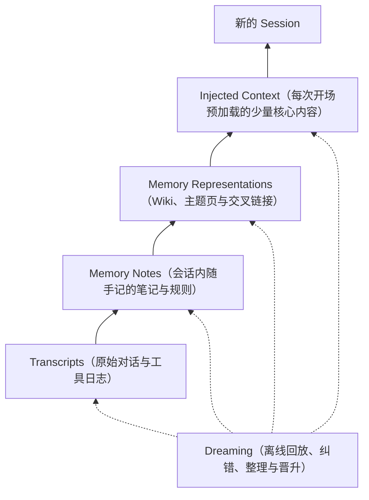

# 读 Anthropic 的 Agent Memory 长文：为什么记忆系统的核心不是存，而是“做梦”整理

写 Coding Agent 久了都会遇到同一个烦人的问题：昨天刚让它花半小时摸清项目里的 SSE 事件协议，今天新开一个 Session，它又像第一天入职一样从头 `grep` 代码、重新踩一遍旧坑。

最直觉的反应当然是“把聊天记录存下来喂给下一次会话”。但真做过就会发现，跑了几百次会话以后，历史日志里塞满了报错堆栈、猜错的排查方向、临时的 UI 状态和早就推翻的结论。全塞进 Prompt 会把 Context 撑爆，全丢进向量库，召回出来的也往往是一堆自相矛盾的片段。

11 月初 Anthropic 发了一篇工程博客 [*The components of agent memory*][anthropic-memory]（作者是 Lance Martin）。读完之后我最大的感受是，它没有把 Agent Memory 当成一个单纯的“存储 + 检索”问题，而是当成了一个类似人脑在离线睡眠时整理记忆的生命周期问题。整篇文章信息密度很高，里面好几个实验结果也挺反直觉，顺手结合自己平常用 Pi 和看其他开源框架的体会，把核心脉络理一遍。

## 先把几个容易混的概念拆开

聊记忆之前，先把工程里经常被混用的四个词划清楚边界。平时很多人把“对话压缩”或者“向量检索”直接叫成 Agent 记忆，在具体实现里其实差得很远。

| 概念 | 实际在解决什么问题 | 典型形态 |
|---|---|---|
| **Context** | 当前这一轮推理，模型到底能看到哪些 Token | System Prompt、消息历史、工具返回结果 |
| **Session State** | 任务中途断了怎么接着跑，分支怎么回溯 | 持久化事件日志、Checkpoint |
| **Compaction** | 对话太长快爆窗口时，怎么保住当前任务不断 | 用摘要替换早期消息，只留近期原文 |
| **Agent Memory** | 下次开新 Session，怎么直接复用以前的经验 | 经验笔记、项目约定、知识索引 |

拿我自己平时看的 Pi Agent 来说，它的 Session 文件把每轮消息和工具事件都记成一棵树，Token 快见底时用 Compaction 把早期的过程压成一段摘要。但这套机制解决的是“当前这个任务别断掉”，新开一个完全不相干的 Session，它照样不知道上周排查过的竞态 Bug 是怎么回事。

Anthropic 在原文开篇就先下了个严格定义：Agent Memory 指的是 Agent 从任务和用户交互中获得、并且**跨 Session 保留下来供以后读取的上下文知识**。它特意排除了三件事——训练时的权重更新、单次对话里的 In-context Learning，以及长对话里的 Compaction。边界画干净了，后面的架构才好讨论。

## 从生物类比到四层记忆结构

原文借用了丹麦哲学家克尔凯郭尔的一句话开场：*Life can only be understood backward, but it must be lived forward.*（生活只能回头看才懂，但必须往前活。）做 Agent 记忆也是这个拧巴劲儿——事件发生的那一刻，模型其实很难准确判断哪句话一个月后还有用；等真出事回头看，当场又往往没留对记录。

生物大脑的处理方式是分工。海马体负责在事情发生时快速抓重点、打上显著性标记（salience），保证当下就能用上；真正变成长期知识，很大一部分发生在人睡觉或安静休息的离线时段，海马体反复回放近期经历，慢慢把稳定的模式整合进新皮层。

对应到 Agent 系统，Anthropic 拆出了一个从下往上逐层收窄的四层结构：

最底层的 **Transcripts** 是原始账本，对话原文、工具调用参数、报错信息原封不动留在这里。平时根本不需要把它们塞进上下文，它的价值在于“兜底的证据链”。一旦上层的某条总结写偏了，只有回到 Transcript 才能查出当时到底发生了什么。

往上一层是 **Memory Notes**，也就是模型在干活过程中觉得“这个以后用得上”而主动写下来的笔记。再往上当笔记多到几千条、全文搜索开始失灵时，就需要 **Memory Representations**——Anthropic 在实验里重点用的是 Markdown 组织的 Wiki，按主题归类并加上互链，相当于给散落的笔记画一张导航图。

最顶层是 **Injected Context**，也就是每次新 Session 启动时自动塞进 Prompt 的一小块常驻上下文。按理说记忆越多越好，但顶层恰恰必须最小。因为这段内容每次都要吃 Token，而且一旦里面混进一条错误结论，等于每次开场都在主动误导模型。Claude Code 的 Auto Memory 就是这个思路：它不会把所有记忆全倒进窗口，而是只预加载 `MEMORY.md` 的前 200 行或 25KB（哪个先到算哪个），把 `MEMORY.md` 当成目录页，细节留在下层文件里按需再去读。

## 记笔记这件事，本质是在预测未来

Anthropic 原文里有个提法我很认同：**写入一条记忆，本质上是在预测未来的自己会需要什么。** 比如记下一条项目构建命令，是赌下个 Session 还会遇到同样的构建问题，省得再试错一次。

为了看不同代际的模型到底能不能做好这个预测，他们在 CL-Bench 1.0 上跑了一组数据库问答任务。玩法很简单：每答一题都是全新的 Session，只有那个 Memory 目录能跨 Session 留下来；答完之后系统会告诉模型正确答案，模型可以自己决定往 Memory 目录里写什么。

按理说最理想的状态是形成一个闭环：答错了，记下错因和猜测，下个 Session 验证猜想，确认无误后再沉淀成一条明确规则。但实际跑下来，不同模型的表现差距非常大。

早一点的模型像 Claude Sonnet 4.6，顶多做到“猜几个可能的原因”，Memory 目录里散落着一堆未经验证的猜测，而且它不到一半的次数会主动去翻自己写过的记忆。Opus 4.7 开始懂得把散乱笔记收拢到单个参考文档里，并区分“已验证”和“待确认”。到 Sonnet 5 时，不用额外提醒，它在 9/10 的任务里都会先读记忆再去作答。而从 Opus 5、Opus 5.5 到 Sonnet 5.5，模型才算真正自己跑通了整个学习闭环——笔记里既有验证过的规则、怎么验证出来的依据，还附带明确的避坑警告。

更有意思的是 **Pokémon Red（宝可梦红）** 的长程对比实验，直接暴露了“乱记笔记”有多致命。

研究者对比了跑了大约一万步时的 Sonnet 3.7 和 Fable 5。Sonnet 3.7 的策略是“万一以后有用呢”，每场战斗、每个道具、每个 NPC 都单独开文件存，最后在 **225 个文件夹里写了 413 个文件**，游戏进度只拿到 1 枚徽章。因为游戏状态一直在变，这些文件迅速过期；走到大约第 10,000 步时，它甚至开了第四个“主目录”整理记忆，紧接着连续 17 步新建 6 个文件、删掉 9 个文件，游戏本体一步都没动。

反观 Fable 5，它一共只维护了 **2 个文件夹里的 9 个文件外加一个顶层 `global.md`**，却拿到了 4 枚徽章。它的判断标准很务实：金币有多少、人在地图哪个坐标，每一帧都能从屏幕直接看到，存下来纯属冗余；真正值得写进记忆的是屏幕上读不出来的东西——当前目标、打道馆的路线规划，以及实测有效的操作规则。比如它连续丢了 7 个精灵球没抓到鲤鱼王之后，写下了一条规则：连续 3 球失败就调整按键节奏，在菜单步骤之间多加几次等待，结果改完当场就抓到了。后来的 Opus 5.5 也沿用了这种克制的记法，直接打通了游戏。

关于怎么用 Prompt 引导模型写记忆，Anthropic 还踩出了一个很反直觉的结论：**告诉模型记忆是干嘛的，但别教它具体怎么记。**

对 Sonnet 4.6 这种还不太习惯看旧笔记的模型，Prompt 里加上“回答前先读记忆、并验证你的猜测”，CL-Bench 得分直接从 0.364 翻倍拉到了 0.641。但同样的硬性规定放到 Opus 4.7 和 Opus 5 身上就成了负优化——一旦在 Prompt 里强制要求“只记录失败教训”，这两个模型从记忆里获得的增益反而大幅缩水。当模型自己的判断力足够强时，给足目标说明、把“什么值得记”的决定权还给它，效果比写死一套机械规则好得多。

## 为什么需要 Dreaming 离线整理

即便模型学会了克制地记笔记，在线干活时依然有两个硬伤绕不开：第一，当下正在解 Bug，模型只能看到当前这一个 Session 的局部视野，很容易得出片面结论；第二，边写业务代码边做知识整理会分走注意力，拖慢主任务。

Anthropic 把 Letta 和 UC Berkeley 提出过的 *Sleep-time Compute* 思路搬了过来，叫 **Dreaming**。它不是在训练模型或者改权重，而是趁着 Agent 空闲、没有用户请求的时候，在后台启动一个异步任务，把历史 Transcript 和现有 Memory 翻出来重新过一遍。

原文用几个很扎实的实验演示了 Dreaming 具体能干什么。

最直观的是**对照原始日志纠错**。在宝可梦的月见山（Mt. Moon）关卡，洞口西进东出，西边入口附近有个单向落差，跳下去就回不来。Claude 把洞口的宝可梦中心当成了地标，却在笔记里写反了方向，以为宝可梦中心在东边。于是它每次从宝可梦中心出来就自信宣布“穿过月见山了”，把笔记改成 `Mt Moon DONE`，几步之后一脚踩空掉回原路。因为导航工具看不出落差，它还以为自己往西走过头了，连掉三次之后彻底陷入死循环，最后打算回上一个镇子补给，全程没能走到下一座城市华蓝市。

研究者对着那份写错的记忆目录跑了一遍 Dreaming。模型重新核对了当时的 Session Transcript，发现了宝可梦中心位置的事实错误并改写笔记。拿到修正后的记忆再跑，Claude 在大约 1,935 次动作后顺利穿过山洞到达华蓝市，而未修正记忆和无记忆的对照组全卡死在了山前。

第二个核心能力是**跨大量文档构建导航地图（Wiki）**。Anthropic 用他们收购的 Stainless 公司内部约 35 万份文档（大约 4.2 亿 Token）做了个测试，出了一套 25 道题的评测集。让 Opus 5 跑了 128 个 Dreaming Session，逐步读文档、建 Wiki 页面、合并重复项、核对引用。

| 评测配置 | 得分表现 | 备注 |
|---|---|---|
| 只用文件搜索 | 53% | 基线 |
| 只用 Wiki（2 轮 → 128 轮） | 13% → 48% | 仅靠 Wiki 仍会漏细节 |
| 初期 Wiki + 文件搜索 | 54% | 初期收益有限 |
| 完善后的 Wiki + 文件搜索 | 61% | 平均每题省约 20,000 Token |

这个结果很说明问题：**Wiki 替代不了文件搜索，它更像是一张能帮模型少走弯路的地图。** 靠 Wiki 快速定位到相关主题，再配合 Search 去翻原文细节，准确率最高，Token 也省了一大截。在另一组 Harvey LAB 的并购文件测试里，需要跨多份文档做信息拼接和计算的复杂问题，靠 Wiki 辅助能拿到 87% 的得分，纯搜索只有 73%。

不过原文也没藏着坏消息，直接给出了 Wiki 失效甚至帮倒忙的例子。如果答案就躺在一份单独文档里，关键词一搜就出来，建 Wiki 几乎没有收益；更极端的一次 LAB 任务里，模型建出来的 Wiki 体积比原始文件还大（博尔赫斯短篇里那个“和帝国一样大的 1:1 地图”），不仅没做任何抽象，还凭空多了一套要维护的臃肿文本。

Dreaming 剩下的几件事偏日常维护：在第二轮整理时修掉指向不存在页面的死链（原文案例里一轮修了 9 条死链、补出 3 个包含索引在内的新页面），把顶层 `Injected Context` 里变臃肿的细节往下沉并只留链接，以及根据具体任务调整组织方式。

这里面我印象最深的是那个**合同条款并发写入**的案例。一开始几个 Agent 并行整理多份收购合同，往同一张汇总表里写条款，结果互相覆盖，最后评测时 57 项关键合同事实只活下来 41 项（72%）。后来改了指令，让每个 Agent 单独负责一份合同的一页 Wiki，并且明确要求**逐字引用核心条款**而不是强行摘要成表格，结果直接拿到了 57/57（100%）。很多时候记忆系统丢信息，不是模型不够聪明，纯粹是工程上的并发写入和摘要策略设计错了。

如果想知道 Anthropic 自己是怎么把这套流程跑起来的，可以看他们配套放出的 [*Dreaming with a dynamic workflow* Cookbook][cookbook]。里面拆了三个角色：Lead Agent 负责调度，多个 Transcript Analyzer 并行去读已经结束的 Session 日志、各自提取主题页，最后交给一个 Memory Organizer 统一做去重、纠错和索引维护。但里面也透了个底：处理大约 50 份长 Session（约 12MB 文本），跑一轮大概花 10 分钟、烧掉 8 美元左右。所以这东西绝对不能每聊两句就触发一次，工程上更现实的是按天批处理或者攒够增量再跑。

## 放到现有开源方案里看

把 Anthropic 这套思路和社区里常见的开源 Agent 记忆方案放在一起看，其实能看清大家各自站在哪个生态位上，倒不存在谁淘汰谁的问题。

| 方案 | 核心做法 | 真正解决的问题 | 容易忽略的边界 |
|---|---|---|---|
| **Pi** | 树形 Session + Compaction | 单任务长对话不断线、可分支回溯 | 不负责跨 Session 经验提炼 |
| **OpenHands** | Event Log + Condenser | 把冗长执行事件剪辑成紧凑视图 | 侧重单次长任务连续性，不是知识库 |
| **LangGraph** | Checkpointer + Store | 明确区分 Thread 内状态和跨 Thread 存储 | 只给原语，写入/淘汰策略全靠自己写 |
| **Letta (MemGPT)** | Core / Archival Memory | 允许 Agent 主动调用工具修改常驻记忆 | 模型写错事实或撑爆 Core Memory 仍需治理 |
| **Mem0** | 事实提取 + 混合检索 | 把记忆做成开箱即用的 Memory API | 抽取准确度、新旧事实冲突仍是难点 |
| **Graphiti** | 时序知识图谱 | 记录事实随时间的变化（例如换工作） | 图谱构建和运维重，简单场景杀鸡用牛刀 |
| **OpenClaw** | 分层文件 + SQLite + Dreaming | 强调来源追溯、可信度晋升门槛、后台整理 | 机制完整但偏重，适合常驻型个人助手 |

像 LangGraph 文档里还会按认知科学把 Store 里的东西分成语义记忆、情景记忆和程序性记忆，提醒开发者“知道什么事实”、“经历过什么事”和“以后该怎么操作”别混在一起存；Graphiti 则专门解决向量检索搞不定的时间线冲突（三个月前说在 A 公司，今天说去了 B 公司，两条语义都很像，到底哪条有效）。而 Anthropic 和 OpenClaw 重点补上的，其实是前面很多方案容易漏掉的**记忆治理层**——写入后错了怎么改、过时了怎么退场、来源不可信怎么办。

## 工程上绕不开的几个坑

读完论文容易热血沸腾，真打算往自己项目里接的时候，有几个现实坑得先想明白。

最要命的是**记忆放大“错误”和“注入”的能力**。向量检索和 Rerank 只能保证你“找得准”，但如果你当初往里写的就是一句拍脑袋的错误推断，检索越准，Agent 在未来犯错就越稳定。更麻烦的是 Prompt Injection：如果 Agent 读了一个带恶意指令的网页，不小心把它记进了 Notes，Dreaming 时又一不小心晋升进了每次开场必加载的 `MEMORY.md`，那就成了永久性的跨会话污染。所以工程上不管怎么做，至少得把外部工具/网页抓回来的内容和用户指令、模型自己验证过的规则在字段上隔离开，不允许未经验证的外部来源自动晋升到顶层上下文。

其次，**Transcript 可追溯不代表结论永远对**。日志只能证明“昨天某个 API 返回了状态 A”，不代表今天线上那个订单还处于状态 A。能直接通过业务接口查到的实时状态，就老老实实交给数据库和业务 API，别往 Agent Memory 里硬塞；Memory 该留的是那些环境里读不到、踩过坑才换来的经验与约定。顺带一提，确定的工作流和定时任务也别全写成一句自然语言丢进记忆里，该用 Skill 固化的用 Skill，该走 Cron 调度器的走调度器。

另外，**别盲目迷信“全自动建 Wiki”**。前面 Stainless 和 Harvey LAB 的数据已经说得很清楚了：需要跨大量文档综合推理的场景，Wiki 配搜索确实香；但如果你的 Agent 主要面对单文档查询或几十条用户偏好，老老实实做全文检索加一个几十行的规则文件，效果可能比折腾一整套多 Agent Dreaming 流水线还好，成本还低一个数量级。

## 如果要在 Pi 里落地，我会怎么做

如果我现在要给自己的 Pi Agent 或者类似 `pi-web-vue` 这种项目加一套长期记忆，我肯定不会一上来就引入 Neo4j、Mem0 服务或者复杂的向量集群，太重了。

第一版直接用 **Markdown 文件 + SQLite FTS5** 就够了。目录结构可以长得跟平常工程文档差不多：底层是 Pi 原生本来就有的 `transcripts/`（JSONL 会话记录），上面加一个 `notes/` 放按主题拆开的项目踩坑经验，一个给用户和核心约束用的 `MEMORY.md`（严格卡死行数或字节上限），再加一个 `memory.db` 用 SQLite FTS5 给它们建全文索引和元数据表。

在每条记忆的元数据里，我只会在意四件事：这条记忆属于哪个项目（`scope`，防止 A 项目的构建约定串到 B 项目里）、从哪次会话哪个事件推导出来的（`source_session` 方便 Dreaming 回查）、来源可信度如何（区分用户明确交代、Agent 实测验证过的规则、以及单纯的临时观察），外加一个状态字段用来把过时结论标成废弃，而不是直接删库留不下痕迹。

读写链路也会刻意切开。在线聊天和写代码的时候，主 Loop 尽量少分心，只负责把 Transcript 落盘，顶多在遇到明确的新约定时顺手往候选区丢一条笔记；真正耗 Token 的查重、对照 Transcript 纠错、更新 `MEMORY.md` 索引，全部丢给一个独立的低频离线脚本（或者每天晚上跑一次的定时任务），跑挂了也不影响白天正常对话。读取时开场只挂小体积的 `MEMORY.md`，真需要查细节再去调用 FTS5 搜索工具按需拉取，遇到关键约束或者前后矛盾的记录再顺着 `source_session` 回头看原始对话。

至于这套东西到底值不值得继续往后加 Embedding 混合检索甚至 Wiki 关联，全靠同一套真实任务题库跑消融对比说了算——分别测“无记忆”、“Notes + 全文搜索”、“加上离线 Dreaming”三组结果。如果加了复杂度之后准确率没涨、Token 反而烧得更多，果断砍掉就是了。

说到底，做 Agent 记忆最忌讳一上来就堆基础设施。从 Anthropic 这篇和几个开源项目的演变能看出来，真正决定记忆系统好不好用的，从来不是你接了多贵的向量库，而是你有没有想清楚：**哪些东西压根不该存，存错的怎么靠原始日志纠回来，以及如何保证顶层注入的那几百行上下文永远干净。**

## 参考资料

1. [Anthropic — The components of agent memory](https://www.anthropic.com/research/components-of-agent-memory)
2. [Anthropic Cookbook — Dreaming with a dynamic workflow](https://platform.claude.com/cookbook/managed-agents-cma-dreaming-with-a-dynamic-workflow)
3. [Claude Code — How Claude remembers your project](https://code.claude.com/docs/en/memory)
4. [Letta / UC Berkeley — Sleep-time Compute (arXiv)](https://arxiv.org/abs/2504.13171)
5. [Pi — Sessions](https://github.com/earendil-works/pi/blob/main/packages/coding-agent/docs/sessions.md) & [Compaction](https://github.com/earendil-works/pi/blob/main/packages/coding-agent/docs/compaction.md)
6. [LangGraph — Persistence and Memory](https://docs.langchain.com/oss/python/langgraph/persistence)
7. [Letta — Memory Blocks](https://docs.letta.com/v1-sdk/memory/memory-blocks)
8. [Mem0 — OSS v2 to v3 Migration](https://github.com/mem0ai/mem0/blob/main/docs/migration/oss-v2-to-v3.mdx)
9. [Zep — Graphiti](https://www.getzep.com/platform/graphiti/)
10. [OpenClaw — Memory Architecture](https://docs.openclaw.ai/concepts/memory-architecture)
11. [OpenHands — Repository](https://github.com/All-Hands-AI/OpenHands)

[anthropic-memory]: https://www.anthropic.com/research/components-of-agent-memory
[cookbook]: https://platform.claude.com/cookbook/managed-agents-cma-dreaming-with-a-dynamic-workflow
