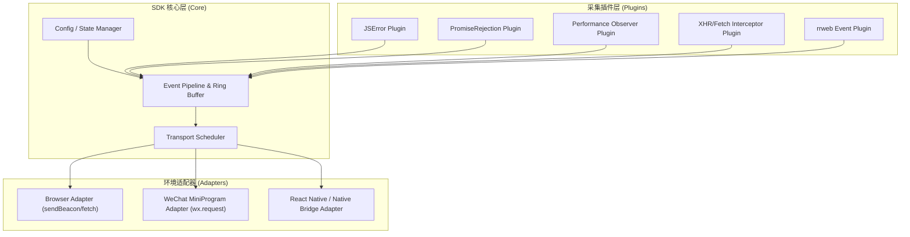

# 企业级前端可观测性全景架构指南：从 SDK 设计、主流方案对比到多项目与多端治理

在现代复杂 Web 应用与跨端体系中，前端已经从过去单纯的“界面展示层”演变成承载着复杂状态机、边缘计算、流式交互（Streaming/AI Chat）与多端微应用的“端侧操作系统”。

一旦代码发版上线，它就运行在千万级用户千奇百怪的设备、浏览器内核、弱网环境与复杂插件代理之中。当用户遇到白屏、卡顿或交互逻辑失效时，传统的“靠用户客服反馈截图”或“本地设法复现”的排查模式彻底失效。

**前端可观测性（Frontend Observability）** 的本质，就是通过在客户端植入高内聚、低损耗的遥测引擎，将客户端运行状态白盒化，建立从**客户端异常与体验数据到后端微服务全链路**的端到端认知。

## 1. 范式演进：传统监控 vs. 前端可观测性 vs. APM

很多人容易将“前端监控”、“APM（应用性能管理）”与“前端可观测性”混为一谈。从工程实践的角度看，三者代表了不同维度的技术演进阶段：

```
┌────────────────────────────────────────────────────────────────────────┐
│                        前端可观测性 (Observability)                     │
│  (高维上下文关联 / 未知问题根因定位 / 会话回放 / 端到端全链路 Trace)       │
├────────────────────────────────────────────────────────────────────────┤
│                          应用性能管理 (APM)                            │
│     (APDEX 指标 / 客户端耗时分段 / 慢请求瀑布图 / 服务依赖拓扑)          │
├────────────────────────────────────────────────────────────────────────┤
│                          传统前端监控 (Monitoring)                      │
│        (JS Error 告警 / UV/PV 统计 / 静态阈值触发 / 事后报表)           │
└────────────────────────────────────────────────────────────────────────┘
```

| 维度 | 传统前端监控 (Monitoring) | 前端 APM | 前端可观测性 (Observability) |
| :--- | :--- | :--- | :--- |
| **核心关注点** | 系统出了什么错？(Known Unknowns) | 页面变慢在哪里？(Performance) | 系统为什么出错/卡顿？(Unknown Unknowns) |
| **数据模型** | 离散的错误计数、PV/UV、日志文本 | 指标 (Metrics)、分段耗时 (Timings) | **三支柱+一元 (Metrics, Logs, Traces + Session Replay)** |
| **上下文深度** | 仅包含单条 Stack Trace 与 UserAgent | 包含页面 URL、设备型号、网络类型 | 包含完整的**用户操作路径 (Breadcrumbs)、DOM 增量快照、HTTP TraceID 串联** |
| **排查方式** | 凭经验搜索错误日志，本地盲猜复现 | 查看大盘 P95/P99 指标变化趋势 | 沿 TraceID 上下游下钻，对比正常/异常 Session 行为差异 |
| **架构定位** | 业务辅助工具 | 运维与性能优化面板 | **研发、运维、产品与客诉协同的核心基础设施** |

## 2. 企业级 SDK 底层内核架构设计

在大型企业或多业务线场景中，不能简单地为每个项目引入一堆零散的第三方 SDK。我们需要设计一个**高扩展、微内核、多租户隔离且对业务零侵入**的前端遥测 SDK。

### 2.1 微插件与适配器架构设计

一个设计良好的遥测 SDK 应该采用 **“Core + Plugins + Adapters”** 的架构，防止包体积膨胀，并支持按需加载。



#### 关键设计模式：
1. **发布-订阅总线 (Event Bus)**：所有采集插件不直接与上报层打交道，而是将标准化事件推送到 Core 的环形缓冲区（Ring Buffer）。
2. **切面拦截 (AOP / Monkey Patching)**：
   * 劫持 `window.onerror` 与 `window.onunhandledrejection`。
   * 重写 `XMLHttpRequest.prototype.open/send` 与 `window.fetch`，注入链路追踪 Header 并监听状态码。
   * 劫持 `console.error` 与 `history.pushState/replaceState` 记录面包屑。
3. **环境适配器 (Adapter Pattern)**：将底层网络传输和设备信息获取抽离为 Adapter。在 Web 端使用 `navigator.sendBeacon`；在微信小程序端使用 `wx.request`；在 React Native 端走 Native Channel。

### 2.2 命名空间与多租户隔离机制

在微前端、插件化平台或包含第三方 SDK 的复杂页面中，极易发生 SDK 之间的冲突（例如两个 SDK 互相重写 `fetch` 导致死循环）。

```typescript
// 示例：基于命名空间与 Symbol 标记的强隔离代理
const GLOBAL_HOOK_KEY = Symbol.for('__ENTERPRISE_TELEMETRY_HOOKS__');

function safeMonkeyPatch(target: any, prop: string, action: Function) {
  if (!target[GLOBAL_HOOK_KEY]) {
    target[GLOBAL_HOOK_KEY] = new Set();
  }

  // 防止重复劫持 (Idempotent Injection)
  if (target[GLOBAL_HOOK_KEY].has(prop)) {
    return;
  }

  const original = target[prop];
  const wrapped = action(original);
  target[prop] = wrapped;
  target[GLOBAL_HOOK_KEY].add(prop);
}
```

## 3. 复杂多终端与多项目架构治理

企业应用形态日益多样化，针对不同的前端运行载体，可观测性治理方案各有侧重：

```
                            ┌─────────────────────────────────────────┐
                            │      企业前端多终端治理生态             │
                            └────────────────────┬────────────────────┘
                                                 │
      ┌──────────────────────┬───────────────────┴───────────────────┬──────────────────────┐
      ▼                      ▼                                       ▼                      ▼
┌───────────┐          ┌───────────┐                           ┌───────────┐          ┌───────────┐
│ 微前端场景 │          │ SSR/Edge  │                           │ 跨端/小程序 │          │ Monorepo  │
│ (qiankun) │          │ (Next/Nuxt│                           │ (Taro/RN) │          │ (Turbo)   │
└─────┬─────┘          └─────┬─────┘                           └─────┬─────┘          └─────┬─────┘
      │                      │                                       │                      │
  主基座统一注册           服务端/客户端                             网络层与路由           全局统一配置
  子应用沙箱隔离           TraceID 跨端透传                           特有 API 适配          公共凭证下发
```

### 3.1 微前端场景（qiankun / Module Federation / Web Components）
* **痛点**：主应用与子应用域名不同、路由混乱，子应用报错可能抛到主应用上下文，造成归属权不清。
* **治理方案**：
  * **主应用统一提供 Telemetry Context**：主应用初始化 SDK，通过 Window 全局对象或 Props 向下透传 `appId`、`tenantId` 和 `subAppVersion`。
  * **沙箱隔离防御**：在 qiankun 等 JS 沙箱中，避免子应用重复注入全局 `onerror` 监听。子应用通过 SDK 提供的 `createScopedClient({ appId: 'sub-crm' })` 进行子实例初始化，事件上报时自动带有 `app_id` 属性标签，在大盘中按子应用维度进行切片分析。

### 3.2 离屏与服务端渲染（SSR / Next.js / Nuxt / Edge Functions）
* **痛点**：Hydration（水化）失败报错发生在客户端，但根因在服务端生成的 HTML 与客户端不匹配；Node.js 端与 Browser 端的错误分布在两套系统。
* **治理方案**：
  * **Hydration 专用错误捕获**：针对 React `Text content did not match` 警告做二次正则识别，关联服务端渲染时的渲染参数。
  * **前后端统一 TraceID 传导**：SSR 在服务端接收到请求时生成 `traceparent`，打入渲染的 HTML 的 `<meta name="traceparent" content="...">` 标签中。客户端 SDK 初始化时直接读取该 Meta 标签作为初始 Context，将 SSR 阶段的 Backend Trace 与 Hydration 之后的 Client Trace 完美闭环缝合。

### 3.3 跨端与小程序（Taro / Uni-app / React Native / Flutter）
* **痛点**：没有标准的 DOM/BOM 对象，`window.onerror` 失效；网络请求走原生 Bridge。
* **治理方案**：
  * **编译时/运行时双重拦截**：如微信小程序利用 `App.onError`、`Page.onUnload` 拦截；React Native 使用 `ErrorUtils.setGlobalHandler`。
  * **Bridge 耗时测量**：将 JSI / Native Bridge 的通信耗时加入性能指标监控中，避免 Native 侧阻塞导致前端卡顿却找不到原因。

## 4. 前端可观测性四大核心数据支柱

### 4.1 异常捕获（Errors）
除了常规的 JS 报错，现代应用还需覆盖以下隐蔽异常：

* **Resource Load Errors**：捕获 `<script>`、`<link>`、`` 资源加载失败，用于识别 CDN 故障或用户 DNS 污染。
* **Unhandled Promise Rejection**：捕获未 `catch` 的异步链条。
* **Iframe 内部错误**：若同域，需主动在主页面向 Iframe 注入错误监听；若跨域，需利用 `postMessage` 搭建跨域事件传输通道。
* **Web Worker / Service Worker 异常**：在 Worker 内部捕获 `onerror` 并通过 `postMessage` 汇总回主线程上报。

### 4.2 真实用户体验性能（RUM & Core Web Vitals）
紧盯 Google 规定的最新 **Core Web Vitals (CWV)** 体系，结合离屏与交互指标：

以下是一次页面加载与交互的示意时间轴，时间以导航开始为零点。

| 阶段 | 观测项 | 示例时间 |
| --- | --- | --- |
| 导航 | 卸载旧页面、DNS 查询和 TCP 连接 | 0–0.5 秒 |
| 渲染 | FP（首次绘制） | 第 0.8 秒 |
| 渲染 | FCP（首次内容绘制） | 第 1.2 秒 |
| 渲染 | LCP（最大内容绘制） | 第 2.1 秒 |
| 交互 | 一次输入到下一次绘制 | 第 2.5–2.7 秒，耗时 200 毫秒 |
| 布局稳定性 | 观察到布局偏移的区间 | 第 1.2–3.5 秒，CLS 记录偏移分数 |

* **LCP (Largest Contentful Paint)**：衡量首屏最大元素渲染完成时间（≤ 2.5s）。
* **INP (Interaction to Next Paint)**：替换了旧的 FID 指标，衡量用户从点击、按键到页面发生下一次实际像素刷新的完整延迟（≤ 200ms）。
* **CLS (Cumulative Layout Shift)**：衡量页面加载期间元素的无预警偏移量（≤ 0.1）。
* **Long Tasks (长任务)**：监听主线程连续占用超过 50ms 的任务，识别阻塞 INP 的罪魁祸首代码块。

### 4.3 行为面包屑与会话回放（Breadcrumbs & Session Replay）
* **Breadcrumbs（面包屑）**：内存中维护定长环形链表，记录 `UI Click` -> `Route Change` -> `API Request` -> `Console Log`。
* **Session Replay（会话回放）**：以开源的 [rrweb](https://github.com/rrweb-io/rrweb) 为例，录制和回放可以分成四步。

> [!STEPS]
>
> 1. **生成初始快照**
>
>    对 DOM 进行递归序列化，记录节点属性和样式。
>
> 2. **记录 DOM 变化**
>
>    用 `MutationObserver` 监听节点和属性的变化，生成带时间戳的增量数据。
>
> 3. **记录交互事件**
>
>    把鼠标移动、滚动、窗口大小变化和输入交互序列化为事件。
>
> 4. **按时间恢复现场**
>
>    回放端在沙箱 Iframe 中加载初始快照，再按时间顺序应用 DOM 变化和交互事件。

### 4.4 全链路追踪（Distributed Tracing）
遵从 **W3C Trace Context** 规范，在发出的 HTTP Header 中注入 `traceparent`：

$$
\text{traceparent} = \text{version(2hex)} - \text{trace\_id(32hex)} - \text{parent\_id(16hex)} - \text{trace\_flags(2hex)}
$$

例如：`00-4bf92f3577b34da6a3ce929d0e0e4736-00f067aa0ba902b7-01`
这使得全链路图谱可以轻松从浏览器端的 `Click Event (Span 1)` 穿透至 API 网关 `(Span 2)`，再到后端微服务 `(Span 3)`，最后进入数据库 SQL 语句 `(Span 4)`。

## 5. 全球主流解决方案与平台横向深度对比

选择自研、开源私有化部署还是 SaaS 云服务，是企业架构师面临的重大决策。以下是目前全球最主流的监控/可观测性方案多维对比：

### 5.1 全景对比矩阵

| 方案 / 平台 | 开源/商业 | 部署方式 | 核心优势 | 劣势 / 短板 | 最佳适用场景 |
| :--- | :--- | :--- | :--- | :--- | :--- |
| **Sentry** | 核心开源 (FSL/BSL) | SaaS / 自建 (Docker-Compose) | 前端错误捕获绝对标杆，Stack Trace 还原极强，生态极其丰富 | 自建运维成本高（Sentry 体系极为庞大），RUM 分析不如专业 APM | 任何规模团队的**错误与崩溃拦截首选** |
| **OpenReplay** | 开源 (ELv2) | SaaS / 私有化 (K8s/AWS) | 专注 Session Replay 与网络请求还原，支持自建以满足数据隐私 | 告警聚合能力不如 Sentry，大规模存储开销大 | 对**用户行为路径复现、客诉排查**要求极高的金融/电商场景 |
| **Highlight.io** | 开源 (Apache 2.0) | SaaS / 私有化 (Docker) | 全栈可观测，完美集成前端 Replay、错误与后端 OpenTelemetry Logs/Traces | 社区相比 Sentry 较新，超大规模高并发未充分验证 | 追求现代化技术栈、前后端一体化分析的独角兽团队 |
| **Grafana Faro** | 纯开源 (Apache 2.0) | 自建 (Prometheus/Loki/Tempo) | 完美融入 Grafana 云原生可观测生态，零额外厂商锁定 | 缺乏开箱即用的高级 Session Replay 工具 | 后端已深度依赖 **Grafana/Loki/Tempo** 的云原生架构团队 |
| **SigNoz** | 开源 (MIT) | 私有化 (ClickHouse) | 基于 OpenTelemetry 标准与 ClickHouse，性能极高，全栈追踪 | 前端专属细节（如 DOM 快照/复杂面包屑）不如 Sentry | 强依赖 OpenTelemetry 标准的工程师文化团队 |
| **Datadog RUM** | 纯商业 SaaS | 纯 SaaS (全球多区域) | 全球可观测性天花板，UI 体验极佳，从前端到基础设施无缝关联 | **价格极其昂贵**，数据出境合规受限（国内企业） | 跨国大企业、预算极其充足且采用全家桶的团队 |
| **阿里云 ARMS** | 商业服务 | 阿里云 SaaS / 混合云 | 国内网络适配极佳，天然打通阿里云日志服务 (SLS) 与 Trace 引擎 | 私有化成本高，依赖阿里云生态 | 基础设施全面托管在**阿里云**的国内企业 |
| **腾讯云 RUM** | 商业服务 | 腾讯云 SaaS | 对**微信小程序、QQ 跨端应用**适配极深，国内 CDN 加速良好 | 生态相对封闭，与第三方开源工具联动较弱 | 深度依赖微信生态与腾讯云的企业 |
| **字节 APM Plus** | 商业服务 | 腾讯云/火山引擎/私有化 | 经过字节跳动海量 App（抖音、今日头条）验证，崩溃率与性能治理极强 | 偏向大厂重型体系，轻量级 Web 项目配置较繁琐 | 海量用户级移动端 App、Web 混合应用 |

## 6. 生产环境硬核踩坑与极限攻防

### 6.1 解决 `Script error.` 彻底解密
当静态资源托管在独立 CDN 域名下，由于浏览器的同源策略（CORS），未经授权的跨域脚本抛出报错时，`window.onerror` 只能拿到 `Script error.` 且行号为 0。

#### 彻底攻防方案：
1. **构建产物 HTTP 头**：CDN 节点必须配置响应头 `Access-Control-Allow-Origin: *`（或业务指定域名）。
2. **HTML 标签属性**：所有静态资源 `<script>` 标签注入 `crossorigin="anonymous"` 属性。
3. **动态加载脚本防御**：如果是动态异步加载 JS（如 Load Script 工具函数），代码中显式给 script Element 加上 crossorigin：

```typescript
export function loadScript(url: string): Promise<void> {
  return new Promise((resolve, reject) => {
    const script = document.createElement('script');
    script.src = url;
    script.crossOrigin = 'anonymous'; // 必须添加
    script.onload = () => resolve();
    script.onerror = (err) => reject(err);
    document.head.appendChild(script);
  });
}
```

### 6.2 SourceMap 离线还原安全闭环
绝对不能将 `.map` 文件暴露在公网，否则等于直接暴露前端源码。

> [!TRACE]
>
> 1. **CI/CD → 私有监控服务**
>
>    构建生成 `app.js` 和 `app.js.map`，使用发布版本 `v1.2.0` 将 Source Map 上传至私有监控服务。
>
> 2. **CI/CD → 公网 CDN**
>
>    从待部署产物中移除 `.map` 文件，再发布 `app.js`。
>
> 3. **用户浏览器 → 私有监控服务**
>
>    运行出错时，上报发布版本 `v1.2.0` 和压缩后的位置 `app.js:1:4029`。
>
> 4. **私有监控服务**
>
>    使用与发布版本匹配的 Source Map，将报错还原到 `src/utils/format.ts:42`。

### 6.3 采样、削峰与数据隐私（GDPR / PII）

高并发流量下，上报流量本身也会变成 DDoS 攻击。

#### 1. 动态采样策略（Sampling Strategies）：
* **基于 Session 的采样**：用户进入页面时分配哈希值，决定该用户整个 Session 是否上报，保证单用户行为完整性。
* **分级采样**：JS 崩溃错误 100% 采样；HTTP 5xx 100% 采样；HTTP 2xx 接口耗时仅 1% 随机采样；性能 Metrics 10% 采样。
* **客户端限流（Client-side Rate Limiting）**：单个 Session 限制最多上报 100 条错误，防止由于无限循环报错打爆 Server。

#### 2. PII 脱敏（Personally Identifiable Information）：
* **DOM 脱敏**：在 Session Replay (rrweb) 配置中，指定文本脱敏规则：

```typescript
rrweb.record({
  emit(event) { /* ... */ },
  // 屏蔽所有输入框内容
  maskAllInputs: true,
  // 屏蔽带指定 class 的敏感元素
  blockClass: 'telemetry-block',
  maskTextClass: 'telemetry-mask',
  // 忽略特定敏感区域的 DOM 变更
  ignoreClass: 'telemetry-ignore',
});
```

* **Header & Payload 脱敏**：在 XHR/Fetch 拦截器中，使用正则清洗 `Authorization`、`Cookie`、`password`、`credit_card` 等敏感 key。

## 7. 总结与 ROI 评估选型矩阵

搭建或选型企业级前端可观测性体系时，不要盲目追求大而全。可以参考以下 **ROI 选型矩阵** 决定技术路线：

```
                              企业前端可观测性选型决策树
                                          │
                  ┌───────────────────────┴───────────────────────┐
                  ▼                                               ▼
         【预算有限 / 敏捷中小型团队】                    【企业级 / 强合规 / 海量流量】
                  │                                               │
        ┌─────────┴─────────┐                           ┌─────────┴─────────┐
        ▼                   ▼                           ▼                   ▼
  【使用 SaaS 服务】   【轻量自建】               【云原生/已有技术栈】 【深度定制/数据安全】
        │                   │                           │                   │
  • Sentry SaaS       • Sentry Docker           • Grafana Faro       • OpenReplay 私有化
  • 腾讯/阿里云 RUM     • OpenReplay Single-Node   • SigNoz (OTel)      • Sentry K8s 部署
                                                                       • 自研 SDK + ClickHouse
```

前端可观测性绝非简单的“写几行监听代码”，它是**工程设计、性能调优、网络协议、网络安全与数据治理**的综合体现。通过构建完善的前端可观测性体系，我们才能真正从“被动接受用户吐槽的消防员”，转变成“主动掌控系统健康度与用户体验的技术掌舵人”。
