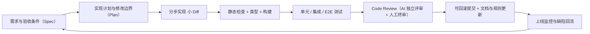

# AI Coding 与代码质量

> 定位：这一章回答"真实项目里怎么用 AI 写代码，并且交付出可维护、可验证的结果"。不讲工具快捷键，讲**为什么要这样用、什么问题值得交给 AI、怎么控制范围和风险、怎么证明结果是错的还是对的**。
> 边界：Agent 是什么、适用场景见《00 Agent 基础概念》；执行循环与状态恢复见《01 Agent Runtime 与架构》；Skill / Hook 的机制细节见《03 Skill 机制》；评测与归因方法见《Agent 评估》；上下文与记忆组织见《Memory 与 Context 工程》。
> 优先级：**P0 核心必学**（真实业务理解和工程设计能力）、**P1 重要进阶**（可靠性、协作、架构取舍）、**P2 了解即可**（特定场景补充）。文中案例均为**示例场景**或公开项目参照，不代表任何公司内部方案。
> 读法：每题先给结论，再解释为什么，然后给做法、业务例子和追问。

## 1. 【P0】你平时怎么用 AI Coding？从需求到交付的完整工作流是什么？

- 核心结论：**AI 负责"在明确边界内产出实现"，人负责"定义问题、划定边界、验证结果"**。工作流的价值不是流程好看，而是每一步都在消除一类特定风险
- 为什么不能直接让 AI 开始写：模型会用"最省事"的方式补全你没说清的约束——默认值、只处理 happy path、跳过校验、按自己的理解改接口。这些错误在运行时不报错，只在业务上出错（第 4 题）

| 步骤 | 做什么 | 跳过它会出什么问题 |
| --- | --- | --- |
| 1 说清目标与验收条件 | 业务目标、输入输出、边界、什么情况算做完 | AI 按自己的理解实现，做完发现不是业务要的 |
| 2 定位受影响模块 | 先读入口、调用链、类型定义、现有测试 | 改动落在错误的层，或在多处重复实现 |
| 3 写实现计划与边界 | 要改哪些文件、先改什么后改什么、哪些坚决不动 | 一次性大范围改动，Review 无从下手 |
| 4 分步实现、小 Diff | 每步一个可运行、可回滚的改动 | 出错时无法定位是哪一步引入的 |
| 5 自动化 + 手动验证 | types / lint / 单测 + 关键路径手点或 E2E | "编译通过"被当成"功能正确" |
| 6 Code Review | 先业务逻辑，再边界异常，最后规范与性能 | 逻辑错误被合进主干，回归成本剧增 |
| 7 提交与回滚点 | 小而完整的 commit，可单独回退 | 出问题时只能整体回退，牵连无关改动 |

**为什么先写计划和边界**：计划是**让你能审查 AI 的理解**，而不是让 AI 显得专业。一份计划里如果出现"重构相关模块""顺便优化命名"这类描述，说明范围失控了，应该先砍掉。

**示例场景（Vue 3 + TypeScript 电商项目）**：需求是"增加会员优惠"。

```text
业务目标：会员在结算页按等级享受折扣，优惠可与其他活动叠加，最终价由后端计算
验收条件：
  - 结算页展示原价、优惠明细、最终价，三者关系自洽
  - 优惠计算以后端返回为准，前端不重复计算（避免两套规则）
  - 无会员 / 优惠过期 / 金额为 0 时不展示优惠行
  - 接口失败时按原价展示并提示，不静默降级成"无优惠"
修改范围：结算页组件、价格展示组件的入参、api 层类型定义、对应 store 的派生状态、单测
明确不改：商品列表页、订单创建流程、优惠规则的后端实现
```

- 为什么第 5 步必须"自动化 + 手动"两条腿：类型和单测能挡住结构性错误，但挡不住"展示对、提交错"这类业务问题（前端显示优惠价，提交时却传了原价）
- 多模块需求怎么降风险：按"接口契约 -> 数据层 -> 展示层"的顺序推进，每层单独验证；不要一次让 AI 同时改前后端

**面试追问**

**1. 需求本身就不清楚怎么办？**
先把它变成可验证的验收条件，再交给 AI。判断标准是：**你能不能用三句话说清"什么情况算做完"**。说不清就先找产品对齐，这一步省不了。

**2. 计划会不会拖慢进度？**
计划本身就是"审查 AI 理解是否正确"的最便宜方式。跳过计划直接写代码，返工通常发生在 Review 或测试阶段，那时成本更高。

**3. 怎么保证 AI 真的按范围改？**
要求它先列出待改文件清单，改完后用 `git diff --stat` 核对；超出清单的改动一律要求说明理由或撤回。

**面试版回答**

> 我的原则是：AI 在明确边界内产出实现，我负责定义问题、划定边界和验证结果。所以我不会一上来就让它写代码，而是先做三件事：说清业务目标和验收条件、让它先读相关模块和调用链、再让它给出实现计划和我确认要改哪些文件。
>
> 然后是分步实现，每一步都要小到可以单独回滚和验证；验证是自动化加手动两条腿，types、lint、单测挡住结构性错误，关键业务路径必须自己或 E2E 走一遍。最后才是 Review 和提交，Review 的顺序是先业务逻辑、再边界异常、最后才是规范和性能。
>
> 比如做一个结算页的会员优惠，我会先明确"优惠以后端为准、前端不重复计算规则"，再把改动范围限定在结算页组件、api 类型、store 派生状态和单测，明确不碰订单创建流程。这样 AI 的产出是可控的，出问题也能定位到具体一步。

## 2. 【P0】面对陌生代码库，怎么让 AI 先理解再改，而不是盲目修改？

- 核心结论：**"让模型看到代码"不等于"让模型理解业务约束"**。正确姿势是先让它产出可核对的认知（结构、调用链、约束），人确认后再动手
- 建立上下文的四个来源，按性价比排序：

| 来源 | 提供什么 | 为什么有效 |
| --- | --- | --- |
| 类型定义与接口契约 | 数据形状、必填字段、允许的取值 | 类型是机器可校验的规格，比注释可信 |
| 测试用例 | 真实行为与边界（尤其失败用例） | 测试写明了"什么算对"，是现成的验收标准 |
| Git 历史与提交信息 | 为什么这么写、避开过什么坑 | 能识别"看起来多余实则必要"的兼容逻辑 |
| 规则与设计文档 | 项目规范、模块职责、禁止事项 | 把人的隐性约束显式化，可复用给后续任务 |

- 真实做法参照（Nuxt 4 + Vue 3 + TS 项目）：根目录 `CLAUDE.md` 写清常用命令、目录职责、环境注意事项和编码规范；`AGENTS.md` 规定"任何可见 UI 改动前，按顺序读 DESIGN.md -> ui-system.md -> interaction-contract.md -> component-map.md"；执行计划目录的 README 规定"先读 README，再只读当前步骤文档，不要跳步"。这些文件的作用不是仪式感，而是**把每次都要重复解释的约束沉淀一次**
- 为什么不能把整个仓库塞进上下文：噪声会稀释关键约束、成本随体积上升、还容易让模型抓错重点（见《Memory 与 Context 工程》的分区与预算）
- 怎么验证 AI 真的理解了：让它回答四个问题——入口在哪、这个需求会经过哪些调用链、要改哪几个文件、哪些文件不能动。答错就说明认知有偏差，先纠正再写
- 遇到错误推断怎么办：要求它给出判断依据（文件 + 位置），再对照源码核实；纠正过的事实写进规则文件，避免下次重复踩

**面试追问**

**1. 上下文窗口很大，是不是可以全塞进去？**
不建议。窗口大只解决"放得下"，没解决"抓得住重点"；而且大型仓库的噪声会让关键约束失效。做法是按任务挑相关模块 + 类型 + 测试 + 规则文件。

**2. 没有测试、没有文档的老项目怎么办？**
用"读调用链 + 写最小复现"替代：先让 AI 画出被改函数的调用方与依赖方，再补几条针对现有行为的回归测试（把现状固化成断言），然后才开始改。这一步同时补了文档。

**3. 怎么让后续任务复用这些认知？**
把确认过的结论写进项目规则文件或架构文档（模块职责、边界、易错点），而不是每次重新口头解释；对复杂模块写一份"改动前必读"清单。

**面试版回答**

> 我会区分"让模型看到代码"和"让模型理解业务约束"。做法是先让它产出可核对的认知，我确认后再动手：入口在哪、这个需求会经过哪些调用链、要改哪几个文件、哪些文件不能动。它答不上来或者答错，说明上下文还不够，先补齐再写代码。
>
> 建立上下文我优先用四样东西：类型定义和接口契约、现有测试、Git 历史、以及项目规则文档。类型和测试是机器可校验的规格，比注释可信；Git 历史能解释"为什么这里要多一层兼容"；规则文档把每次都要解释的约束沉淀下来，比如我们要求任何 UI 改动前按顺序读设计规范和组件契约。
>
> 我不会把整个仓库塞进上下文。窗口大只解决放得下，但噪声会稀释关键约束，成本也会上去。按任务挑相关模块更稳。如果它推断了错误的结构，我会要求它给出依据再核实，并把纠正后的结论写回规则文件。

## 3. 【P0】为什么 AI Coding 不能只看生成速度？怎么衡量它是否真的提高了效率？

- 核心结论：**要衡量"从需求到可交付"的总时长和返工率，而不是代码生成速度或代码行数**
- 成本要算全：首次实现 + 人工修改 + 测试与验证 + Code Review + 返工 + 后续维护。只看前两项，就会得出"AI 提效"的错误结论

| 指标 | 说明 | 为什么值得看 |
| --- | --- | --- |
| 需求交付周期 | 从接需求到上线的时间 | 最接近业务感受的指标 |
| 返工次数 | 同一需求被退回修改的轮次 | 反映"需求理解"和"上下文"是否到位 |
| Review 意见数/千行 | 评审发现的实质问题密度 | 直接对应评审成本 |
| 缺陷逃逸率 | 上线后发现的缺陷占比 | 衡量"测试是否够用"，而不是"测试是否写过" |
| 回归与回滚次数 | 因改动引发的其他功能故障 | 衡量范围控制和回归覆盖 |
| AI 参与占比、生成行数 | 只能作为过程指标 | 与业务价值无直接关系，容易自我安慰 |

- 为什么"生成快"可能整体更慢：一次生成 500 行，Review 时要重新建立上下文、逐段核对业务分支，出错时很难定位是哪一段引入的；拆成 5 次 100 行、每次都能验证，虽然生成时间更长，但总时长更短、返工更少
- 什么任务收益有限：业务规则隐性且复杂、上下文难以获取、验收条件无法自动验证、错误成本极高的任务——这类任务里 AI 的价值是"辅助理解"和"补测试"，不是"直接产出实现"

**示例对比**

```text
方案 A：一次性让 AI 生成完整优惠功能
  生成快 -> Review 成本高 -> 优惠叠加顺序错 -> 排查靠人读代码 -> 返工 2~3 轮
方案 B：先对齐规则与验收 -> 拆成"规则解析 / 价格计算 / 展示与提交一致 / 单测"四步
  生成慢一点 -> 每步可验证 -> 同一步的错误当场暴露 -> 返工集中在 1 轮内
```

- 结论不是"B 一定比 A 快"，而是：**当业务规则复杂、错误不可自动发现时，B 的总成本更低**；反过来，机械性改动（改命名、补类型、写样板测试）交给 A 更划算

**面试追问**

**1. 怎么证明提效，而不是感觉提效？**
用同一类需求的前后对比：交付周期、返工轮次、评审问题数、上线缺陷数。样本少时只做趋势观察，不要下"提效 X%"的结论。

**2. 团队 KPI 用 AI 生成占比合理吗？**
不合理，它会鼓励"多生成"而不是"少返工"。合理的替代是交付周期与缺陷逃逸率，AI 使用情况作为过程指标。

**3. 怎么判断某项任务不适合交给 AI？**
三个信号：说不清验收条件、拿不到相关上下文、错误代价高且无法自动验证。命中两个以上，就该人主导、AI 辅助。

**面试版回答**

> 我不会用生成速度或者代码行数衡量 AI Coding 的效率，那只能说明"写得快"，不能说明"交付快"。我算的是全成本：首次实现、人工修改、测试验证、Code Review、返工和后续维护，其中返工和评审成本最容易被低估。
>
> 具体会看需求交付周期、同一需求的返工轮次、评审每千行发现的实质问题数、上线后的缺陷逃逸率和回归次数。AI 生成占比和行数我只当过程指标，因为它跟业务价值没有直接关系，还会鼓励"多生成"而不是"少返工"。
>
> 举个对比：一次性生成一整块优惠功能，生成很快，但评审要重新建立上下文，优惠叠加顺序错了还很难定位，最后返工两三轮；改成先对齐规则、再拆成四步、每步都能验证，生成慢一点但总时长更短。所以结论是：业务规则复杂、错误不能自动发现时，小步走更省；机械性改动才适合一次生成。

## 4. 【P0】AI 生成的代码可以运行，但业务逻辑错误，你会怎么发现和处理？

- 核心结论：**"能跑"只证明语法、类型和主流程通，"业务正确"要靠可验证的预期**——验收条件、断言、数据对比、真实数据回放
- 六步处理流程：

```text
1 定预期与复现条件：业务上"正确"应该是什么样，能否稳定复现
2 对比实现与预期：需求、数据流、接口契约、关键分支逐个核对
3 定位证据：日志 / 断点 / 单元测试 / 直接查库对比数据
4 归因：需求理解错 / 上下文不足 / 生成逻辑错 / 接口契约不符 / 验证不足
5 修复并补回归：先加一条能复现该错误的测试，再改代码让它变绿
6 沉淀：写进项目规范、测试用例，或变成下一次 AI Coding 的显式约束
```

- 为什么"没报错 ≠ 业务正确"：报错来自运行时约束（类型、空值、异常），而业务错误来自**规则顺序、边界条件、权限、契约理解**，这些都不在编译器和运行时的检查范围内
- 六类典型错误与发现手段：

| 典型错误 | 为什么不会被报错捕获 | 怎么发现 |
| --- | --- | --- |
| 优惠叠加顺序错（先打折再满减 vs 反过来） | 两种算法都能算出数 | 用同一组订单构造"两种顺序结果不同"的用例 |
| 分页边界错（末页、空页、总数） | 常规数据下结果正确 | 补末页/空结果/恰好整除的用例 |
| 权限判断遗漏（后端接口没校验） | 前端按钮隐藏看起来没问题 | 绕过前端直接调接口，查后端鉴权与数据范围 |
| 前端展示与提交不一致 | 页面看起来正常 | 对比"展示用值"与"提交值"是否同源 |
| 接口返回成功但库状态不对 | HTTP 200 不代表业务落库 | 直接查库或用业务查询接口验证终态 |
| 并发重复提交 | 单次请求都成功 | 并发/重复点击压测，验证幂等键是否生效 |

- 归因经验：如果**同一输入重跑结果不稳定**，先怀疑模型/随机性与状态；如果**只在特定数据、特定角色下错**，先查数据与权限；如果**逻辑本身自洽但和业务规则不一致**，是需求或契约理解错（这点最常见，也最容易被误判成"模型不行"）

**面试追问**

**1. 为什么不是"加强测试"就完事？**
因为测试的断言来自你对业务的理解。理解错了，测试也会一起错——所以第一步永远是先确认业务预期，而不是先写测试。

**2. 业务方也说不清规则怎么办？**
找一个真实订单/真实流程，把它的正确结果算出来当基准；用"这个订单应该收多少钱、应该走哪个分支"来倒逼规则明确。

**3. 怎么避免同类错误反复出现？**
把它写成回归用例（永远可验证）+ 写进项目规则（永远可见）+ 必要时在代码里用类型或断言把约束固化，而不是只在对话里叮嘱一次。

**面试版回答**

> 我的起点是：能跑只说明语法、类型和主流程没问题，业务正确性必须靠可验证的预期。所以发现这类问题我不会靠"再看一遍代码"，而是先确定业务上正确的样子能不能稳定复现。
>
> 然后是六步：定预期与复现条件、把实现和需求/数据流/接口契约/关键分支逐个对照、用日志断点测试或直接查库拿证据、归因到底是需求理解错还是上下文不足还是生成逻辑错还是契约不符、修完先补一条能复现的回归测试、最后沉淀成规范或用例。
>
> 常见的几类错误有个共性：它们都不会被报错捕获。比如优惠叠加顺序，两种顺序都能算出数字；分页边界只在末页出错；权限遗漏在前端隐藏按钮时看起来很正常，但绕过前端直接调接口就露了；接口返回 200 但数据库状态不对。所以我会针对这些点专门构造用例，而不是等它自己暴露。另外，"没报错不等于业务正确"这句话在面试里值得主动讲。

## 5. 【P0】AI 生成了大量代码，你如何做 Code Review 保证可维护、可测试、符合规范？

- 核心结论：Review 按**业务正确性 -> 边界与异常 -> 架构与规范 -> 性能与安全**的顺序看，顺序反过来等于白看（逻辑都错了，命名再漂亮也没用）
- 检查清单（按优先级）：

| 优先级 | 检查什么 | 常见问题 |
| --- | --- | --- |
| 业务逻辑 | 规则、顺序、条件分支是否与需求一致 | 默认值兜底掩盖了"应该报错"的场景 |
| 边界与异常 | 空值、超长、并发、失败与超时路径 | 只处理 happy path，失败静默吞掉 |
| 数据一致性 | 前端展示值 vs 提交值是否同源；写库是否幂等 | 两处各算一遍，结果不一致 |
| 权限与安全 | 鉴权、输入校验、越权、敏感信息 | 前端隐藏按钮当权限控制 |
| 架构与职责 | 是否落在正确的层、是否有重复实现 | 在组件里写业务规则，绕过服务层 |
| 可维护性 | 不必要的抽象、过度设计、复制粘贴 | 为一次性需求造通用框架 |
| 可用性与性能 | 渲染/请求/查询是否有明显浪费 | 循环里发请求、重复计算 |
| 测试 | 关键分支是否有测试，失败用例是否覆盖 | 只测 happy path，断言形同虚设 |
| 影响面 | 调用方、依赖方是否需要同步改 | 改了函数签名，遗漏调用点 |

- 四层机制**不能互相替代**：

| 机制 | 能覆盖什么 | 覆盖不了什么 |
| --- | --- | --- |
| AI 自我审查 | 格式、明显遗漏、与规则文件的对照 | 与作者同源，同样的误解会一起通过 |
| 静态检查 + 自动化测试 | 类型、规范、可重复验证的行为 | 没写进断言的业务规则 |
| 独立的 AI Code Review | 跨文件一致性、影响面、可疑分支 | 业务语义、真实数据与权限边界 |
| 人工终审 | 业务正确性、风险取舍、是否值得合入 | 成本高，不可能逐行看大规模 Diff |

- 降低 Review 成本的做法：小 Diff、按"先看 diff --stat 判断影响面，再看关键函数，最后扫命名"的顺序；要求 AI 在提交说明里写清"改了什么、为什么、怎么验证的"；把重复出现的评审意见写进规则文件

**面试追问**

**1. 代码量太大，人不看怎么办？**
拆。把"生成 2000 行"变成"4 次 500 行、每次可验证"。真正的问题不是看不完，而是一次性改动太大导致无法判断正确性。

**2. AI Review 和人工 Review 怎么分工？**
AI 负责"结构性问题"——不一致、遗漏调用点、可疑分支、规范违背；人负责"业务是否正确、风险能不能接受"。让人去看缩进，是浪费。

**3. 怎么防止 AI 为了过测试改断言？**
把测试改动视为高风险变更：要求测试与实现分开提交、测试改动需人工确认、关键用例在 CI 里受保护。

**面试版回答**

> 我的 Review 顺序是业务正确性、边界和异常、架构与规范、最后才是性能和安全。顺序不能反，因为逻辑错了，命名和结构再漂亮也要重写。
>
> 具体会重点看几类问题：默认值兜底有没有掩盖本该报错的情况、失败路径是不是被静默吞掉、前端展示值和提交值是不是同源、权限是不是只在前端做了、有没有把业务规则写进组件、以及函数签名改了有没有遗漏调用方。
>
> 四种 Review 手段我不会互相替代：AI 自审能查格式和明显遗漏，但跟作者同源，同样的误解会一起放过；静态检查和自动化测试能挡住类型、规范和已断言的行为，但挡不住没写进断言的业务规则；独立的 AI Review 擅长跨文件一致性和影响面；人工终审负责业务正确性和风险判断。真正降低成本的其实是把 Diff 变小。

## 6. 【P0】如何建立 AI Coding 的质量保障闭环？

- 核心结论：**每种机制解决一类特定风险，缺一个就会出现一类事故；把机制当清单堆上去，只会增加维护成本**
- 闭环与各环节解决什么问题：



| 机制 | 解决什么问题 | 缺了会怎样 |
| --- | --- | --- |
| 项目规则与编码规范 | 让 AI 不需要每次重新解释约定 | 每次都要口头重复，风格和结构逐渐发散 |
| Spec / 验收条件 | 把"做完"变成可判断的事实 | 做完才发现理解错，返工成本最高 |
| Plan / 实施计划 | 暴露理解偏差、限定改动范围 | 大范围改动，Review 与回滚都困难 |
| 限定修改范围 | 防止顺手重构、误伤无关模块 | 隐性回归，问题在几周后爆发 |
| 类型检查 / Lint / 构建 | 结构性错误、规范违背 | 低级错误靠人工发现，浪费 Review 注意力 |
| 单元 / 集成 / E2E | 行为回归、边界与集成问题 | 只能靠手点，覆盖不稳定、不可重复 |
| Code Review | 业务正确性、架构职责、风险判断 | 错误进入主干，修复成本随阶段上升 |
| Git Diff / 提交 / 回滚 | 出问题时能快速止损 | 只能整体回退，牵连无关改动 |
| 线上反馈回流 | 把真实缺陷补成用例与规则 | 同一个坑反复踩，团队记忆无法沉淀 |

- 两个必须主动说明的边界：
  1. **测试通过 ≠ 业务正确**。测试只覆盖写过的断言；没写进断言的规则（优惠顺序、权限范围、数据范围）依然可能是错的
  2. **AI Review ≠ 独立验证**。它擅长结构性问题，但判断依据来自同一份上下文和同一套理解，高风险改动仍需人工确认 + 真实数据验证
- 真实项目参照（Nuxt 4 + Vue 3 + TS 项目）：提交前的门禁是 `typecheck` + `vitest` + `prettier --check`；执行计划里明确写"每步末尾做 5 分钟快速冒烟，确认核心链路无致命 bug，**不是**全面回归，不要在冒烟上过度投入"。这是一种取舍：**在正确的环节花正确的成本**——冒烟保证不带着明显故障继续下一步，全面回归留给发布前

**面试追问**

**1. 小团队没资源建这么多环节，先做哪个？**
先做三件性价比最高的：验收条件写清楚、提交前跑类型检查和单测、改动保持小而可回滚。这三件事挡住的是最贵的错误。

**2. 为什么强调"可回滚提交"？**
因为 AI 改动的返工概率更高。小提交能让止损成本从"回退一周工作"降到"回退一个文件"。

**3. 怎么衡量闭环有效？**
看缺陷逃逸率和回归次数，不看"写了多少测试"。逃逸率高说明断言与验收条件没对齐，而不是测试数量不够。

**面试版回答**

> 我会把它当成一套分工明确的闭环，而不是工具清单：先有验收条件，再有实现计划和修改边界，然后分步实现、跑类型检查和测试、做 Review、用小提交留下回滚点，最后把线上缺陷补成用例和规则。
>
> 每个环节挡的是不同的东西：验收条件挡"理解错"，计划和范围挡"改多了"，类型和单测挡"结构性错误和行为回归"，Review 挡"业务和风险判断"，小提交挡"无法止损"。少一个就会在最贵的地方付出成本。
>
> 但我会主动讲两个边界：测试通过不等于业务正确，因为测试只覆盖写过的断言；AI Review 也不能替代独立验证，它的判断依据和我是一样的上下文。所以我们项目里冒烟测试只做 5 分钟核心链路，目的是别带着明显故障往下走，全面回归放到发布前——把成本花在对的环节。

## 7. 【P1】AI 一直修改代码，但 Bug 反复出现，你会怎么办？

- 核心结论：**连续追加 Prompt 是在"没有定位"的前提下碰运气**。正确做法是先止损、再定位、最后才决定怎么改
- 处理顺序：

```text
1 停止追加 Prompt：避免在错误方向上叠加修改，让 Diff 越来越难读
2 回到最小复现：把触发条件缩到最小，确认它稳定复现
3 拿证据：错误日志、失败断言、网络与数据库的真实返回
4 判断"根因是否找对"：现在的修法是否真的作用在根因上
5 必要时整体回滚：改乱了就回到已知良好状态，重新规划
6 限制每轮改动：一次只改一个假设，改完必须验证
7 补回归：修复前先有一条能复现的测试
```

- 为什么追加 Prompt 常常无效：模型看到的是"当前代码 + 你的描述"，而不是"真实运行结果"。当你的描述本身基于错误猜测时，它只会在错误方向上做出更复杂的改动

| 症状 | 更可能的根因 | 该做什么 |
| --- | --- | --- |
| 同一个现象反复出现 | 根因判断错，或改的是症状 | 回到复现与证据，重做归因 |
| 改 A 坏 B | 改动范围超出理解，缺少回归测试 | 缩小范围 + 补回归用例 |
| 时好时坏 | 并发、缓存、时序或数据差异 | 对齐环境与数据，做可重复复现 |
| 越改越乱 | 多轮修改叠加，上下文已污染 | 回滚到干净状态重来 |

- 必须提防的行为：AI 为了"让测试变绿"而删除断言、放宽校验、`try/catch` 吞异常、或顺手改无关文件。防护手段是**测试与实现分开提交、测试改动必须人工确认、关键用例在 CI 中受保护**

**面试追问**

**1. 什么时候应该放弃自己改，直接重写这段？**
当改动已经覆盖多个不相关文件、Diff 无法逐段解释、或者原实现的前提假设已被推翻时，重写往往比修补便宜。前提是先写清重写的验收条件。

**2. 怎么判断"根因找对了"？**
用可证伪的方式验证：预测"如果这是根因，那么把 X 改回去错误应该重现"，然后在最小复现上验证。只能"改了之后看起来好了"不算。

**3. 怎么防止再次陷入这种循环？**
把这次的触发条件变成回归用例，把结论写进规则文件；如果同类问题反复发生，说明缺的是测试或验收条件，不是缺 Prompt 技巧。

**面试版回答**

> 我的第一反应是停止追加 Prompt。连续追加在没有任何定位的情况下等于碰运气，而且多轮修改叠加之后 Diff 会变得无法审阅，最后连哪一步引入的问题都说不清。
>
> 正确的顺序是：先止损，回到最小复现确认它能稳定触发；再拿证据——日志、失败断言、真实的接口和数据库返回；然后判断当前的修法有没有作用在根因上，如果没有就把改动整体回滚到已知良好的状态重新规划；之后每一轮只改一个假设，改完必须验证，并且修复前先补一条能复现的测试。
>
> 还有一个必须防的行为：AI 为了过测试去删断言、放宽校验、吞异常，或者顺手改无关文件。我的做法是测试和实现分开提交，测试改动必须人工确认，关键用例在 CI 里保护起来。

## 8. 【P1】如何防止 AI 修改过多文件，破坏原有架构或引入隐性回归？

（多 Agent 并发协作部分为 **P2 了解即可**）

- 核心结论：**范围控制不是靠提醒，而是靠结构**——先给允许修改的清单和接口契约，再用小提交和回归测试兜底
- 四层控制手段：

| 手段 | 怎么做 | 挡住什么风险 |
| --- | --- | --- |
| 文件边界 | 明确"允许改哪些文件、禁止碰哪些目录" | 顺手重构、误伤无关模块 |
| 接口契约 | 先确定函数签名、入参与返回类型，再改实现 | 改了签名遗漏调用方 |
| 分阶段实施 | 按"契约 -> 数据层 -> 展示层"顺序，每层各自验证 | 前后端同时改，出错无法定位 |
| 可回滚提交 + 回归 | 小 commit；关键路径有自动化回归 | 出问题能快速止损 |

- 为什么 Demo 可以"让 AI 自由发挥"，业务系统不行：Demo 的隐式契约少、没人依赖、坏了重写即可；业务系统里有大量**看不见的依赖**——其他调用方、埋点、权限中间件、缓存键、历史兼容逻辑。改动的真实影响面远超文件本身
- 多 Agent 或多人同时改（P2）：用文件级所有权避免两个执行体改同一文件；分支隔离 + 合并前跑全量检查；把"公共契约文件"设为串行修改（谁先改谁负责通知）；冲突不要靠自动合并解决，要回到契约确认

**面试追问**

**1. 怎么发现"隐性影响面"？**
改之前先查三样：谁调用了它（引用搜索）、谁依赖它的返回结构（类型与前端字段）、有没有监控或埋点依赖它。这比事后回归便宜得多。

**2. AI 说"顺手优化"要不要放行？**
单独拆成另一个任务，并明确这次不是为了它。混在一起会让 Review 无法判断风险来源。

**3. 真的需要多 Agent 并行改代码吗？**
多数情况下不需要。并行的收益是吞吐，代价是冲突与一致性；只有在任务确实独立（不同模块、契约已冻结）时才值得。

**面试版回答**

> 我的思路是范围控制靠结构而不是靠提醒。具体三层：第一，明确允许改哪些文件、禁止碰哪些目录，改完用 diff --stat 核对；第二，先冻结接口契约再改实现，避免改了签名又遗漏调用方；第三，分阶段推进、每阶段单独验证，并且保持小提交，随时可以回滚。
>
> 为什么不能像 Demo 那样让 AI 自由发挥？因为业务系统里有大量看不见的依赖——其他调用方、埋点、权限中间件、缓存键、历史兼容逻辑。改动的真实影响面远比文件本身大。所以改之前我会查三样：谁调用了它、谁依赖它的返回结构、有没有监控依赖它。
>
> 如果是多 Agent 并行，我会用文件级所有权避免同时改同一个文件、契约文件串行修改，合并前跑全量检查。但多数情况下我不建议并行改代码，并行的收益是吞吐，代价是一致性和冲突。

## 9. 【P1】Harness、Hook、Skill、Spec、Plan、SubAgent 在 AI Coding 里分别解决什么问题？

- 核心结论：**它们不是同一层能力，也不能互相替代**。判断要不要引入的标准只有一个：当前流程里出现了哪一类具体问题
- 边界与适用场景：

| 机制 | 解决什么 | 什么时候值得引入 | 引入成本 |
| --- | --- | --- | --- |
| Spec（规格/验收条件） | 把"做完"定义清楚 | 需求有歧义、验收靠感觉 | 几乎为零，收益最高 |
| Plan（实施计划） | 暴露理解偏差、限定范围 | 跨模块改动、陌生代码库 | 少量沟通成本 |
| Harness（执行环境与反馈） | 让模型能跑命令、看结果、拿到失败反馈 | 需要真实的构建/测试反馈闭环 | 需要环境与权限设计 |
| Hook（生命周期钩子） | 在固定节点自动做检查或治理 | 有必须每次执行、不能靠自觉的规则（格式化、禁改目录、提交前校验） | 维护成本，过度使用会拖慢流程 |
| Skill（可复用流程与知识） | 把重复任务的做法沉淀下来 | 同类任务反复出现（发布检查、写回归测试） | 需要维护与版本管理 |
| SubAgent（子代理） | 上下文隔离与任务拆分 | 探索型任务、大范围检索、职责清晰的并行子任务 | 通信损耗、结果需要校验 |

- 关键判断：**机制越多，理解和维护成本越高**。小型需求用 Spec + Plan + 测试就够；只有当"每次都要口头强调的规则"反复出现时，才值得做成 Hook 或 Skill
- 真实项目参照：执行计划目录用"README + 分步文档 + 每步验收冒烟"承担 Spec 与 Plan 的角色；根目录规则文件（`CLAUDE.md` / `AGENTS.md`）承担"每次都要遵守的约束"；UI 改动强制按顺序读设计契约，本质是把隐性规范变成可执行的前置步骤
- Skill 与 Hook 的机制细节见《03 Skill 机制》和《01 Agent Runtime 与架构》，这里只回答"在 AI Coding 场景该不该用"

**面试追问**

**1. 能不能用 Hook 挡住所有错误？**
不能。Hook 只能执行确定性检查（格式化、禁止改动、必跑测试），业务是否正确它判断不了。它挡的是"低级且必犯"的错误。

**2. Skill 和"写一份文档"有什么区别？**
Skill 是能被自动加载、按需触发的流程封装，文档要靠人记得看。如果一份文档每次都得口头提醒你用，那它更适合做成 Skill 或 Hook。

**3. 什么情况下 SubAgent 反而有害？**
任务之间高度耦合、需要频繁共享中间结论时，拆出去会引入通信损耗和结果不一致，反而不如一个上下文里做完。

**面试版回答**

> 我会先分清它们各自解决什么：Spec 解决"做完的定义"，Plan 解决"理解偏差和改动范围"，Harness 解决"模型能不能拿到真实执行反馈"，Hook 解决"必须每次执行、不能靠自觉的规则"，Skill 解决"重复任务的做法沉淀"，SubAgent 解决"上下文隔离和任务拆分"。它们不是同一层能力，也不能互相替代。
>
> 判断要不要引入的标准是：当前流程里到底出现了哪一类问题。如果需求本身有歧义，先写好验收条件，收益最大、成本最低；如果总是忘记跑某项检查，那才值得做成 Hook；如果同类任务反复做，才值得沉淀成 Skill。
>
> 我会特别强调不要"为了显得专业"堆机制。机制越多，理解和维护成本越高，而且会掩盖真正的问题。小型需求用规格、计划加测试就够了。

## 10. 【P1】如何判断一项业务需求是否适合使用 AI Coding？

- 核心结论：**看"需求是否可定义、上下文是否可得、结果是否可验证、错误是否可承受"**，而不是看 AI 能不能写出来——它几乎什么都能写出来，问题在于你能不能验证
- 判断清单：

| 维度 | 适合交给 AI | 需要人主导 |
| --- | --- | --- |
| 需求明确度 | 验收条件能说清 | 规则隐性、需要业务经验判断 |
| 上下文可得性 | 相关代码、类型、测试齐全 | 关键逻辑在文档外、依赖口头知识 |
| 可拆分性 | 能拆成独立可验证的小步 | 改动牵一发动全身，无法独立验证 |
| 可验证性 | 有测试或可自动断言的结果 | 只能靠人工主观判断 |
| 错误代价 | 出错可回滚、影响面小 | 涉及资金、权限、数据删除、合规 |
| 回滚能力 | 小提交、可快速回退 | 改动涉及数据迁移、不可逆操作 |
| 验证成本 | 人工验证成本低于生成成本 | 人工核对比手写更慢 |

- 高风险业务的正确姿势：**AI 生成候选实现，人做决策与责任承担**——涉及资金、权限、合规的代码，AI 可以写实现、写测试、写检查清单，但关键分支必须人工确认，并且要有独立验证（真实数据、灰度、监控）
- 一个常被忽略的判断：**验证成本**。如果一段代码的正确性只能靠人工逐条核对业务规则，而且规则本身复杂，那么"AI 生成 + 人工核对"可能比"人直接写"更慢

**面试追问**

**1. "AI 都能写"是不是就代表适合？**
不是。能生成和能交付是两件事。真正卡住的是需求定义与验证成本，而不是生成能力。

**2. 高风险业务里 AI 还有什么价值？**
写测试、写校验与边界检查、生成回归用例、做代码审查辅助、把规则沉淀成文档——这些工作放大的是人的判断，而不是替代判断。

**3. 怎么把"不适合"变成"适合"？**
补验收条件、补测试、把隐性规则显式化、把大改动拆成可回滚的小步。多数"不适合"其实是"没准备好上下文和验证手段"。

**面试版回答**

> 我判断的标准不是"AI 能不能写出来"，因为它基本什么都能写；关键是能不能定义清楚、拿到上下文、验证结果、承受错误。具体看四项：需求能不能说清验收条件、相关代码和类型测试能不能拿到、结果能不能自动或低成本验证、出错代价和回滚能力如何。
>
> 高风险业务里我的做法是：AI 生成候选实现和测试，人负责决策和责任。涉及资金、权限、合规的关键分支一定人工确认，并且要有独立验证——真实数据、灰度、监控，而不是只看它说"改好了"。
>
> 还有一点容易被忽略：验证成本。如果一段代码只能靠人工逐条核对复杂规则，那"AI 生成加人工核对"可能比人直接写更慢，这种需求就不该硬上 AI。

## 案例 A：电商会员优惠功能（示例场景）

**1）业务背景与目标**
结算页要对会员展示等级折扣，折扣能与满减活动叠加，最终价以后端计算为准；前端只负责展示与提交。

**2）直接让 AI 编码可能出现的问题**
- 前端自己算了一遍优惠（和后端两套规则），出现"展示价 ≠ 实付价"
- 优惠顺序错：先满减后打折与先打折后满减结果不同，AI 按直觉选了其中一种
- 边界未处理：非会员、优惠过期、金额为 0、接口失败时静默按原价展示
- 提交时用展示值而不是后端返回的最终价

**3）推荐的工程处理过程**

```text
1 对齐规则：叠加顺序、取整方式、上限（由业务确认，写成验收条件）
2 定位影响面：结算页组件、价格展示组件入参、api 类型、store 派生状态、单测
3 冻结契约：接口返回 { originalAmount, discountDetail[], finalAmount }
4 分步实现：类型 -> 数据层 -> 展示 -> 提交校验 -> 单测
5 验证：单测覆盖叠加顺序与边界；手动走"会员+满减+过期券"组合
6 Review：重点看"是否存在第二套计算逻辑"和失败路径
```

**4）每一步为什么必要**
对齐规则是因为顺序与取整无法从代码里推断；冻结契约是为了让前端不重复实现业务规则；分步是为了让"展示错"和"提交错"两类问题能分别暴露。

**5）如何验证最终结果**
断言三条：展示明细之和等于最终价、最终价等于后端返回值、提交值等于后端返回的最终价。加上边界用例与接口失败用例。

**6）常见错误做法**
让 AI"顺便"把商品列表页的价格展示也改了；把优惠规则写成前端可配置；只用一条正常订单验证。

**7）面试追问**
- 如果业务中途改规则怎么办？-> 规则只在后端，前端无需改；这正是"以后端为准"的价值
- 怎么防止同类问题再犯？-> 把"前端不得重复计算优惠"写进规则文件 + 回归用例

## 案例 B：后台管理系统增加权限控制（示例场景）

**1）业务背景与目标**
后台要按角色控制菜单、按钮和接口访问范围（如运营只能看自己负责的业务线数据），并保证越权请求被后端拒绝。

**2）直接让 AI 编码可能出现的问题**
- 只做前端隐藏，接口没有校验，构造请求即可越权
- 角色判断散落在多个组件里，新增角色时到处漏改
- 只控制"能不能进页面"，没控制"能看哪些数据"（数据范围）
- 忽略超级管理员、默认角色、角色变更后旧会话仍生效等场景

**3）推荐的工程处理过程**

```text
1 明确模型：角色 -> 权限点 -> 资源与数据范围，前端只消费权限点
2 定义契约：后端返回权限点列表与数据范围，前端不推导角色含义
3 分阶段：后端鉴权与数据过滤 -> 前端路由与按钮 -> 越权用例
4 验证：绕过前端直接调接口；用不同角色交叉验证数据范围
5 Review：搜索是否存在"角色字符串"散落判断，统一收敛到权限点
```

**4）每一步为什么必要**
权限的核心在后端与数据范围，前端隐藏只是体验；把角色判断收敛到权限点，才能避免"新增角色时到处漏改"。

**5）如何验证最终结果**
三类用例：无权限接口被拒绝、越权数据不可见（用接口而非 UI 验证）、权限变更后新会话生效；再补一条"前端隐藏 + 后端拒绝"的一致性断言。

**6）常见错误做法**
把权限表写死在前端常量里；只测管理员账号；用前端路由守卫当唯一防线。

**7）面试追问**
- 前端权限还有意义吗？-> 有意义，负责体验和减少无效请求，但不能当安全边界
- 权限缓存怎么处理？-> 权限变更需失效缓存并在下一次请求生效，这一点要写进验收条件

## 案例 C：修复一个反复出现的线上 Bug（示例场景）

**1）业务背景与目标**
线上偶发"提交订单后金额与结算页不一致"，间歇出现，用户投诉；目标是定位根因并防止复发。

**2）直接让 AI 编码可能出现的问题**
- 在没有任何证据的情况下让 AI"猜一个修法"，改完不复发就当作修好
- 连续多轮追加修改，改动扩散到计价、缓存、并发多个模块
- 为让测试通过而放宽断言或吞掉异常，掩盖真实问题

**3）推荐的工程处理过程**

```text
1 最小复现：固定输入与并发条件，确认能稳定触发
2 拿证据：服务端日志、两次金额的来源、缓存命中情况、请求时间线
3 归因：是并发覆盖、缓存过期不一致、还是取整规则在两条链路上不同
4 修根因：统一金额来源（单一真源）+ 幂等/加锁
5 补回归：把复现条件写成用例，纳入 CI
6 上线观察：监控不一致率，而不是只看"没人再反馈"
```

**4）每一步为什么必要**
"偶发"意味着条件和时序相关，没有最小复现就无法判断修法是否有效；只改症状会在其他条件组合下再次出现。

**5）如何验证最终结果**
复现用例稳定通过；上线后监控该不一致率的曲线归零并保持；确认没有引入新的超时或锁竞争。

**6）常见错误做法**
用"再试一次"掩盖；在两条链路上各改一半；把偶发归因为"用户操作问题"。

**7）面试追问**
- 为什么不能靠追加 Prompt 修？-> 因为根因判断错了，追加只会让改动更难回滚
- 加了锁会不会有性能问题？-> 要用指标验证（P95、锁等待），必要时改成幂等设计而不是粗粒度锁

## 与现有专题的关系

- 概念与选型（Agent 是什么、什么时候用）：[00 Agent 基础概念](./00-agent-basics)
- 执行循环、状态与恢复（AI 工具行为异常时的底层原因）：[01 Agent Runtime 与架构](./01-agent-runtime-architecture)
- Skill 与 Hook 的机制区别：[03 Skill 机制](./03-skills)
- 上下文组织与压缩（为什么不能全塞仓库）：[Memory 与 Context 工程](./02-memory-and-context)
- 评测、Trace 与缺陷归因（把事故变成用例）：[Agent 评估](./07-agent-evaluation)
