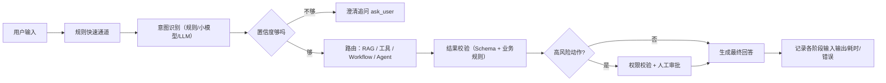

# Prompt、意图识别与模型调用工程

> 定位：这一章讲**从用户输入到系统消费模型输出的完整工程链路**：Prompt 怎么组织、意图怎么识别与路由、输出怎么变成可靠的结构化数据、调用成本与稳定性怎么治理。
> 边界：上下文与记忆的组织、压缩、持久化见《Memory 与 Context 工程》；知识检索与召回排序见《05 RAG 面经》；工具协议与连接见《06 MCP 面经》；执行循环、状态与恢复见《01 Agent Runtime 与架构》；评测方法与 Trace 归因见《Agent 评估》。本章讲"怎么把模型稳稳地用起来"，不重复这些机制。
> 优先级：**P0 核心必学**、**P1 重要进阶**、**P2 了解即可**。示例中的业务数据与技术指标标注为示例或引用自公开项目，不代表任何公司内部方案。
> 核心问题：**让模型理解正确的问题、走正确的处理路径、输出可被系统消费的结果，并在效果、延迟、成本之间做出可解释的取舍。**

## 1. 【P0】System Prompt、User Prompt、上下文和工具描述分别负责什么？如何设计一套可维护的 Prompt？

- 核心结论：**这四样东西职责不同**——System Prompt 定"你是谁、守什么规则"；User Prompt 说"这次要什么"；上下文提供"判断所需的材料"；工具描述告诉模型"什么时候能用什么手段"
- 职责边界与常见错位：

| 组成 | 负责什么 | 不该塞什么 | 错位的后果 |
| --- | --- | --- | --- |
| System Prompt | 角色、职责边界、硬规则、输出约束、终止条件 | 具体业务数据、每次变化的参数 | 规则和数据混在一起，无法版本管理 |
| User Prompt | 本次任务、用户原话与显式参数 | 全局规则、权限约定 | 规则散落在用户输入里，无法审计 |
| 上下文 | 判断依据：工具结果、检索片段、任务状态 | 与本次任务无关的历史 | 噪声稀释关键约束（见《Memory 与 Context 工程》） |
| 工具描述 | 何时用、输入含义、失败时返回什么 | 业务规则本身 | 模型选错工具或填错参数 |

- 可维护 Prompt 的四个工程习惯：
  1. **按段落分组**：角色与职责、硬规则、工具使用约束、输出格式、终止与拒绝策略。改一处不会牵连全部
  2. **规则可判定**："信息足够时直接回答"是可判定的；"尽量专业友好"不可判定，模型只能自由发挥
  3. **版本化**：把提示词当代码管理，带版本号、可回滚、可对比（第 10 题展开）
  4. **纯函数组装**：提示词由参数拼装，不依赖隐藏状态，便于复用与对比

- 真实项目参照（电商售后 Agent）：系统提示词文件顶部标注版本号，正文按"职责与边界 -> 工具使用约束"分组；每条规则写成可执行动作，例如"需要用户提供信息时必须调用 `ask_user` 工具，不要只在文本里提问后结束""最终答复完成后必须调用 `conclude` 结束，纯文本回复会被系统视为继续等待用户"。注释里还记录了历史试错（出处就是该文件自己的版本注释）：某版本把三类越权诉求合并处理，导致纯攻击的拦截率从 40% 掉到 7.7%；另一个版本过度合并又让正当诉求被卡进人工队列
- 为什么 Prompt 不能替代服务端校验：**Prompt 是概率性约束，权限与业务规则必须是确定性的**。工具能不出现就不出现（能力门控），比在提示词里写"请不要越权"可靠得多（见第 2 题、《06 MCP 面经》）
- 为什么 Prompt 会膨胀：每次线上问题都往里加一条，规则开始互相冲突、重复描述、无人敢删。治理方式是——能进工具契约的进契约，能进代码校验的进代码，Prompt 只保留"模型必须知道但无法用代码表达"的部分

**面试追问**

**1. 规则冲突了怎么办？**
先定位冲突的两条规则各自解决哪个历史问题，再决定哪条优先或合并成一条更精确的规则；无法判断就删掉较弱的一条并补一个评测用例看是否退化。

**2. 提示词越长越好还是越短越好？**
都不是。判断标准是"每条规则是否对应一个可验证的行为"。没有对应行为的规则是负担，会稀释真正的约束。

**3. 怎么让工具描述更有效？**
写"什么时候该用"而不是"这个工具是什么"，把参数含义与失败返回写清楚；多个工具职责重叠时优先合并或重命名，而不是加提示词区分。

**面试版回答**

> 我会先分清四件事的职责：System Prompt 负责角色、职责边界、硬规则和终止条件；User Prompt 只说这次要什么；上下文提供判断依据，比如工具结果、检索片段和任务状态；工具描述负责"什么时候该用哪个工具、参数是什么"。它们混在一起就会出现规则散落、无法审计、无法版本管理的问题。
>
> 设计上我按段落分组、规则写成可判定的动作、整份提示词版本化、并且用纯函数组装，这样改一处不会牵连全部。判断一条规则该不该留，标准是它能不能对应一个可验证的行为；"尽量友好专业"这种没法判定的规则只会稀释真正的约束。
>
> 我还会强调 Prompt 不能替代服务端校验。提示词是概率性的，权限和业务规则必须是确定性的。更可靠的做法是让不该做的事在工具目录里就不出现，而不是在提示词里恳求模型不要越权。

**项目落点**

- **挂什么**：在一个电商售后 Agent 里，系统提示词是**独立的提示词文件 + 版本号常量 + 纯函数组装**：正文按"职责与边界"和"工具使用约束"两段组织，改动记录写在文件注释里。
- **当时的判断**：把提示词当代码管理——纯函数组装保证同一输入可复现同一提示词，版本号让"哪一版导致指标变化"可追溯；规则都写成可判定的动作，例如"需要用户提供信息时必须调用工具澄清，不要只在文本里提问后结束""最终答复完成后必须显式结束任务"。
- **可引用的证据**：文件注释里保留了历史试错的结论——某版本把多类越权诉求合并处理，纯攻击拦截率从 40% 掉到 7.7%；另一版本过度合并，又把正当诉求卡进人工队列（L2 用例因此失败）。这类记录能证明"提示词是迭代出来的，不是写一次就完"。

## 2. 【P0】如何保证大模型输出的 JSON 格式正确，并且真正满足业务要求？

- 核心结论：**格式正确和业务正确是五层问题，逐层校验、逐层兜底**，不要指望一句"请输出 JSON"解决全部
- 五层校验：

| 层次 | 检查什么 | 谁来做 | 失败怎么办 |
| --- | --- | --- | --- |
| 1 语法 | 是不是合法 JSON | 解析器 | 有限次修复重试，仍失败则降级 |
| 2 结构 | 字段、类型、必填、枚举 | JSON Schema | 回灌错误让模型修正；超次数则拒绝 |
| 3 业务约束 | 取值范围、状态前置条件、归属关系 | 服务端校验 | 直接拒绝，不进入执行 |
| 4 证据与真实性 | 结论是否有数据支持、金额与编号是否来自工具结果 | 程序比对 + 模型/人工 | 标注不确定或拒答 |
| 5 执行安全 | 当前身份是否有权执行该动作 | 权限与策略层 | 拒绝或走人工审批 |

- 关键认知：**模型输出符合 Schema，不等于业务结果正确**。Schema 能保证"字段齐全、类型正确"，不能保证"金额算对、订单属于当前用户、当前状态允许退款"
- 工程做法：
  1. 优先使用模型侧的结构化输出能力 + 服务端 JSON Schema 双重校验，不依赖"提示它输出 JSON"
  2. 校验失败时做**有限次**修复重试（把校验错误原文回灌），不要无限重试；重试仍失败则走降级（拒答、转人工、使用保守默认值）
  3. 工具参数同样过 Schema 与业务校验，校验错误作为工具结果回灌（见《01》第 5 题）
  4. 结构化字段与自然语言解释分开：机器消费字段，人看解释，避免模型把关键信息只写进散文

**示例（工单分类场景，示例数据）**

```json
// 输入：用户消息"我的订单显示已签收但我没收到，怎么处理？"
// 期望输出
{ "category": "logistics", "subCategory": "notReceived", "urgency": "high",
  "needHuman": true, "reason": "已签收未收到，需要核实物流" }

// 常见错误输出（语法合法、结构也可能合法，但业务错误）
{ "category": "refund", "subCategory": "quality", "urgency": "low",
  "needHuman": false, "reason": "商品质量问题" }   // 分类错误 + 需要人工却标 false
```

- 校验流程（示意思路）：

```text
模型输出 -> JSON 解析 -> Schema 校验 -> 业务规则校验 -> 权限校验 -> 落库/执行
             失败则修复重试（有限次）；任一环节失败都要有明确终态，不能静默通过
```

**面试追问**

**1. 为什么要有限重试，而不是一直重试到成功？**
模型在同一个上下文里重复失败通常意味着信息不足或规则冲突，继续重试只会拉长延迟并放大成本；有限次之后降级更快也更安全。

**2. 校验失败能不能让模型"自己判断要不要修"？**
可以把校验错误回灌给它修，但**是否放行必须由程序决定**。让模型自己宣布"已修正"，等于把校验交给被校验方。

**3. 结构化输出和函数调用（tool calling）用哪个？**
需要执行动作或获取数据时用工具调用（参数天然结构化、可校验）；只是要一份结构化结果时用结构化输出即可。真实系统里两者常常同时使用。

**面试版回答**

> 我把这个问题拆成五层：语法是不是合法 JSON、结构是否符合 Schema、字段取值是否满足业务约束、数据是否真实有证据、最后执行动作是否有权限。前两层可以靠解析器和 Schema，第三层开始必须由服务端校验，因为模型输出符合 Schema 不代表业务结果正确。
>
> 具体做法是模型侧结构化输出加服务端 Schema 双重校验，校验失败把错误原文回灌做有限次修复重试，超过次数就降级——拒答、转人工或者走保守默认值，绝不静默放行。工具参数也走同一套校验，错误作为工具结果回灌让模型改参数。
>
> 举个例子：用户说"显示已签收但我没收到"，模型可能输出一个语法和 Schema 都正确、但分类成"质量问题、无需人工"的结果。这种错误只有业务校验能发现，所以我在验收里会专门构造这类"结构正确、语义错误"的用例。

**项目落点**

- **挂什么**：这个项目用的是原生 tool calling：工具以目录形式随请求下发，每个工具带 JSON Schema；跨包的数据结构统一用 schema 校验库定义在契约包里。
- **当时的判断**：能不进模型的就坚决不进。最典型的是**能力门控**——未成功查询过对应订单之前，业务动作工具根本不出现在模型的工具目录里。这是用结构保证"不该做的做不了"，比在提示词里写"请不要盲目提交"可靠。
- **可引用的证据**：模型侧结构化输出 + 服务端 Schema 与业务规则校验 + 权限层，三层分工可以在项目里指出来；这也是我对"格式正确不等于业务正确"的实证。

## 3. 【P0】Prompt 多次调试仍然没有效果，你会如何定位问题？

- 核心结论：**Prompt 调不动，通常不是 Prompt 的问题**。先判断失败落在哪一层，再决定改什么
- 八类根因与判别方法：

| 根因 | 典型现象 | 怎么验证 |
| --- | --- | --- |
| 任务定义不清 | 输出有时对有时不对，标准飘忽 | 写出验收条件后重跑，看是否收敛 |
| 规则冲突/膨胀 | 加了新规则，旧行为退化 | 关掉新规则对比；做规则消融 |
| 上下文缺失或噪声 | 模型"答得很自信但事实不对" | 换更少但更相关的上下文对比 |
| 检索质量差 | 有依据却引错、答非所问 | 单独测召回与排序（见《05 RAG 面经》） |
| 工具描述或参数契约不清 | 选错工具、参数缺字段 | 只改工具描述做 A/B |
| 模型能力不足 | 规则简单仍稳定失败 | 换更强模型对照，确认是能力问题 |
| 后处理/格式问题 | 模型答对但系统用错 | 看原始输出与解析结果是否一致 |
| 评测样本不具代表性 | 评测涨了线上没变 | 检查评测集与线上分布差异（见《Agent 评估》） |

- 定位方法：
  1. 固定评测集 + 失败样例清单，先量化"到底哪里不对"，再谈改法
  2. 每次只改一个变量（提示词、上下文、工具描述、模型），否则无法归因
  3. 保留原始输出与解析结果，区分"模型错"和"链路错"
  4. 记录 Prompt 版本与评测结果，形成"改动 -> 指标"的对应关系

- 为什么不能只凭主观体验判断优化是否成功：少量样本里的"感觉变好了"往往来自样本选择和随机性；真实改进需要固定样本、可重复执行、以及能区分"效果提升"与"只是换了种说法"
- 真实项目参照：某轮迭代把"失败归因 -> 定向修复 -> 全量重跑"做成闭环，先按失败类型分组（拒绝不升级、解释不全、工具可见性等），再针对性改提示词与工具参数契约，最后全量重跑验证——该项目 README 记录的那轮结果是任务成功率从 **31.4% 提升到 52.3%**；同一轮还把"工具参数精确匹配"的断言改成语义包含匹配，避免把合理差异判成失败

**面试追问**

**1. 怎么判断该改 Prompt 还是该改代码？**
能用确定性代码表达的逻辑（枚举、范围、权限、状态机）就该写进代码。Prompt 只负责"模型必须知道的判断依据"。

**2. 一次改多条规则行不行？**
不建议。多变量同时改，指标变化无法归因；确需批量调整时，至少保留可回滚的版本与分步评测记录。

**3. 评测集从哪里来？**
线上真实请求脱敏抽样 + 历史失败案例回流 + 边界与对抗样本；规模不必大，但必须能重复执行（见《Agent 评估》第 9 题）。

**面试版回答**

> Prompt 调不好时我不会继续换写法，而是先判断失败落在哪一层。常见的有八类：任务定义不清、规则冲突或膨胀、上下文缺失或噪声、检索质量差、工具描述和参数契约不清、模型能力不足、后处理解析出错、以及评测样本不具代表性。
>
> 定位的方法是固定评测集加失败样例，每次只改一个变量，保留模型的原始输出和解析结果，这样能区分是模型答错了还是链路用错了。如果有条件，按失败类型分组做定向修复，最后全量重跑验证，而不是靠"感觉这次好多了"。
>
> 举个例子，某轮迭代里我们发现一部分失败是"拒绝之后没有升级人工"，另一部分是"解释政策没给依据"，这两类的修法完全不同；把它们分开改、再全量重跑，指标才有可解释的提升。顺带说一句，如果一条规则能用代码确定性表达，它就该在代码里，不要指望提示词兜住。

**项目落点**

- **挂什么**：我们把"调不动"的情况做成了闭环：先按失败类型分组（例如拒绝后未升级、解释政策缺依据、工具可见性问题），再针对每一类定向修改，最后全量重跑对比。
- **当时的判断**：提示词改不动，多数时候不是措辞问题，而是**失败没有分类**。分类之后才发现有的问题该改工具描述，有的该改路由，有的确实是模型能力边界。
- **可引用的证据**：同一轮里还修正了评测断言本身——把工具参数的"精确匹配"改成语义包含匹配，因为路径合法但表达不同，不该被判失败；这属于"评测口径错了，看起来像模型错了"。

## 4. 【P0】用户发来一句话，你如何判断应该走普通 LLM、RAG、工具调用、Workflow 还是 Agent？

- 核心结论：**按"需要什么才能答对"来分流**——需要知识走 RAG，需要实时数据或副作用走工具，路径可枚举走 Workflow，路径依赖中间结果才用 Agent
- 五条路径的判断标准：

| 路径 | 什么时候用 | 典型请求 | 不用的后果 |
| --- | --- | --- | --- |
| 普通 LLM | 不依赖私有事实与实时数据 | 改写、总结、翻译 | 强行检索，引入无关证据与延迟 |
| RAG | 答案取决于内部知识/政策/文档 | "年假怎么算""退款政策是什么" | 模型凭记忆编政策 |
| 工具调用 | 需要实时数据或执行动作 | "我的订单到哪了""帮我退款" | 编造订单状态；该动手的没动手 |
| Workflow | 步骤与分支可预先定义，要求确定性 | 审批流、固定数据同步、对账 | 交给模型自由执行，结果不可复现 |
| Agent | 路径依赖中间结果、需动态决策 | "帮我排查这笔退款为什么失败" | 无法处理开放式问题 |

- 分流的工程实现（从便宜到贵）：

```text
1 规则快速通道：命中固定模式/权限/关键词（如"转人工""查看订单"）
2 意图分类：小模型或规则+模型混合，输出 { intent, slots, risk, needTools }
3 澄清：意图或槽位缺失时先追问一句，不要猜
4 路由：按 intent 映射到 处理链（LLM / RAG / 工具 / Workflow / Agent）
5 校验：高风险动作额外做权限与人工确认
```

- 为什么不能所有请求都交给 Agent：成本、延迟和不可预测性都会上升，而且**简单请求走 Agent 会引入本不存在的失败模式**（多轮决策、工具误选）。反过来，把所有请求都塞进固定流程，则长尾请求永远接不住
- 多意图与模糊意图：一句里包含多个诉求时先拆分（"先查订单，再申请退款"）；意图置信度低或槽位缺失时**追问比猜更快**——猜错会触发错误的工具执行，代价远高于一次澄清
- 真实项目参照（电商售后 Agent）：能力门控的做法是"未成功查询过对应订单前，业务动作工具不出现在模型的工具目录里"——用结构性手段减少错误路由，而不是在提示词里反复叮嘱；同时把"需要用户提供信息就必须调用 `ask_user` 工具、不能只在文本里提问后结束"写成硬约束，保证澄清这一环可被系统观测

**面试追问**

**1. 规则路由够用的时候还要上模型判断吗？**
不需要。规则路由确定、便宜、可解释；只有当表达多样、规则维护成本超过模型成本时才升级（第 5 题）。

**2. 意图识别错了怎么办？**
两道防线：低置信度先追问或给候选选项；高风险动作在真正执行前做权限校验与人工确认，让错误路由不会直接变成错误副作用。

**3. 怎么避免"多调用一次模型"的浪费？**
先做规则快速通道，把高频固定请求挡在模型调用之前；意图分类用小模型或与主链路并行执行。

**面试版回答**

> 我按"要答对它需要什么"来分流。不需要外部信息、只是改写总结的走普通 LLM；答案取决于内部知识和政策的走 RAG；需要实时数据或要执行动作的走工具；步骤和分支能预先定义、要求确定性的走 Workflow；只有路径依赖中间结果、需要动态决策的才用 Agent。
>
> 实现上我会做四级：先用规则快速通道挡掉高频固定请求，再用意图分类输出意图、槽位、风险和是否需要工具，然后按意图映射到具体处理链，最后对高风险动作加权限校验和人工确认。意图不清或者槽位缺失时我会先追问，因为猜错的代价远高于一次澄清——尤其是在会触发真实操作的场景。
>
> 有一点我会主动说：不能所有请求都丢给 Agent。简单请求走 Agent 不仅更贵更慢，还会引入本来不存在的失败模式。我们项目里甚至用能力门控做了结构性约束——没查过订单之前，业务动作工具根本不出现在工具目录里，靠结构而不是靠提示词防止错误路由。

**项目落点**

- **挂什么**：这个售后 Agent 的架构是混合的：模型负责理解与决策，**副作用路径固化为确定性工作流，资金动作永不直接经过模型**；模型输出的只是意图与参数。
- **当时的判断**：把所有请求都交给 Agent 会让简单请求也付多轮决策的成本和风险；所以能确定性的部分就走确定性路径，模型只在"需要理解与判断"的地方出现。
- **可引用的证据**：澄清也被做成了强制环节——退款或退货范围依赖客户选择而客户未明确时，必须先调用澄清工具确认再提交，不允许"默认按整单全额处理"。这正对应"模糊意图先追问、不要猜"。

## 5. 【P0】意图识别应该用规则、分类模型还是 LLM？如何选择？

- 核心结论：**从规则开始，按"误判代价 + 表达多样性 + 维护成本"逐步升级**，不要默认上 LLM
- 三种方案对比：

| 维度 | 规则/关键词 | 分类模型（小模型） | LLM 判断 |
| --- | --- | --- | --- |
| 准确率 | 固定表达高，变体差 | 中等偏上，需标注 | 复杂语义强，边界仍会错 |
| 延迟 | 极低 | 低 | 较高，可能成为链路瓶颈 |
| 成本 | 接近零 | 低 | 每次调用都付费 |
| 维护 | 意图多时爆炸 | 需要标注与重训 | 改提示词即可，但易漂移 |
| 适合 | 意图集合小且稳定、有强特征词 | 意图集合稳定、样本充足 | 意图开放、语义复杂、快速迭代 |
| 风险 | 长尾识别不了 | 新意图需要重训 | 不稳定、可能"编"一个意图 |

- 升级的触发条件（满足任一即可考虑升级）：
  1. 规则数量增长到没人敢改，且新表达持续漏判
  2. 误判代价上升（错误路由会触发工具执行或影响资金）
  3. 意图集合频繁变化，重训周期跟不上
  4. 需要理解复杂语义（多意图、隐含条件、上下文指代）
- 常见折中：**规则兜高确定性与高风险，模型兜长尾**——先用规则命中明确模式（含高风险关键词），其余交给模型；模型输出低置信度时追问或降级到人工
- 必须配套的东西：意图清单与定义（含正反例）、混淆矩阵（哪些意图互相误判）、误判代价分级（错到"查询"和错到"退款"完全不是一个量级）

**面试追问**

**1. 怎么评测意图识别？**
用带标注的真实请求计算准确率与混淆矩阵，并对高风险意图单独看召回率（宁可多问一句，也不要漏判成高风险动作）。评测集要覆盖用户真实表达（见《Agent 评估》）。

**2. LLM 判断意图要不要让它输出理由？**
建议输出简短理由或置信度，便于排查和设阈值；但**是否放行仍由程序按阈值和风险等级决定**。

**3. 多意图怎么办？**
优先拆成多个子意图分别路由，而不是硬塞进一个标签；拆不了时按最高风险处理。

**面试版回答**

> 我的默认起点是规则，然后按触发条件升级。规则快、便宜、可解释，适合意图集合小且稳定、有强特征词的场景；问题是长尾表达识别不了，规则多到没人敢改。
>
> 升级的信号有四个：规则维护成本失控、误判代价上升（比如错误路由会触发真实操作）、意图集合频繁变化、以及需要理解复杂语义。到那时可以上小模型分类，样本不足或意图开放就用 LLM。
>
> 实际项目里我更多用折中方案：规则兜高确定性和高风险的部分，模型兜长尾，模型置信度低就追问或者降级人工。另外我会配三样东西：意图定义和正反例、混淆矩阵、以及误判代价分级——错到"查询"和错到"退款"完全不是一个量级，这两类不能用同一个阈值。

**项目落点**

- **挂什么**：在这个项目里，高风险处置不依赖模型的意图判断：越权诉求被分成几类分别处理（正当但办不了的、纯攻击的、正当诉求外包攻击话术的），分类结果会影响是否升级人工与是否记审计。
- **当时的判断**：意图识别的价值不在"标签好看"，而在**决定后续走哪条路、要不要人介入**；所以关键不是准确率数字，而是高危意图别漏判、正当诉求别误伤。
- **可引用的证据**：分类枚举集中定义在契约包里（而不是散落在提示词里），并且注释里记录了两版试错的对比结论——过度合并或过度拆分都会导致某一类错误率飙升。

## 6. 【P0】意图识别之后，如何衔接多个模型、RAG、工具和业务流程？

- 核心结论：**意图识别的产物必须是一份结构化契约**，后续每一段都按契约消费它，而不是靠自然语言继续传递
- 意图结果的推荐结构（示意）：

```ts
interface IntentResult {
  intent: string;            // 意图标签，枚举受控
  slots: Record<string, string>; // 抽取到的槽位（订单号、时间范围等）
  risk: "low" | "high";      // 误判代价等级，决定是否加权限与人工确认
  needRetrieval: boolean;    // 是否需要知识检索
  needTool: string[];        // 需要哪些工具（可为空）
  confidence: number;        // 置信度，低于阈值先澄清
}
```

- 完整链路（每一步都要留下可观测记录）：



- 衔接的关键工程点：
  1. **契约优先**：每个模型/组件的输入输出都定义结构，缺字段就是错误而不是"让下一个模型猜"
  2. **错误不要静默传递**：上一段返回空结果或低置信度时，要显式标注并决定降级策略，避免"错误被下游放大"（典型：检索没命中，模型却按常识作答）
  3. **串行与并行**：互不依赖的步骤（如"检索政策"与"查订单")并行；有依赖的串行；并行能降低端到端延迟（总 token 不变甚至略增），但要各自处理超时
  4. **每段可观测**：输入摘要、输出、耗时、错误类型、token 用量都落 Trace，否则失败无法归因（见《Agent 评估》第 12 题）
  5. **状态与恢复交给 Runtime**：涉及多轮、暂停、审批恢复时不要自己发明机制，直接用《01》的 Run / State / Checkpoint

- 真实项目参照（电商售后 Agent）：架构上明确"模型负责理解与决策，副作用路径固化为确定性工作流，资金动作永不直接经过模型"。也就是说模型输出的是"意图 + 参数"，真正执行由工作流负责，并有幂等键、一次性审批令牌和网关级去重三道防线；上下文压缩也会落一条可量化的事件，方便统计"压了多少、效果如何"

**面试追问**

**1. 前一个模型输出错了，怎么防止被放大？**
在每段之间加校验：结构校验、业务规则校验、以及"关键字段是否为空/是否为默认值"的显式检查；校验不过就降级或追问，不往下传。

**2. 什么时候该把链路拆成多个模型调用？**
当职责不同（分类 vs 生成 vs 抽取）、对成本或延迟要求不同、或需要不同模型能力时。只为"看起来更专业"而拆分，会增加失败点和延迟。

**3. 怎么保证换模型后链路还通？**
所有模型调用走同一层抽象（统一的消息/工具/用量结构），换模型只改适配层；用同一套评测集回归（第 10 题）。

**面试版回答**

> 我会让意图识别的产物变成一份结构化契约：意图标签、槽位、风险等级、是否需要检索、需要哪些工具、置信度。后续每一段都按这份契约消费，而不是继续用自然语言传话。
>
> 链路上有几个点必须做：置信度不够就先澄清，不要猜；每段之间做校验，尤其检查关键字段是不是空的、是不是用了默认值，防止上游错误被下游当成事实放大；互不依赖的步骤并行以降低延迟，有依赖的串行；每段的输入输出、耗时和错误都落 Trace，否则失败没法归因。
>
> 涉及多轮、暂停和审批恢复的部分，我不会自己发明机制，直接用 Runtime 的 Run、State 和 Checkpoint。项目里的分工也是这样：模型负责理解和决策，副作用路径固化成确定性工作流，资金动作永不直接经过模型，再配幂等键和审批令牌防重复。

**项目落点**

- **挂什么**：这套链路的关键设计是**模型接口与 provider 无关**：统一的流式事件与内容块结构（assistant 轮带工具调用，user 轮带工具结果），另有一个脚本化模型与真实模型**同构**，离线评测和线上共用同一套循环。
- **当时的判断**：多段衔接最怕"换一个模型就全乱"，所以先把契约固定住，再谈模型选型；每段的输入输出、耗时与错误都落事件，出问题能按段定位。
- **可引用的证据**：契约包里有成本、错误、幂等、事件等统一定义；离线可复现（脚本化模型 + 冻结时钟）让"同样的输入跑出同样的链路"成为可能，这本身就是链路可信的前提。

## 7. 【P1】如何控制 Token 成本，并在效果、延迟和成本之间做权衡？

- 核心结论：**成本优化的第一步是把口径算清楚**，第二步才是省——省错了会通过"更多轮次、更多错误"把钱花回去
- 成本口径（真实项目参照的字段设计）：输入 token、输出 token、命中缓存的输入 token（缓存命中的输入单价更低，必须单列，否则成本会被高估）、模型调用轮次、以及运行耗时（包含工具执行与审批等待）。按运行聚合而不是按请求聚合，才能看出"成本是被长会话推高，还是被单轮长上下文推高"
- 一个被忽略的纪律：**估算值和实测值不能混算**。脚本化模型（离线评测用的假模型）的 token 是估算值，真实模型的是 API 返回的实测值；口径要写进数据本身（例如带一个 `source: measured | estimated` 字段），而不是靠调用方记得区分

| 手段 | 省什么 | 代价与风险 |
| --- | --- | --- |
| 上下文裁剪与压缩 | 输入 token | 丢关键信息会导致返工，反而更贵（见《Memory 与 Context 工程》） |
| 模型分级路由 | 单价 | 弱模型在难任务上失败率上升，需要按任务分级 |
| 提示词缓存 | 重复前缀的输入 token | 要求前缀稳定；每轮都变的内容插到最前面会让缓存失效 |
| 结构化输出替代长解释 | 输出 token | 过度压缩会丢可解释性，影响人工核对 |
| 并行调用 | 延迟（不是 token） | 总 token 不变甚至略增，要各自处理失败 |
| 结果缓存 | 重复请求成本 | 一致性问题：数据变更后必须失效，否则答旧结果 |

- 为什么"减少 Token 不一定提效"：压缩掉业务约束后，模型可能反复追问或给出错误结论，导致轮次增加、人工介入增加——**单次成本下降，单位成功成本上升**。所以要看的指标是 `总成本 / 成功任务数`，不是单次请求成本
- 与记忆和上下文的关系：具体的压缩策略、分区预算、跨会话拼接见《Memory 与 Context 工程》，这里只做调用侧的取舍判断

**面试追问**

**1. 缓存什么情况下不能用？**
结果依赖实时数据、用户权限或频繁变更的配置时不能直接用结果缓存；提示词缓存则要求前缀稳定，和"每轮都变"的上下文是冲突的。

**2. 怎么判断该换更便宜的小模型？**
按任务分级做 A/B：同一批用例跑两个模型，比较成功率、单位成功成本与 P95；只要成功率不掉到阈值以下，换小模型就是净收益。

**3. 成本骤升怎么排查？**
先看口径：是轮次变多、上下文变长、缓存失效，还是某个环节重试风暴。按运行聚合的 token 与轮次数据能直接区分这几种情况。

**面试版回答**

> 我先算清口径再谈优化。成本要按运行聚合：输入 token、输出 token、命中的缓存 token、模型轮次、以及运行耗时，这样才能看出成本是被长会话推高，还是被单轮长上下文推高。还有个纪律我会强调：估算值和实测值不能混着算，口径要写进数据本身，比如带一个 measured 或 estimated 的来源字段。
>
> 优化手段有上下文裁剪、模型分级、提示词缓存、结构化输出、并行和结果缓存，每种都有代价。我特别提醒一个反直觉的点：减少 token 不一定提效。如果把业务约束压掉了，模型会反复追问或者给出错误结论，轮次和人工介入都会上升，单次成本降了但单位成功成本反而更高。
>
> 所以我盯的指标是总成本除以成功任务数，而不是单次请求成本。判断要不要换小模型也是同一套方法：同一批用例跑两个模型，比成功率、单位成功成本和 P95。

**项目落点**

- **挂什么**：成本在这个项目里是**一等公民的契约**：按运行聚合输入/输出/缓存命中的 token、模型轮次、估算成本与耗时，成本单位用"分"避免浮点误差。
- **当时的判断**：成本口径必须先诚实——估算值（脚本化模型）和实测值（真实模型 API）**永不混算**，来源字段写进数据本身，而不是靠调用方记得区分；同时记录轮次，才能判断成本是被长会话还是被单轮长上下文推高。
- **可引用的证据**：上下文压缩会落一条可量化事件，便于统计"压了多少、效果如何"；面试时可以讲"我盯的是总成本除以成功任务数，而不是单次请求成本"。

## 8. 【P1】TPM、RPM、并发限制、429 和请求队列应该如何治理？

- 核心结论：**限流不是"挡住用户"，而是给系统一个可预期的降级顺序**；没有排队和背压，流量突增会把整个服务拖垮
- 先分清指标：**RPM 是每分钟请求数**，**TPM 是每分钟 token 数**。一个请求可能很小也可能很贵，所以两者都要看：短请求多时 RPM 先撞上限，长上下文请求多时 TPM 先撞上限
- 治理手段与作用：

| 手段 | 解决什么 | 缺了会怎样 |
| --- | --- | --- |
| 请求队列 + 并发上限 | 把突发流量排成可处理的速度 | 瞬时并发打满，全部请求一起变慢或失败 |
| 背压（超出容量就拒绝/降级） | 保护系统不雪崩 | 排队无限增长，内存与超时一起爆 |
| 429 退避重试 + 随机抖动 | 应对限流与临时故障 | 所有客户端同时重试，形成重试风暴 |
| 最大重试次数 | 限制失败成本 | 一个坏请求反复消耗配额 |
| 超时与取消 | 释放被占用的并发 | 慢请求长期占用连接池，拖累所有人 |
| 用户/租户/模型级配额 | 公平与成本可控 | 单个用户或租户吃掉全部配额 |
| 优先级队列 | 保证关键任务先跑 | 后台批处理挤掉用户交互请求 |
| 降级策略 | 容量不足时保住核心功能 | 全量失败，而不是"部分可用" |

- 一次流量突增的处理顺序（示例场景）：

```text
1 入口限流：按用户/租户配额挡住明显超额的请求（快速失败，返回可重试提示）
2 排队与优先级：交互请求优先，批处理与后台任务降级到低优先级队列
3 并发控制：按模型配额设置并发上限，避免 TPM 撞顶
4 429/超时处理：指数退避 + 抖动 + 最大次数；超时主动取消释放并发
5 降级：容量仍不足时切小模型或返回缓存结果，并显式标注"降级回答"
6 观测：队列长度、等待时长、429 比例、重试次数、按模型配额使用率
```

- 为什么必须有抖动：所有客户端在收到 429 后同时退避同一时长，会在同一时刻再次冲击服务，抖动把重试打散
- 为什么不能无限重试：重试本身消耗配额，失败请求重试会挤掉正常请求，形成"越忙越乱"

**面试追问**

**1. 429 和 5xx 的处理有区别吗？**
有。429 表示限流，应按服务端建议退避并降速；5xx 多为临时故障，可快速重试但要有上限与熔断；参数错误、权限错误这类 4xx 重试无意义，应立刻返回。

**2. 队列会不会让用户等太久？**
所以要有"排队超时 + 预估等待 + 可取消"；交互请求超过阈值直接降级或提示稍后重试，比让用户干等更好。

**3. 怎么验证限流策略有效？**
压测到超过配额，观察是否按预期快速失败、是否有请求堆积、P95 是否可控；同时确认降级路径真的可用。

**面试版回答**

> 我会把限流理解成"给系统一个可预期的降级顺序"，而不是简单挡住用户。第一步先分清 RPM 和 TPM——一个看请求数，一个看 token 数，短请求多的时候先撞 RPM，长上下文请求多的时候先撞 TPM，两个都要监控。
>
> 治理上做六件事：入口按用户或租户配额限流、请求进队列并按优先级排队、按模型配额控制并发、对 429 做指数退避加随机抖动并设最大重试次数、超时主动取消释放并发、容量不足时降级到小模型或缓存结果并显式标注。
>
> 有两个细节容易忽略：一是抖动，大家都在同一时刻按同样时长重试，会形成第二次冲击；二是不能无限重试，失败请求反复消耗配额，会把正常请求挤掉。

**项目落点**

- **挂什么**：坦白说，限流与配额这部分在我项目里主要体现为"减少对不可靠外部依赖的冲击"：脚本化模型与冻结时钟保证离线链路零成本可重放，工作流侧用幂等键 + 一次性审批令牌 + 网关级去重防止重复执行。
- **当时的判断**：LLM 侧的限制（RPM/TPM）本质是**容量规划问题**：先算清每分钟请求数与 token 量，再决定队列、并发与降级顺序，而不是等 429 来了再加重试。
- **可引用的证据**：我会用队列长度、等待时长、429 比例、重试次数、按模型配额使用率这几个指标验证策略；项目里已有的成本与耗时契约正好是这些指标的数据源。

## 9. 【P1】模型超时、输出截断或服务不可用时，如何保证调用链可靠？

- 核心结论：**先区分错误类型，再决定重试、降级还是立即失败**；只要链路后面有副作用，"重试"就必须先判断上一次是否已经执行成功
- 错误分类与处置：

| 情况 | 特征 | 处置 |
| --- | --- | --- |
| 超时 | 无响应或超过阈值 | 可重试，但要带退避与上限；同时取消原请求释放并发 |
| 429 / 限流 | 明确返回限流 | 退避重试，必要时降级到备用模型 |
| 5xx / 服务不可用 | 临时故障 | 有限重试 + 熔断，避免持续冲击 |
| 参数/权限类 4xx | 请求本身有问题 | 不重试，立即返回并记录 |
| 输出截断 | 达到输出上限，JSON 不完整 | **不重试同一请求**：应提高上限、分段输出或改结构化输出后重试 |
| 内容被安全策略拦截 | 明确拒答 | 不重试，走人工或改写请求 |

- 输出截断的处理：先判断截断原因（输出上限过低 / 单次要求过多内容 / 模型停不下来），再改策略——提高输出上限、把长输出拆成多次调用、或改成结构化字段 + 服务端拼装。**截断导致的 JSON 不完整，直接重试常常还是截断**
- 备用模型切换的前提是**契约一致**：统一的消息结构、工具定义与用量字段，否则切换后参数、内容块或工具调用格式不兼容，错误会以更难排查的方式出现（真实项目做法：把模型接口抽象成 provider 无关的流式接口，脚本化模型与真实模型同构，离线评测与线上共用同一套循环）
- 有副作用时的重试纪律：
  1. 调用前记录"待执行"状态与幂等键
  2. 超时或失败后先查询执行状态，再决定是否重试
  3. 重放必须幂等（同一业务意图多次执行只生效一次）
  4. 区分"模型调用失败"和"业务处理失败"——前者可换模型重来，后者需要业务侧补偿或人工介入
- 失败要能复盘：记录错误类型、模型与版本、请求摘要、重试次数、最终终态；无终态的失败（一直重试）比明确失败更危险

**面试追问**

**1. 为什么超时不能直接重试？**
因为超时只说明"没等到响应"，不代表请求没有执行。对写操作而言，盲目重试可能造成重复退款、重复建单。

**2. 降级到什么程度可以接受？**
分场景：查询类可以返回缓存或"稍后重试"，写入类宁可失败也不能重复执行或写入错误数据。

**3. 截断为什么不算普通失败？**
它说明模型输出能力或输出上限与任务不匹配，属于策略问题，重试同一请求往往得到同样结果。

**面试版回答**

> 我会先分类：超时、限流、5xx、参数错误、输出截断、内容拦截，处置完全不同。超时和 5xx 可以带退避重试，但要设上限并配合熔断；429 要降速；参数和权限类的 4xx 立即失败；输出截断不该重试同一请求，而要提高输出上限、拆成多次调用或改成结构化输出。
>
> 最关键的一条纪律是：只要链路后面有副作用，重试前必须先判断上一次是否已经执行成功。做法是执行前落一条待执行状态和幂等键，失败后先查状态再决定是否重试，并且保证重放幂等。同时区分模型调用失败和业务处理失败，前者可以换模型重来，后者需要业务补偿。
>
> 切备用模型的前提是契约一致，统一消息结构、工具定义和用量字段，否则切换后的问题会以更难排查的形式出现。最后所有失败都要有明确终态和可复盘记录，一直重试而不落终态是最危险的状态。

**项目落点**

- **挂什么**：这个项目对"可靠性"的核心设计是**可恢复**：模型调用无状态、可重放，工作流逐步存档，进程中断后能从事件重建继续跑；副作用侧靠幂等键与审批令牌兜底。
- **当时的判断**：超时只说明"没等到响应"，不代表没执行；所以重试前必须先判断上一次是否已经生效——这也是"资金动作永不直接经过模型"的另一个理由：模型输出的是意图，执行由可审计的工作流负责。
- **可引用的证据**：离线可复现（脚本化模型 + 冻结时钟）意味着失败可以稳定重放，这类项目里"能不能复现"往往比"能不能重试"更决定排查效率。

## 10. 【P1】如何管理 Prompt 版本，并验证修改确实提升了效果？

- 核心结论：**把提示词当代码管理**——有版本、有评测集、有对比、有灰度和回滚，而不是改完凭感觉上线
- 版本管理的最小要求：
  1. 提示词文件带版本号（如 `v2.5`），改动记录"改了什么、为什么改、影响哪些行为"
  2. 与代码一起提交，可追溯、可回滚；关键改动保留对照版本
  3. 提示词是**纯函数组装**（输入参数 -> 输出文本），便于对比不同版本在同一输入下的差异
  4. 记录历史试错的失败原因，避免同一坑重复踩（真实项目里就记录了"某版本合并越权分类导致拦截率骤降"这类结论）

- 验证流程：

```text
1 固定评测集 + 历史失败样例（Badcase）
2 离线对比：旧版 vs 新版，同输入同参数
3 分层看重：先任务成功率/正确率，再看过程与安全指标，最后看成本与延迟
4 人工评审：抽样看理由与边界用例，确认不是靠"话术变长"得分
5 灰度发布：分桶对比业务指标，红线指标异常直接回滚
6 沉淀：把新发现的失败样例补进评测集
```

- 三个容易自欺的地方：
  1. **只挑有利样本**：只看改好的那几条，不看回归的。必须全量跑并保留失败清单
  2. **只看模型指标不看业务指标**：格式合规率上去了，但用户问题解决率没变，甚至因过度拒答下降
  3. **忽略副作用**：效果提升但成本、延迟或安全变差——例如靠"多轮追问"提高正确率，实际把延迟抬上去了

- 与评测体系的关系：评测集构建、Evaluator 选型、Trace 归因、线上灰度的完整方法见《Agent 评估》；本节只讲"提示词与模型调用链路"的具体实践

**面试追问**

**1. 一次改多条规则怎么做对比？**
拆成多次小改分别评测，或者至少保留中间版本；否则指标变化无法归因到具体规则。

**2. A/B 测试在小流量下可靠吗？**
不可靠。样本不足时差异可能只是噪声，此时更适合离线评测 + 人工抽样，或者延长观察期而不是急着下结论。

**3. 提示词版本和模型版本一起变怎么办？**
分开实验：先固定模型换提示词，再固定提示词换模型，最后才做组合验证。两个变量一起动，结论无法解释。

**面试版回答**

> 我把提示词当代码管理：文件带版本号，改动记录写清改了什么、为什么改、影响哪些行为，跟代码一起提交、可回滚，并且用纯函数组装，保证同一输入可以复现同一提示词。历史试错的结论也要记下来，比如某次合并分类导致拦截率骤降，这种结论不写下来就会重复踩。
>
> 验证上我走固定评测集离线对比、分层看指标、人工抽检、灰度发布、最后把新失败案例补回评测集这条链路。分层看的顺序是先任务成功率，再看过程和安全指标，最后看成本和延迟。
>
> 有三个容易自欺的点要注意：只挑改好的样本看、只看模型指标不看业务指标、以及效果提升但成本延迟或安全变差。比如靠多轮追问把正确率抬上去，其实牺牲了延迟，这种"提升"上线后会被用户感知到。

**项目落点**

- **挂什么**：提示词有版本号常量，改动记录写清"改了什么、为什么改"；验证走两级：**L1 是脚本化回归（项目 README 记录 124 条、零成本、作为 CI 门禁）**，**L2 是模拟用户的多轮对话评测**（让模型扮演客户与 Agent 多轮交互）。
- **当时的判断**：提示词改动必须能回答"哪条规则导致了指标变化"，所以要先有一层零成本、可反复跑的回归，再谈在线灰度；靠"感觉这次答得更好了"过不了门禁。
- **可引用的证据**：项目 README 记录的那轮定向修复把任务成功率从 31.4% 提到 52.3%，并且断言本身也迭代过——工具参数从精确匹配改成语义包含匹配，避免把合理差异判成失败。这正是"评测口径要先于模型优化被校准"的实例。

## 案例 A：业务请求意图路由（示例场景）

**1）业务目标**
一个后台助手同时支持四类请求：查内部文档、查实时业务数据、修改业务配置、总结用户粘贴的文本。要求响应快、权限正确、误操作可控。

**2）初始方案及其缺陷**
一开始所有请求都交给同一个 Agent，让它自己决定是否检索、是否调工具。问题：简单总结也要走 Agent 循环，延迟和成本上升；配置修改这类高危动作缺少强制校验；意图判断不稳定，同一句话有时走检索有时直接回答。

**3）问题定位过程**
按失败类型分组：把"该检索没检索""该拒绝却执行""简单请求延迟高"分别统计，发现根因是**没有显式路由层**，把决策全部压给模型。

**4）改进方案及原因**

```text
规则快速通道：明确模式（"总结以下内容""配置项 X 改成 Y"）直接路由，命中即走确定路径
意图分类：输出 { intent, slots, risk, needTool }，低置信度先澄清
风险闸门：risk=high 的配置修改强制走权限校验 + 二次确认，与意图识别结果无关
成本控制：总结与文档查询走小模型/检索链路，只有开放式问题才进 Agent
```

**5）关键工程约束**
意图标签是受控枚举；路由表配置化（改路由不改代码逻辑）；所有动作工具在执行前做权限与参数校验；每次请求记录命中路径与耗时。

**6）验证指标**
路径命中准确率（对比人工标注）、误路由导致的错误动作数（应为 0）、P95 延迟、单位成功成本、以及"该追问却直接回答"的比例。

**7）面试追问**
- 模糊意图怎么办？-> 给候选选项让用户点选，比让模型猜更准也更快
- 权限不足怎么答？-> 明确说明原因与可行替代路径，不要让模型自行"想办法"
- 怎么防止模型误判成高危意图？-> 高危动作不依赖意图置信度，一律走二次确认

## 案例 B：模型输出格式错误与调用成本过高（示例场景）

**1）业务目标**
工单系统需要模型把用户消息分类成结构化结果（分类、子类、紧急度、是否需要人工），并控制单次处理成本与延迟。

**2）初始方案及其缺陷**
单次调用直接要求输出 JSON 文本；解析失败就重试整段请求；分类后再串行调用一次模型生成回复摘要。结果：JSON 解析失败率偏高（模型爱加解释性文字）、重试放大成本、串行调用把 P95 拉到不可接受。

**3）问题定位过程**
分层统计：解析失败（语法）、Schema 失败（字段缺失/枚举越界）、业务失败（分类正确但 needHuman 判断相反）、以及耗时分布。发现主要是语法与 Schema 层问题，且重试没有区分错误类型。

**4）改进方案及原因**

```text
输出契约：改用结构化输出能力 + 服务端 Schema 校验，禁止在 JSON 外附说明文字
有限重试：只在语法/Schema 失败时修复重试（上限 2 次），业务校验失败直接降级人工
并行化：分类与摘要生成并行，把两次串行调用压成一次等待
模型分级：分类用小模型，仅当置信度低或涉及高风险类别时才升级到强模型
上下文瘦身：只传入最近必要消息与用户历史标签，去掉无关长文本
```

**5）关键工程约束**
Schema 与枚举由服务端定义并版本化；模型输出的原始文本必须落痕以便复盘；降级路径（转人工）必须有明确终态。

**6）验证指标**
解析成功率、Schema 通过率、分类准确率与混淆矩阵、P95 延迟、单位成功成本、人工降级比例。注意区分"模型指标"（解析/格式）与"业务指标"（分类正确、是否真的减少人工）。

**7）面试追问**
- 为什么不让模型自己校验 JSON？-> 被校验方不能当校验方，服务端必须有独立校验
- 并行后失败了怎么办？-> 两个分支各自超时与降级，不要求同时成功
- 小模型分类错了怎么办？-> 低置信度升级强模型，高风险类别不依赖小模型结果

## 与现有专题的关系

- 上下文、记忆与压缩策略：[Memory 与 Context 工程](./02-memory-and-context)
- 检索质量与引用校验（意图路由中的 RAG 分支）：[05 RAG 面经](./05-rag)
- 工具协议、权限与执行边界：[06 MCP 面经](./06-mcp)、[01 Agent Runtime 与架构](./01-agent-runtime-architecture)
- 评测集、Evaluator、Trace 与线上闭环：[Agent 评估](./07-agent-evaluation)
- 框架侧的 Agent 入口与中间件：[02 LangChain 与 LangGraph](./02-langchain-langgraph)
