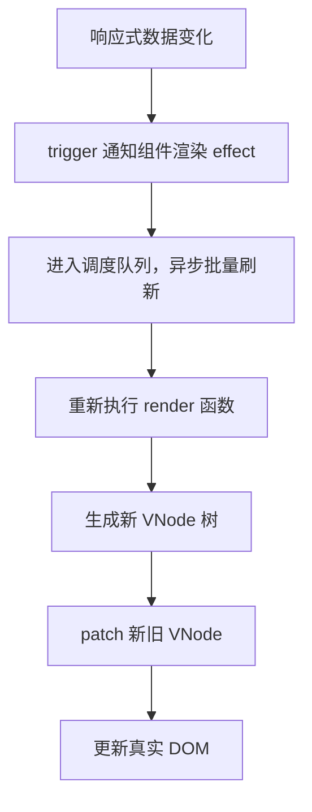

# Vue

> Vue 面试核心：Vue2 / Vue3 差异、响应式原理与更新调度、模板编译、虚拟 DOM 与 Diff、Composition API、组件与通信、生命周期与内置组件、Vuex / Pinia、路由模式与权限、SPA 与性能优化。
>
> 姊妹篇：[Nuxt](./nuxt)

整体知识链：

**响应式数据变化 → 依赖收集与触发 → 调度与批量更新 → render 函数与 VNode → Diff 与 patch → 组件更新 → 状态管理与业务应用 → 性能优化。**

---

## 一、Vue 基础与 Vue2 / Vue3 核心区别

### 你如何理解 Vue？它有哪些核心特点？

- **渐进式**：可以只用一个 `<script>` 引入做局部增强，也可以配合路由、状态管理、构建工具做成完整框架。
- **声明式渲染**：用模板或渲染函数描述 UI「应该长什么样」，框架负责把它变成真实 DOM。
- **响应式**：数据变化自动驱动视图更新，不需要手动操作 DOM。
- **组件化**：把 UI 拆成可复用的、自带模板/逻辑/样式的单元。
- **虚拟 DOM**：用 JS 对象描述 UI，配合 Diff 尽量复用已有 DOM、减少不必要的更新（不是性能的唯一来源）。
- **生态完善**：Vue Router、Pinia、VueUse、Nuxt 等配套成熟。

> **面试回答：**
>
> - Vue 是一个渐进式框架，核心是「声明式渲染 + 响应式 + 组件化」，它要解决的根本问题是：状态变化如何高效、可维护地反映到 UI 上。
> - 声明式渲染让我只描述「UI 应该长什么样」，把「怎么改 DOM」交给框架；响应式让数据变化自动触发更新，不需要手动操作 DOM。这两点是它和 jQuery 式直接操作 DOM 最本质的区别。
> - 组件化把 UI 拆成独立单元，每个组件有自己的模板、逻辑、样式和明确边界，便于复用、单测和多人协作。
> - 「渐进式」的意义在于接入成本：不强求你一次性上路由、状态管理和构建工具，可以先用一个 script 标签做局部增强，再逐步扩展成完整应用。这对老项目改造和团队上手很关键。
> - 底层实现上，Vue3 用 Proxy 做响应式、虚拟 DOM + Diff 做更新，再叠加编译期优化（静态提升、Patch Flags）让运行时更精准。

### Vue2 和 Vue3 的主要区别是什么？

| 维度 | Vue2 | Vue3 |
| --- | --- | --- |
| 响应式 | `Object.defineProperty` 逐个劫持已有属性 | `Proxy` 代理整个对象 |
| 新增/删除属性 | 无法自动检测，需要 `$set`/`$delete` | 直接支持 |
| 数组索引 / length | 无法检测，靠重写数组方法兜底 | 直接支持 |
| 集合类型 | 不支持 Map/Set | 原生支持 |
| 组织方式 | Options API 为主 | Composition API（仍兼容 Options API） |
| 生命周期 | `beforeDestroy`/`destroyed` | `beforeUnmount`/`unmounted` |
| 根节点 | 必须单一根节点 | 支持 Fragment 多根节点 |
| 源码 | JavaScript（Flow 类型） | TypeScript 重写 |
| 编译优化 | 运行时 diff 为主 | 静态提升、Patch Flags、Block Tree 等编译优化 |

> **面试回答：**
>
> - 最核心的区别是响应式实现：Vue2 用 Object.defineProperty 逐个劫持已有属性，Vue3 用 Proxy 代理整个对象。
> - 这个改动带来的是能力差异：Vue2 监听不到新增/删除属性、数组下标和 length，所以要靠 $set/$delete 和重写数组方法兜底；Proxy 是对象级的，这些操作天然能拦截，还能覆盖 Map/Set，并且可以懒代理，避免了初始化时全量递归的成本。
> - 其次是代码组织：Vue3 引入 Composition API，按业务功能聚合逻辑、支持 composable 复用，TS 类型推导也更自然；但 Options API 仍然保留，不是替代关系。
> - 还有编译期优化（静态提升、Patch Flags、Block Tree），让运行时只处理动态部分、减少无效比较。
> - 要澄清一个常见误解：Vue3 仍然有运行时 Diff，编译优化只是缩小了 diff 范围，列表乱序照样要走完整算法，不是「不再 diff」。

### Vue2 和 Vue3 的响应式原理有什么区别？为什么 Vue3 选择 Proxy？

#### Vue2 的实现与局限

Vue2 初始化时会**递归遍历 `data` 中的每个属性（包括嵌套对象）**，把每个已有属性转成 `getter/setter`：读时收集依赖，写时触发更新。它是**深度递归观测**，不是只能处理第一层。

```javascript
const data = { count: 0 }
let value = data.count // 用闭包保存当前值，getter 才能返回它

Object.defineProperty(data, 'count', {
  get() {
    console.log('依赖收集')
    return value
  },
  set(newVal) {
    console.log('触发更新')
    value = newVal
  }
})
```

根本限制：**`defineProperty` 只能劫持「对象上已经存在的属性」**，它是属性级的，不是对象级的。所以：

- 新增属性 `this.user.age = 18`：`age` 原本不存在，没有对应的 getter/setter，不是响应式，需要 `this.$set(this.user, 'age', 18)`。
- 删除属性 `delete this.user.age`：同样无法被 setter 捕获，需要 `this.$delete`。
- 数组索引直接修改 `a[0] = 1` 或修改 `a.length`：也捕获不到。Vue2 通过重写 `push`、`pop`、`splice`、`sort` 等数组变更方法兜底，但 `a[0] = 1` 这种直接下标赋值仍无法检测。

所以 Vue2 的短板集中在「新增/删除属性、数组下标和 length」，对已存在属性的读取与修改，响应式能力是完整的。

#### Vue3 的实现

Vue3 用 `Proxy` **代理整个对象**，拦截对象层面的各种操作，无论属性是否存在都能拦截：

```javascript
const obj = { count: 0 }
const proxy = new Proxy(obj, {
  get(target, key, receiver) {
    // 读取属性：收集依赖
    return Reflect.get(target, key, receiver)
  },
  set(target, key, value, receiver) {
    // 新增、修改属性都能监听到
    const result = Reflect.set(target, key, value, receiver)
    // 触发更新
    return result
  },
  deleteProperty(target, key) {
    // 删除属性也能监听到
    const result = Reflect.deleteProperty(target, key)
    // 触发更新
    return result
  }
})
```

`Proxy` 相比 `defineProperty` 的改进：

- **新增属性、删除属性、数组下标、length 变化**都能拦截。
- **不需要初始化时递归遍历**：采用懒代理，访问到哪一层才代理哪一层。
- **对 Map、Set** 这类集合类型也能做响应式支持。
- 从「监听属性」→「监听对象行为」；从「补丁式处理数组」→「统一拦截机制」。

除 `get`/`set`/`deleteProperty` 外，`Proxy` 还能拦截 `has`（`in` 操作符）、`ownKeys`（`Object.keys` / `for...in` 遍历）等行为，这是 `defineProperty` 做不到的。

> **面试回答：**
>
> - 两者的本质差别是拦截粒度：defineProperty 是属性级的，只能在初始化时对「已存在的属性」定义 getter/setter；Proxy 是对象级的，代理整个对象，可拦截 get/set/deleteProperty/has/ownKeys 等操作。
> - Vue2 之所以监听不到新增和删除属性，是因为新属性根本没有对应的 getter/setter，删除操作也走不到 setter；数组下标赋值和 length 修改同理。所以 Vue2 只能重写数组变更方法、提供 $set/$delete 来兜底。这里要澄清一点：Vue2 对嵌套对象是深度递归观测的，并不是只能处理一层。
> - Vue3 选 Proxy 的原因有两层：一是能力上能覆盖新增、删除、下标、length、遍历这些操作；二是它可以做懒代理——只在访问到深层对象时才继续代理，避免了 Vue2 初始化时递归遍历整棵 data 的成本，对大型对象更友好。
> - 另外 Proxy 对 Map/Set 这类集合类型也能通过专门的 handler 支持，这是 defineProperty 做不到的。
> - 代价也要说清：Proxy 无法被 polyfill，所以 Vue3 放弃了 IE11 支持，这是有意的取舍。

### Vue3 做了哪些编译期与运行时优化？

Vue3 的更新优化是**编译期 + 运行期共同作用**的结果，不是简单的「Vue2 全量 diff、Vue3 定点更新」：

- **静态提升**：不变的静态 VNode 提升到 render 函数外，避免每次渲染重复创建。
- **Patch Flags**：编译时给动态节点打上标记（如 `TEXT`、`CLASS`、`PROPS`），运行时只处理被标记的部分。
- **Block Tree**：以「块」为单位收集动态后代节点，更新时跳过静态部分。
- **事件缓存（cacheHandlers）**：缓存事件处理函数，减少不必要的函数重建与子组件更新。

Vue3 仍然有运行时 Diff。这些优化的核心是「利用编译期信息，减少运行时不必要的比较与更新」，而不是「所有更新都不再经过 Diff」。具体机制见第三章「Vue 模板是如何编译成 render 函数的？编译期做了哪些优化？」。

> **面试回答：**
>
> - 优化的核心思路是：把「哪些是静态、哪些是动态」这个判断从运行时提前到编译期，运行时就不用再猜。
> - 静态提升：不依赖响应式数据的静态 VNode 提升到 render 函数外，避免每次渲染重复创建，复用同一份对象。
> - Patch Flags：编译期给动态节点打标记（TEXT/CLASS/PROPS 等），运行时只处理被标记的部分，跳过静态 props 的比较。
> - Block Tree：把动态后代收集进 dynamicChildren，更新时直接遍历这些动态节点，跳过整片静态子树，避免整树递归。
> - 事件缓存：内联事件函数缓存到 _cache，避免每次渲染创建新函数，减少不必要的子组件更新。
> - 为什么这不等于「不再 diff」：这些优化缩小的是 diff 的范围，列表乱序这类场景仍然要走 key 映射 + LIS 的完整算法，所以它是「减少无效工作」而不是「取消比较」。

### Options API 和 Composition API 有什么区别？

两者是**组织代码的两种方式**，不是二选一的对立：

- Options API 按 `data`/`computed`/`methods`/生命周期等选项组织，简单组件直观。
- Composition API 按**业务功能**组织，把同一功能的状态、计算、方法、生命周期聚在一起，复杂组件更清晰，逻辑复用和 TypeScript 类型推导也更好。

Vue3 同时支持两种写法，`<script setup>` 只是 Composition API 的编译期糖。选型与设计原因详见第四章。

> **面试回答：**
>
> - Options API 按「选项类型」组织代码（data/computed/methods/生命周期），简单组件非常直观、上手快，这是它的优点。
> - 但它的问题是聚合维度错了：不是按业务功能聚合，而是按选项类型聚合。一个复杂组件里，同一个功能的状态、计算、方法、生命周期会散落在四五个选项里，改一个功能要来回跳；多个功能混在一起时更明显，这也是它难以复用的根源。
> - Composition API 按业务功能聚合，把同一功能的状态、计算、方法和生命周期写在一起，还能整块抽成 composable 复用。这就顺带解决了 mixin 的三个老大难：来源不清晰、同名会冲突、类型推导差。
> - 类型方面的收益也来自同一个原因：composable 是普通函数，参数和返回值类型能自然推导，不像 mixin 那样靠隐式合并。
> - 要强调取舍：Composition API 的价值是逻辑组织和复用，不是「减少代码行数」；Options API 仍然可用，简单组件用它反而更清晰，不必为用而用。

---

## 二、响应式系统与更新调度

### Vue3 的响应式原理是什么？数据变化后如何驱动视图更新？

**核心结论：** Vue3 用 `Proxy` 把对象变成响应式：读取属性时 `track` 收集当前副作用，数据变化时 `trigger` 找到依赖并交给调度器，最终驱动组件重新执行 render、生成新 VNode 并 patch 到真实 DOM。

> **面试回答：**
>
> - Vue3 用 Proxy 代理对象，在 get 里 track、在 set/deleteProperty 里 trigger，这是整套机制的骨架。
> - 依赖存储是三级结构 WeakMap → Map → Set：WeakMap 的 key 是原始对象（对象被回收后依赖关系也能被 GC，避免内存泄漏），Map 的 key 是属性名，Set 存依赖这个属性的 effect（用 Set 是为了去重）。
> - effect 就是「数据变化后要重跑的副作用」，组件渲染本身也是一个 effect。执行 effect 时把自己设为 activeEffect，期间读取到的响应式数据就会把它收集进依赖集合。
> - 为什么每次重跑前要 cleanup：如果不清旧依赖，条件分支变化后已经不再读取的属性仍保留这个 effect，会造成多余触发甚至内存泄漏。所以是「先清、再收集」。
> - trigger 会区分操作类型：改属性取该 key 的依赖；新增/删除属性还要额外通知 ITERATE_KEY 遍历依赖，因为 for...in 和 Object.keys 依赖的是「键的集合」而不是具体某个 key。
> - 最后 trigger 不直接渲染，而是交给 scheduler 入队、去重、批量刷新，所以修改数据后 DOM 不会立即更新。

#### 整体执行链路

```text
组件渲染 / effect 执行时读取响应式数据
        ↓
触发 Proxy 的 get
        ↓
track 收集依赖（当前 effect 记入该属性的 Set）
        ↓
响应式数据发生变化
        ↓
触发 Proxy 的 set / deleteProperty
        ↓
trigger 找到依赖并（经过 scheduler 调度）通知更新
        ↓
组件重新执行 render，生成新 VNode
        ↓
diff + patch 更新真实 DOM
```

响应式系统只负责「数据变化 → 通知依赖」这一段；后面的调度、render、VNode 比较、patch 属于渲染更新系统。两者通过「组件渲染本身也是一个 effect」衔接起来。

#### 核心组成与 Reflect

```text
reactive  对象转响应式
ref       基本类型/对象转响应式（带 .value）
effect    副作用函数，数据变化后重新执行
track     依赖收集
trigger   依赖触发
proxy     代理对象，拦截 get/set/delete 等
reflect   配合 proxy 完成默认对象操作
```

拦截器里用 `Reflect.get(target, key, receiver)`、`Reflect.set(target, key, value, receiver)` 而不是直接 `target[key]`，是为了：

- 保留对象的默认行为（如原型链上的属性、setter）。
- 通过 `receiver` 让 `this` 指向代理对象本身，避免继承场景下 `this` 指向出错。
- `Reflect.set` 返回布尔值，正好符合 Proxy `set` 陷阱「返回是否成功」的约定。

#### reactive 的实现

```typescript
const reactiveMap = new WeakMap()       // 缓存：同一原始对象只创建一个代理
const ITERATE_KEY = Symbol('iterate')   // 遍历类依赖的虚拟 key

function reactive(target) {
  // 只代理对象
  if (typeof target !== 'object' || target === null) return target
  // 已代理过直接返回缓存，避免每次读取嵌套对象都新建 Proxy
  if (reactiveMap.has(target)) return reactiveMap.get(target)

  const proxy = new Proxy(target, {
    get(target, key, receiver) {
      const result = Reflect.get(target, key, receiver)
      track(target, key) // 读取属性时收集依赖
      // 懒代理：读到对象才继续代理，而不是初始化时全递归
      if (typeof result === 'object' && result !== null) {
        return reactive(result)
      }
      return result
    },

    // 遍历（Object.keys / for...in）时收集「遍历依赖」，新增/删除属性会触发它
    ownKeys(target) {
      track(target, ITERATE_KEY)
      return Reflect.ownKeys(target)
    },

    set(target, key, value, receiver) {
      const oldValue = target[key]
      const hadKey = Object.prototype.hasOwnProperty.call(target, key)
      const result = Reflect.set(target, key, value, receiver)
      // Reflect.set 失败（如目标属性只读）时不触发更新
      if (!result) return result
      if (!hadKey) {
        trigger(target, key, 'ADD') // 新增属性，同时触发遍历依赖
      } else if (oldValue !== value) {
        trigger(target, key, 'SET') // 修改已有属性
      }
      return result
    },

    deleteProperty(target, key) {
      const hadKey = Object.prototype.hasOwnProperty.call(target, key)
      const result = Reflect.deleteProperty(target, key)
      if (hadKey && result) {
        trigger(target, key, 'DELETE') // 删除属性，同时触发遍历依赖
      }
      return result
    }
  })

  reactiveMap.set(target, proxy)
  return proxy
}
```

关键点：

- **嵌套对象缓存**：`reactiveMap` 保证同一个嵌套对象反复读取时返回同一个 Proxy（否则每次 `state.user` 都生成新代理，破坏身份一致性）。
- **懒代理**：只在 `get` 读到对象时才继续 `reactive(result)`，不是初始化时全量递归。
- **区分新增与修改**：用 `hadKey` 判断，新增/删除属性还要通知「遍历」依赖（`ITERATE_KEY`）。
- **`Reflect.set` 的返回值**必须返回，它表示赋值是否成功；失败时不触发更新。
- **属性值比较**：只有 `oldValue !== value` 才触发，避免无变化也派发更新。

这段代码**没有实现**的能力（真实源码里有）：`readonly`、`isReactive`/`isProxy`、集合类型（Map/Set 需要专门的 handler）、数组 `length` 与索引的联动、`shallow` 浅层模式、`toRaw` 等。

#### track、trigger 与 effect 如何协作

依赖收集的本质：当副作用函数读取某个响应式数据，把它记录到该数据的依赖集合里，数据变化时重新执行它。

```typescript
effect(() => {
  document.body.innerText = state.count
})
```

上面 effect 执行时读取 `state.count`，触发 `get`，`track` 把当前 effect 收集进 `state.count` 的依赖集合；`count` 变化时重新执行它。常见的 effect：组件渲染函数、`watchEffect` 回调、`computed` 的 getter、`watch` 的 source。

支持多个对象时，把单个 `Set` 升级成 `WeakMap → Map → Set`：

```text
targetMap (WeakMap)
└── state 对象
    └── depsMap (Map)
        ├── count → Set [effect1, effect2]
        └── name  → Set [effect3]
```

`track` 双向记录依赖：

```typescript
const targetMap = new WeakMap()

function track(target, key) {
  if (!activeEffect) return // 不在 effect 里读取，不需要收集

  let depsMap = targetMap.get(target)
  if (!depsMap) {
    depsMap = new Map()
    targetMap.set(target, depsMap)
  }
  let deps = depsMap.get(key)
  if (!deps) {
    deps = new Set()
    depsMap.set(key, deps)
  }
  deps.add(activeEffect)
  activeEffect.deps.push(deps) // 反向记录，供 cleanup 使用
}
```

- `WeakMap` 的 key 是原始对象：对象被回收后，依赖关系也能被 GC，避免内存泄漏。
- 用 `Set` 存依赖：保证同一个 effect 不被重复收集。
- `track` 本质是发布-订阅：`track` 订阅，`trigger` 发布通知。

朴素 effect 写法有 bug：

```typescript
let activeEffect = null
function effect(fn) {
  activeEffect = fn
  fn()
  activeEffect = null // 第一次执行后清空，trigger 重跑时没有恢复上下文
}
```

第一次执行能收集依赖，但 `trigger` 再次调用 `fn()` 时 `activeEffect` 已不在正确位置，依赖收集上下文丢失。正确实现要处理四件事：

1. **执行时设置当前上下文**：执行前把自身设为 `activeEffect`，执行后恢复外层。
2. **重新执行时重新收集依赖**：每次重跑都走一遍 `fn()`，重新触发 `get`、重新 `track`。
3. **清理旧依赖**：重跑前先把自己从旧依赖集合移除。
4. **嵌套 effect 保存/恢复外层上下文**：用栈保存外层 `activeEffect`。

```typescript
let activeEffect = null
const effectStack = []

function effect(fn, options = {}) {
  const effectFn = () => {
    cleanup(effectFn)          // 先清理旧依赖，避免脏依赖残留
    activeEffect = effectFn    // 设置当前上下文
    effectStack.push(effectFn)
    const result = fn()
    effectStack.pop()
    activeEffect = effectStack[effectStack.length - 1] ?? null // 恢复外层
    return result
  }
  effectFn.deps = []           // 记录自己都被收集进了哪些 Set
  effectFn.scheduler = options.scheduler
  if (!options.lazy) effectFn()
  return effectFn
}

function cleanup(effectFn) {
  for (const dep of effectFn.deps) dep.delete(effectFn)
  effectFn.deps.length = 0
}
```

**为什么要 cleanup**：如果重跑前不清旧依赖，条件分支变化后已经不再读取的属性仍保留这个 effect，会造成多余触发甚至内存泄漏。例如 `effect(() => flag.value ? a.value : b.value)`，`flag` 从 `true` 变 `false` 后若不清理，`a` 变化仍会重跑这个 effect。

`trigger` 根据「怎么变的」找到依赖并通知：

```typescript
function trigger(target, key, type) {
  const depsMap = targetMap.get(target)
  if (!depsMap) return

  const effects = new Set()
  const deps = depsMap.get(key)
  if (deps) deps.forEach(fn => effects.add(fn))

  // 新增/删除属性，还要通知依赖「遍历结果」的 effect（如 Object.keys、for...in）
  if (type === 'ADD' || type === 'DELETE') {
    const iterateDeps = depsMap.get(ITERATE_KEY)
    if (iterateDeps) iterateDeps.forEach(fn => effects.add(fn))
  }

  effects.forEach(effectFn => {
    // 有调度器就交给调度器，决定执行时机；否则同步执行
    if (effectFn.scheduler) effectFn.scheduler(effectFn)
    else effectFn()
  })
}
```

为什么不能只用 `target + key` 一个简单 Set 概括全部行为：

- **新增/删除属性**会改变「遍历结果」，需要额外通知 `ITERATE_KEY` 依赖。
- **数组 `length` 与索引联动**：修改 `length` 会影响索引大于等于新长度的元素；改某个索引又可能影响 `length`，依赖映射更复杂。
- **对象遍历**（`Object.keys`/`for...in`）依赖的是「键的集合」而非某个具体 key，需要 `ITERATE_KEY` 这类虚拟 key 单独收集。

`trigger` 通知依赖后，**不代表每个组件立即同步更新 DOM**：组件渲染 effect 带 `scheduler`，`trigger` 只是把任务交给 scheduler，由它入队、去重、批量刷新（见「Vue 为什么采用异步批量更新？nextTick 是什么？」）。

#### ref 的实现与 reactive 的区别

`reactive` 用 Proxy 只能代理对象，**基本类型（number/string/boolean）不是对象，无法被 Proxy 代理**。`ref` 的解法是把值包成一个带 `.value` 的对象，在 `.value` 的 getter/setter 里做依赖收集与触发：

```typescript
// 简化实现，省略深层对象转换
function ref(value) {
  const wrapper = {
    get value() {
      track(wrapper, 'value')
      return value
    },
    set value(newValue) {
      if (newValue !== value) {
        value = newValue
        trigger(wrapper, 'value')
      }
    }
  }
  return wrapper
}
```

- `.value` 提供了**可追踪的读写入口**：基本类型自身没有可拦截的读写行为，包装对象让读写都走 getter/setter，从而可被 track/trigger。
- **ref 存对象时仍具备深层响应式**：真实实现里 `ref(object)` 内部会调用 `reactive(object)` 转成深层响应式，所以 `ref({ a: { b: 1 } }).value.a.b` 也是响应式的。
- **JS 与模板访问的区别**：JS 里必须写 `ref.value`；模板里 Vue 自动解包，直接写 `{{ count }}`。`reactive` 对象里嵌套的 `ref` 属性在模板/读取时也会自动解包（数组和 Map 集合里的 ref 不解包）。
- 上面的包装对象是**简化实现**，不是完整 ref（真实实现还处理对象深层代理、只读、比较、`__v_isRef` 标记等）。

#### 高频追问

- **为什么需要 Reflect？** 保留默认行为、用 `receiver` 修正 `this` 指向、拿到 `Reflect.set` 的布尔返回，和 Proxy handler 一一对应。
- **条件分支变化后如何清理依赖？** effect 重跑前先 `cleanup`，把自己从所有旧依赖 Set 中移除，再重新收集。
- **为什么 DOM 不会在赋值后立即更新？** 组件渲染 effect 带 scheduler，数据变化只是入队，等同步代码结束才批量刷新。
- **`defineProperty` 为什么监听不到新增属性？** 它是属性级的，只对初始化时存在的属性定义 getter/setter。

### computed 为什么有缓存？它和 watch 有什么区别？

**核心结论：** `computed` 是**带缓存、惰性求值**的派生状态（依赖不变就复用上次结果，被读取时才计算）；`watch` 是**无缓存**的副作用侦听器（数据变化就执行回调）。要一个新值用 computed，要「做点什么」用 watch。

> **面试回答：**
>
> - computed 是一个带缓存、惰性求值的派生状态，内部用带 scheduler 的 effect 包住 getter。
> - 为什么能缓存：它维护一个 dirty 脏标记。依赖不变时 dirty 为 false，读 .value 直接返回上次结果，不会重新执行 getter。
> - 为什么是惰性：内部 effect 带 lazy，创建时不执行，只有第一次读 .value 才求值。这样没被用到的计算属性完全不产生开销。
> - 依赖变化时怎么失效：scheduler 只把 dirty 置真，不立刻重算，等下次读 .value 时才重新计算并刷新缓存。这是「标记失效 + 按需重算」，避免了依赖频繁变化时反复计算。
> - 和 watch 的本质区别：computed 是派生值、有缓存、同步；watch 是副作用、无缓存、支持异步，数据变化就执行回调。
> - 所以选型是：要一个新值用 computed，要「做点什么」（请求、操作 DOM、持久化）用 watch。也正因为它的缓存和惰性会让副作用时机不可预测，computed 不适合承担异步副作用。

#### computed 的缓存与惰性求值

```typescript
function computed(getter) {
  let value
  let dirty = true // 脏标记：true 表示需要重新计算

  const effectFn = effect(getter, {
    lazy: true,              // 不立即执行
    scheduler() {
      dirty = true           // 依赖变化时只标记为脏，不立即重算
      trigger(computedRef, 'value') // 通知依赖 computed 的 effect 更新
    }
  })

  const computedRef = {
    get value() {
      if (dirty) {
        value = effectFn()   // 真正读取时才重新求值
        dirty = false
      }
      track(computedRef, 'value') // 收集「谁依赖了这个计算属性」
      return value
    }
  }
  return computedRef
}
```

- **为什么有缓存**：`getter` 依赖不变时，`dirty` 一直为 `false`，多次读取直接返回上次结果，不重复执行 `getter`。
- **为什么惰性求值**：`effect` 带 `lazy: true`，不在创建时立即执行，只有第一次读取 `.value` 时才求值。
- **依赖变化如何失效**：依赖变化时 `trigger` 调用 `scheduler`，只把 `dirty` 置真，**不立即重算**；下一次读取 `.value` 时才重新计算。

#### computed 与 watch 的对比

| 维度 | computed | watch / watchEffect |
| --- | --- | --- |
| 本质 | **派生**一个值，声明式 | **副作用**，命令式 |
| 返回值 | 必须返回一个值 | 无返回值 |
| 缓存 | 有，依赖不变走缓存 | 无，变化就执行 |
| 执行时机 | 惰性，被访问时才计算 | 数据变化时执行（watchEffect 立即执行一次） |
| 依赖变化后的行为 | 只标记为脏，下次读取才重算 | 立即调度执行回调 |
| 异步 | 不适合 | 适合 |
| 场景 | 从多个状态得到新值、模板中复杂逻辑 | 发请求、操作 DOM、保存状态、清理 |

**为什么 computed 不适合承担副作用**：它只承诺「依赖变化后，读取时返回最新值」，不负责异步和时序。在 getter 里发请求、写 DOM 会破坏「可预测的派生」语义，而且缓存/惰性机制会让副作用触发时机变得难以预料。

### watch 和 watchEffect 有什么区别？如何处理异步副作用？

**核心结论：** `watch` 显式指定数据源、能拿到新旧值、默认不立即执行；`watchEffect` 自动收集依赖、默认立即执行、不区分新旧值。异步副作用要用 cleanup 或 `AbortController` 取消旧请求，避免过期结果覆盖新结果。

> **面试回答：**
>
> - 区别在依赖来源和回调信息：watch 显式指定 source，能拿到 newValue/oldValue，默认不立即执行；watchEffect 自动收集回调里读到的依赖，默认立即执行一次，只有当前值、没有新旧值。
> - 所以 watch 适合「明确知道要监听什么、需要对比前后值」的场景；watchEffect 适合「依赖就是回调里用到的东西」这种简单场景，写起来更省事但控制力弱。
> - 常用配置要理解含义而不是死记：immediate 让它立即跑一次；deep 控制是否深度监听（watch 一个 reactive 对象默认就深，watch getter 返回对象默认浅，要显式开）；flush 决定回调相对组件更新的时机——pre 是默认、在更新前，post 在更新后所以能安全访问最新 DOM，sync 会破坏批量更新所以慎用。
> - 异步副作用的真正问题是竞态：快速输入时旧请求可能比新请求晚返回，导致旧结果覆盖新结果，这是请求时序问题，不是 Vue 的 bug。
> - 解决方式是在 cleanup 里取消旧请求：watch 回调的第三个参数 onCleanup，或 Vue 3.5 的 onWatcherCleanup（必须在 await 之前同步调用，否则注册不上）。如果请求不支持取消，就用「请求序号」只接受最新结果。

#### 两者的区别

```typescript
// watch：显式 source + 回调
watch(
  () => state.count,
  (newValue, oldValue) => console.log(newValue, oldValue)
)

// watchEffect：自动依赖收集
watchEffect(() => {
  console.log(state.count, state.name) // 两者任一变化都会重跑
})
```

- **watch 的 source 内部会被包装成 effect**，读取 source 时收集依赖；依赖变化后通过 **scheduler** 调度执行回调，回调拿到新旧值。
- **`watch` 默认不立即执行**（可用 `immediate: true`）；`watchEffect` 默认立即执行一次。
- **`watch` 可以监听 `ref`、reactive 对象、getter、多个 source 数组**；`watchEffect` 只能自动收集，无法指定。
- 两者都用于**副作用**，与 computed（派生值）区分开。

#### 常用配置

- `immediate: true`：创建后立即执行一次回调。
- `deep: true`：深度监听（`watch` 一个 reactive 对象时默认深；`watch(getter)` 返回对象时默认浅，需要显式 `deep`）。
- `flush: 'pre'`（默认）：组件更新前执行，回调里改状态会合并进本次更新。
- `flush: 'post'`：组件更新后执行，回调里可安全访问最新 DOM。
- `flush: 'sync'`：同步执行，破坏批量更新，慎用。

#### 异步请求的竞态与 cleanup

快速输入搜索词时，旧请求可能比新请求更晚返回，导致旧结果覆盖新结果。用 watcher 的 cleanup 在回调失效时取消旧请求：

```typescript
watch(keyword, async (value, _oldValue, onCleanup) => {
  const controller = new AbortController()
  onCleanup(() => controller.abort()) // 下一次回调触发前取消上一次请求

  const response = await fetch(`/api/search?q=${encodeURIComponent(value)}`, {
    signal: controller.signal
  })
  results.value = await response.json()
})
```

- 回调第三个参数 `onCleanup` 用于注册清理逻辑；Vue 3.5 起也可用 `onWatcherCleanup()`，但 `onWatcherCleanup()` 必须在回调的同步阶段（`await` 之前）调用。二者都应在异步操作启动前注册，避免竞态和遗漏。
- `AbortController` + `onCleanup`：当 `keyword` 再次变化，Vue 先执行上一次的 cleanup，`abort()` 让旧请求失效，新请求结果才可靠。
- 若请求无法取消，可用「请求序号」判断：只有最新序号的结果才写入，避免过期结果覆盖。

### Vue 为什么采用异步批量更新？nextTick 是什么？

**核心结论：** Vue 在**同一轮同步代码中**多次修改响应式数据时，不会每次都同步更新 DOM，而是把更新任务放进队列，等本轮同步代码执行完后再「批量刷新」，最终只渲染一次。`nextTick` 就是「在下次 DOM 更新完成后」执行回调的钩子。

> **面试回答：**
>
> - 为什么批量更新：组件渲染是一个 effect，它的 scheduler 不直接渲染，而是把 effect 放进更新队列并按 id 去重。这样同一轮同步代码里改三次数据，只会渲染一次，避免重复的 render + diff + patch，这是纯粹的性能收益。
> - 什么时候刷新：本轮同步代码执行完后，Vue 用微任务（Promise.then）刷新队列。选微任务而不是宏任务，是因为它会在同一个事件循环里更早执行，用户几乎感知不到延迟，同时又能拿到「本轮所有同步修改」的最终结果。
> - nextTick 等的就是这次刷新完成，它返回一个 Promise，所以 await nextTick() 之后才能拿到更新后的 DOM。
> - 它不是固定延时，也不等于 setTimeout：如果本轮没有数据变更，它很快（微任务级别）就返回。
> - 一个容易搞错的点：nextTick 只保证 Vue 的 DOM 更新已完成，不代表浏览器已经完成绘制——如果要等绘制，得用 requestAnimationFrame 或下一帧。
> - 实际场景：改完数据要立刻读新 DOM（元素尺寸、滚动位置）、动态渲染后马上操作 DOM、子组件挂载后拿实例。

1. 组件渲染是一个 effect。修改响应式数据时 `trigger` 找到这个渲染 effect，但 Vue 给组件渲染 effect 挂了 `scheduler`。
2. scheduler 不直接执行渲染，而是把 effect 放进**更新队列**（`queue`），同一 effect 通过 id 去重，只入队一次。
3. 本轮同步代码结束后，Vue 通过**微任务**（`Promise.then`）刷新队列，统一执行队列里的所有 effect。
4. 所以同一轮里 `count++` 三次，`trigger` 三次，但组件只重新渲染一次。

```text
同步代码修改 count（多次）
        ↓
trigger 通知渲染 effect，scheduler 把 effect 入队（去重）
        ↓
同步代码继续执行，DOM 还没变
        ↓
同步代码结束，微任务刷新队列
        ↓
重新渲染、diff、patch，DOM 更新完成
        ↓
nextTick 的回调在此之后执行
```

`nextTick` 的要点：

- 等待的是「**本次数据变更引起的 DOM 更新完成后**」，不是固定延时。
- 实现上它返回一个 Promise（或接受回调），把回调排进更新队列刷新之后；`await nextTick()` 之后访问 DOM 才是更新后的状态。
- 不是 `setTimeout` 那样的固定延时：如果本轮没有数据变更，`nextTick` 很快（微任务级别）就返回。
- `nextTick` 只保证 Vue 的 DOM 更新已完成，**不代表浏览器已完成绘制**（绘制要等下一帧）。

什么时候用 `nextTick`：

- 修改数据后**立即访问更新后的 DOM**（如获取新的元素尺寸、滚动位置）。
- 在 `onMounted` 里渲染了动态内容后需要立刻操作 DOM。
- 子组件挂载/更新后需要拿到其最新 DOM 或实例。

```javascript
count.value++
await nextTick()
console.log(document.querySelector('#count').textContent) // 已是最新值
```

### Vue 响应式 API 有哪些常见陷阱？

**核心结论：** 响应式的坑集中在「丢失响应式关联」和「触发时机/范围不符合预期」两类：解构 reactive、整体重赋值 reactive、对第三方实例做深层代理、watch 监听范围过大、computed 里做副作用。

> **面试回答：**
>
> - 最典型的是解构丢响应式：解构 reactive 拿到的是当时的普通值，后续不随原对象更新。根因是响应式挂在 Proxy 上，解构相当于把值取出来、脱离了代理，所以要用 toRefs 把字段转成 ref，或用 toRef 取单个字段。
> - reactive 不能整体重新赋值：重新赋值后模板和其他引用仍指向旧 Proxy，等于换了个对象；重置要用 Object.assign 原地改。另外它不能代理基本类型，基本类型必须用 ref。
> - 选型上默认用 ref：可以整体替换、传参和解构语义清晰；字段多且原地修改的对象（表单、筛选条件）用 reactive 更自然。这不是绝对规则，复杂对象用 ref 也完全没问题。
> - watch 要传对 source：watch(() => route.params.id) 能精确监听，而 watch(form, cb) 会对整个 reactive 对象隐式深监听，大表单会造成大量多余触发，性能和语义都不好。
> - 第三方实例（ECharts、地图）不要被深度响应式代理，用 shallowRef 或 markRaw 保存，并在卸载时 dispose。否则既有深层代理的性能开销，又有实例没释放的内存泄漏风险。
> - 最后一条原则：computed 只做同步派生，异步副作用一律交给 watch。

#### ref 与 reactive 怎么选

`ref` 用带 `.value` 的包装对象，基本类型和对象都能用（对象内部会转深层响应式）；`reactive` 直接返回 Proxy，只能代理对象/数组/Map/Set。

| 维度 | ref | reactive |
| --- | --- | --- |
| 支持类型 | 基本类型 + 对象 | 只能对象/数组/Map/Set |
| 访问方式 | JS 中 `.value`，模板自动解包 | 直接访问属性 |
| 能否整体替换 | 可以（改 `.value`） | 不可以，会断开与原引用的关联 |
| 解构行为 | 解构 ref 本身仍是响应式引用 | 解构属性丢失响应式 |
| 适用场景 | 单值、可整体替换的状态 | 字段多、原地修改的表单/筛选对象 |

- **默认用 `ref`**：变量可整体替换，传参、解构语义更清晰。
- 表单、筛选条件这类「字段多、原地修改」的对象用 `reactive` 更自然。
- **不是绝对规则**：复杂对象也可以用 `ref`，不必强求「复杂对象必须用 reactive」。

```typescript
const page = ref(1)
const user = ref({ name: 'Tom' }) // ref 也能装对象

const form = reactive({ name: '', departmentId: undefined })

// reactive 的引用不能整体替换，否则模板/其他引用仍指向旧 Proxy
Object.assign(form, { name: '', departmentId: undefined }) // 正确：原地重置
```

#### 常见陷阱清单

- **不要直接解构 `reactive` 对象**：解构拿到的是当时的普通值，后续不随原对象更新。用 `toRefs` 暴露多个字段，`toRef` 取单个字段。

```typescript
const state = reactive({ page: 1, pageSize: 20 })
const { page, pageSize } = toRefs(state) // 保持响应式关联
const currentPage = toRef(state, 'page')
```

- **`reactive` 不能代理基本类型**：`reactive(1)` 无效，基本类型要用 `ref`。
- **`reactive` 整体重新赋值会断开响应式**：`form = reactive({...})` 后，模板和其他引用仍指向旧 Proxy，应该用 `Object.assign` 原地重置。
- **`shallowRef` 只追踪 `.value` 整体替换**，不深层代理内部对象，适合 ECharts 实例、地图实例、大型不可变数据。`markRaw` 让对象永远不被转成响应式。两者是「确认深层响应式带来开销或兼容问题时」的优化手段，不是默认写法。
- **`watch` 传对 source**：`watch(() => route.params.id, loadUser)` 精确监听 ID；`watch(form, cb)` 对 reactive 对象隐式深监听，大表单可能造成多余触发。
- **第三方类实例**（如 `echarts.init` 返回的对象）不适合深度响应式代理，用 `shallowRef` 或 `markRaw` 保存，并在卸载时 `dispose`。
- **异步 watcher 要注意竞态与清理**：旧请求可能覆盖新结果，用 cleanup / AbortController / 请求序号处理。

---

## 三、模板编译、虚拟 DOM 与 Diff

### Vue 模板是如何编译成 render 函数的？编译期做了哪些优化？

**核心结论：** 模板经过 parse（生成 AST）、transform（识别指令并做静态分析、打 Patch Flag、静态提升、收集 Block Tree）、generate（生成 render 函数）三步编译；编译发生在构建期并缓存，运行时只重新执行 render。编译期信息让运行时更新更有针对性。

> **面试回答：**
>
> - 编译分三步：parse 把模板字符串解析成 AST；transform 遍历 AST、识别 v-if/v-for 等指令，同时做静态分析和优化标记；generate 把 AST 生成 render 函数，运行时执行它得到 VNode。
> - 为什么要编译而不是运行时解释模板：编译一次、结果缓存复用，之后每次更新只执行 render 函数，不用反复解析模板字符串。
> - 编译期最关键的价值是「提前知道哪些是静态、哪些是动态」。这个信息运行时拿不到——运行时只能看到新旧两棵 VNode，而编译期能从模板源码直接得出结论，所以 Vue3 把它放在编译期产出。
> - 具体产物：静态节点被提升到 render 外复用；动态节点带 Patch Flag，运行期只处理被标记的部分；Block Tree 把动态后代收集进 dynamicChildren，更新时跳过整片静态子树；内联事件函数也缓存到 _cache。
> - 需要澄清：这些优化缩小的是 diff 范围，没有消灭 diff，列表乱序仍然要走 key 映射 + LIS。

#### 编译三阶段

1. **parse（解析）**：把模板字符串解析成 AST（抽象语法树），描述节点类型、属性、指令、子节点等。
2. **transform（转换）**：遍历 AST，识别 `v-if`、`v-for`、`v-on`、`v-bind` 等指令，做静态分析、生成 Patch Flags、做静态提升、收集 Block Tree 信息。
3. **generate（生成）**：把转换后的 AST 生成 JS 代码（render 函数），渲染时调用 `h()`/`createVNode()` 生成 VNode。

```html
<div class="box">{{ message }}</div>
```

大致编译为（示意）：

```javascript
import { createElementVNode as _createElementVNode, toDisplayString as _toDisplayString } from 'vue'

export function render(_ctx, _cache) {
  return _createElementVNode('div', { class: 'box' }, _toDisplayString(_ctx.message), 1 /* TEXT */)
}
```

- 编译发生在**构建阶段**（SFC 通过 vue-loader / @vitejs/plugin-vue），或运行时用 `compile` 编译字符串模板。
- 运行时**不是每次更新都重新编译模板**，编译结果被缓存复用；每次更新只是重新执行 render 函数。

#### 编译期优化

这些优化是「编译期生成信息 + 运行期使用信息」，目标是让更新更有针对性，**不意味着 Vue3 不再需要 VNode 和 Diff**：

- **静态提升**：把不依赖响应式数据的静态 VNode 提升到 render 函数外，避免每次渲染重复创建，复用同一份。
- **Patch Flags**：给动态节点打标记（`1 /* TEXT */`、`2 /* CLASS */`、`8 /* PROPS */` 等），运行期只处理被标记的动态部分，跳过静态 props 比较。
- **Block Tree**：以 Block 为单位收集「动态后代节点」存进 `dynamicChildren`，更新时直接遍历动态节点，跳过整片静态子树。
- **事件缓存（cacheHandlers）**：把内联事件函数缓存到 `_cache`，避免每次渲染创建新函数，减少不必要的子组件更新。

```html
<div :class="{ active: isActive }"></div>
```

`isActive` 变化时，因为节点带 CLASS 的 Patch Flag，运行期只更新 class，不会重新比较整个节点。

这些优化让「整棵树的递归 diff」变成「优先处理已标记的动态部分」，但列表乱序等场景仍要走 key 映射 + LIS 的完整 diff；编译优化缩小了 diff 范围，没有消灭 diff。

### 什么是 VNode 和虚拟 DOM？为什么 Vue 使用虚拟 DOM？

**核心结论：** VNode 是描述单个节点的 JS 对象，虚拟 DOM 是由 VNode 组成的一整棵虚拟节点树。虚拟 DOM 的价值不是「一定更快」，而是让开发者声明式描述 UI、统一渲染更新流程、屏蔽 DOM 操作并支持跨平台。

> **面试回答：**
>
> - VNode 是描述单个节点的普通 JS 对象，可以描述元素、组件、文本、Fragment；虚拟 DOM 是 VNode 组成的整棵树。两者是「单个节点」和「一棵树」的关系。
> - 链路是：模板编译成 render 函数，执行 render 得到 VNode 树，首次通过 mount 创建真实 DOM，更新时生成新 VNode 树、patch 新旧两棵。
> - 为什么用它——而不是简单说「它更快」：它不一定比精心手写的 DOM 快。真正的价值是：用声明式描述 UI、把「怎么改 DOM」统一交给框架、屏蔽底层 DOM API、以及支持跨平台（同样的 VNode 可以渲染到 DOM、Canvas、小程序等宿主）。
> - 能更新得更少的原因是：有了新旧两棵树，才能在 JS 层面对比出「哪些节点能复用、哪些要创建/删除/移动」，而不是数据一变就整块重建 DOM。这才是 diff 能成立的前提。
> - 也要避免绝对化：不是所有 DOM 更新都会触发完整重排重绘，具体取决于更新内容和浏览器优化。

#### VNode 与真实 DOM

```html
<div id="app">
  <p>Hello Vue</p>
</div>
```

对应 VNode：

```javascript
const vnode = {
  type: 'div',
  props: { id: 'app' },
  children: [
    {
      type: 'p',
      props: null,
      children: 'Hello Vue'
    }
  ]
}
```

| 对比项 | VNode | 真实 DOM |
| --- | --- | --- |
| 本质 | JS 对象 | 浏览器 DOM 节点 |
| 创建成本 | 相对低 | 相对高 |
| 操作位置 | JS 内存中 | 浏览器渲染引擎中 |
| 作用 | 描述 UI 结构 | 真正渲染页面 |
| 更新方式 | 新旧 VNode diff | 真实 DOM patch |
| 是否直接显示 | 不会 | 会显示在页面上 |

完整渲染链路：

```text
Template（模板）
   ↓ 编译（构建期）
render 函数
   ↓ 执行（渲染/更新时）
VNode 树（虚拟 DOM）
   ↓ mount（首次）/ patch（更新）
真实 DOM
```

#### 虚拟 DOM 的价值

不要把虚拟 DOM 简单等同于「比手写 DOM 快」，它不一定比精心手写的 DOM 操作更快。它的价值在于：

- **声明式描述 UI**：开发者只描述「UI 应该是什么样」，不必手写命令式的 DOM 操作。
- **统一渲染与更新流程**：数据变化后，统一走「生成新 VNode → 对比 → 更新」的流程。
- **抽象真实 DOM 操作**：屏蔽底层 DOM API 细节。
- **支持按新旧 VNode 差异更新**：复用已有节点，减少不必要的创建/删除/移动。
- **为跨平台提供抽象基础**：同样的 VNode 可以渲染到 DOM、Canvas、原生（如小程序）等宿主。

也不要把所有 DOM 更新都描述成必然触发完整重排重绘。浏览器渲染流程复杂，是否重排/重绘取决于更新内容和优化策略（如合成层、样式是否影响布局等）。



### Vue 首次挂载和后续更新经历什么？mount 和 patch 有什么区别？

**核心结论：** 首次渲染走 `mount`，按 VNode 创建真实 DOM 并插入页面；后续更新走 `patch`，比较新旧 VNode，复用或替换真实 DOM 并应用差异。

> **面试回答：**
>
> - 首次渲染走 mount：组件渲染 effect 执行 render 得到 VNode，mount 按 VNode 创建真实 DOM 并插入容器。
> - 后续更新走 patch：响应式依赖变化触发渲染 effect 重跑，生成新 VNode，patch 对比新旧 VNode 并应用差异。
> - patch 的入口判断是 type 和 key：不同就卸载旧节点、挂载新节点；相同就复用真实 DOM，更新 props，再递归处理 children。
> - children 分三类：新的是文本就直接改 textContent；是空就卸载旧子节点；是数组就走子节点 diff，带 key 时进入列表 diff。
> - 要分清层次：mount 解决「第一次怎么建」，patch 解决「之后怎么改」，列表 diff 是 patch 处理子节点时的一种特殊情况，三者不是同一个概念，混着说容易在追问时露馅。
> - 另外组件节点的 patch 比普通元素复杂：除了 props，还要处理 slots 的更新和子组件实例的复用/更新。

- **mount（挂载）**：首次渲染时，根据 VNode 创建真实 DOM 并插入页面。
- **patch（更新）**：更新时，比较新旧 VNode，复用或替换真实 DOM，把差异应用到页面。

patch 的入口判断：

```typescript
function patch(oldVNode, newVNode) {
  if (oldVNode 与 newVNode 不是同一类型 / key 不同) {
    unmount(oldVNode) // 卸载旧节点
    mount(newVNode)   // 挂载新节点
  } else {
    // 复用旧节点对应的真实 DOM，继续按类型比较（更新 props、children 等）
  }
}
```

普通元素节点的 patch 过程：

```text
1. 判断新旧节点是否同类型（type + key）
2. 复用旧节点的真实 DOM
3. 更新 props（class、style、事件、属性等）
4. 更新 children
```

children 的几种情况：

```text
1. 新 children 是文本 → 直接更新 textContent
2. 新 children 是数组 → 进入子节点 diff（带 key 时走列表 diff）
3. 新 children 为空 → 卸载旧子节点
```

### Vue3 的列表 Diff 是如何工作的？为什么需要稳定的 key 和最长递增子序列？

**核心结论：** Vue3 的带 key 列表 diff 先头尾同步跳过稳定部分，再处理新增/卸载，中间乱序区间用 key 建映射、构建 `source` 数组，最后用最长递增子序列找出「不需要移动」的节点，其余从后向前移动或挂载。稳定 key 是身份标识，index 在增删/排序时会引发错误复用。

> **面试回答：**
>
> - 列表 diff 要解决的核心问题是「新列表的每个节点，对应旧列表的哪个节点」，所以要用 key 建立身份映射。只有知道新节点 B 就是旧节点 B，才能复用它并决定是否移动，而不是卸载重建。
> - Vue3 的流程是：先从头部同步、再从尾部同步，跳过前后稳定的部分；然后处理「旧节点用完要挂载新增」和「新节点用完要卸载多余」；剩下的中间乱序区间建 key → 新索引映射，遍历旧节点判断复用还是卸载。
> - 然后构建 source 数组（新节点对应旧索引 + 1，0 表示新增、没有对应旧节点），对它求最长递增子序列。
> - 为什么用 LIS：LIS 的下标对应的节点，在旧列表里的相对顺序本来就是递增的，也就是「不移动也正确」。把这些节点固定住、只移动其余节点，就能把真实 DOM 移动次数降到最少。本质是用 O(n log n) 的算法换更少的 DOM 操作，而 DOM 操作正是最贵的部分。
> - 最后从后向前处理，是因为移动/插入需要正确的锚点（下一个已就位的兄弟节点），从后往前能保证锚点已经就位，这也是实现上的关键细节。
> - key 层面：没有 key 只能按位置就地复用，插入/删除会错位，典型现象是输入框内容错乱、组件状态错乱；index 不是稳定身份，会随插入和排序变化，所以动态列表要用业务 id。但也不能绝对化——静态、不增删不重排且节点没有内部状态的列表，用 index 一般不会出错。另外 key 变化会导致组件实例重建、内部状态重置。

#### 概念：身份映射与 LIS

列表 diff 要解决的核心问题：**新列表里的每个节点，对应旧列表里的哪个节点？**

- **为什么需要身份映射**：只有知道新节点 B 其实是旧节点 B，才能复用它并决定是否移动，而不是「卸载旧的、创建新的」。
- **为什么 LIS 能减少移动**：如果新列表里有若干节点，它们在旧列表里的相对顺序已经是递增的，那这些节点保持不动即可，只需移动其余节点。找到这样一组「顺序保持不变的节点」就是求最长递增子序列。

#### Vue3 实现阶段

```text
1. 从新旧子节点列表头部开始同步（i 递增），跳过相同节点
2. 从尾部同步（e1、e2 递减），跳过相同节点
3. 旧节点已耗尽、新节点还有剩余 → 挂载新增节点（带正确锚点）
4. 新节点已耗尽、旧节点还有剩余 → 卸载多余节点
5. 对中间未匹配区间，建立「新节点 key → 新索引」的映射
6. 遍历中间旧节点：能在映射里找到则复用/更新，找不到则卸载
7. 构建 source 数组（新节点对应旧节点位置），求最长递增子序列
8. 从后向前遍历中间新节点：LIS 之外的节点执行移动或新增（从后向前保证锚点正确）
```

`source` 数组与 LIS 的约定：

```text
旧中间：B C D E
新中间：C B D E

旧节点索引：B=0, C=1, D=2, E=3
source[i] = 新位置 i 的节点在旧列表的索引 + 1（0 表示新增、没有对应旧节点）
  C → 1+1 = 2
  B → 0+1 = 1
  D → 2+1 = 3
  E → 3+1 = 4
source = [2, 1, 3, 4]
```

对这个 `source` 求**值严格递增**的最长递增子序列，返回的是**下标**：

```text
source = [2, 1, 3, 4]
值递增的子序列：
  [2, 3, 4] → 下标 [0, 2, 3]（对应新节点 C、D、E）
  [1, 3, 4] → 下标 [1, 2, 3]（对应新节点 B、D、E）
```

- `source[i]` 的值是「旧索引 + 1」，`0` 表示该新节点在旧列表中没有对应，需要挂载。
- LIS 求的是「值严格递增」的**下标序列**，这些下标对应的新节点在旧列表中的相对顺序是递增的，可以**保持不动**，其余节点再移动或新增。
- 上例中 `[0, 2, 3]`（C、D、E）保持不动，只有 B 需要移动到 C 之后——与「旧 B C D E → 新 C B D E 只有 B 移动」一致。

#### 为什么 key 很重要

key 是**节点或组件身份的标识**，diff 靠它判断「新列表的某个节点是否是旧列表里的同一个节点」。

- 没有 key 时，Vue 只能按位置「就地复用」，第 0 个更新成第 0 个、第 1 个更新成第 1 个……列表插入/删除/重排时就会错误复用。

```text
旧：A B C
新：B C A
没有 key → 误认为 A→B、B→C、C→A 三个就地更新（实际应该移动）
```

典型副作用：动态列表里输入框内容错位、组件状态错乱、动画异常、表单数据错乱。

```html
<li v-for="item in list" :key="item.id">
  <input :value="item.name" />
</li>
<!-- 用稳定业务 id 作为 key，避免输入框内容错位 -->
```

**为什么不推荐用 `index` 作 key**：index 不是稳定身份。头部插入元素后，所有后续元素的 index 都变了，Vue 会误以为「旧 index=0 的 A 就是新 index=0 的 D」，导致错误复用。

```text
index: 0 1 2
item:  A B C
头部插入 D 后：
index: 0 1 2 3
item:  D A B C
```

边界：

- **不能绝对地说「所有用 index 的列表都错」**：列表静态、不增删不重排、且节点没有内部状态（输入框、动画、组件实例）时，用 index 通常不会出错。但列表会插入/删除/排序时，index 就可能引发错误复用。
- **key 改变可能导致组件实例重建**：diff 判断「同类型 + 同 key」才复用组件实例；key 变了，旧实例被卸载、新实例被创建，内部 state、DOM 状态都会重置。

#### 高频追问

- **`source` 为什么用旧索引 + 1 而不是旧索引？** 因为 `0` 被保留表示「新增节点、没有对应旧节点」，用 +1 避免与旧索引 0 冲突。
- **LIS 求的是值还是下标？** 求的是「值严格递增」的子序列，返回这些值在原数组中的**下标**；下标对应新节点位置。
- **为什么从后向前处理移动？** 插入需要正确的锚点（下一个已处理的兄弟节点），从后往前能保证锚点已经就位。

### Vue 的 Diff 算法遵循哪些核心原则？它是最优的吗？

**核心结论：** Diff 的核心是「同层比较 + 同类型/key 复用 + 不同类型卸载重建」。Vue 用的是**启发式**策略，保证的是「在合理复杂度下足够好」，不保证每次更新都是全局最优。

> **面试回答：**
>
> - 核心原则是「同层比较 + 同类型/key 复用 + 不同类型卸载重建」。
> - 判断「同一个节点」看 type 和 key：相同就复用真实 DOM、只更新属性和子节点；不同就卸载重建，因为节点身份已经变了，继续复用会带来错误状态。
> - 只比较同层是刻意的取舍：两棵树求最小编辑距离的最优解复杂度很高（O(n³) 级别），而真实业务里跨层移动极少见，所以 Vue 用同层 + 启发式的策略把复杂度降到接近 O(n)，代价是跨层移动会被当成卸载重建。
> - 列表重排和普通节点更新是不同层次的问题：前者要处理一批节点的身份映射、复用、移动、增删，后者只管「这一个节点变没变」。分开处理才能各自用合适的算法。
> - 编译期信息（静态提升、Patch Flags、Block Tree）让运行时跳过静态部分，进一步减少实际比较量，这是「用编译期换运行时」的思路。
> - 所以不能说它每次都全局最优：它是启发式算法，「在可控复杂度下足够好」才是设计目标，跨层移动等场景确实会产生多余操作。

- **同类型、同 key 的节点通常可以复用**：节点身份没变，只需更新属性和子节点，不必重建 DOM。
- **类型或 key 不同则卸载旧节点、创建新节点**：节点身份已经改变，继续复用会带来错误状态。
- **列表重排与普通节点更新是不同层次的问题**：普通节点 diff 处理「这一个节点变没变」，列表 diff 处理「一批节点的身份映射、复用、移动、增删」。
- **性能与准确性之间的取舍**：Vue 选择「只比较同层节点」而不是求两棵树的最小编辑距离。全量树 diff 的最优解复杂度高（O(n³) 级别），同层比较 + 启发式策略把复杂度降到接近 O(n)，代价是跨层级移动会被当成「卸载重建」——真实业务里跨层移动很少见，这个取舍合理。
- **编译期信息进一步减少运行时工作**：静态提升、Patch Flags、Block Tree 让运行时跳过静态部分，只处理动态节点。

**为什么不能宣称「每次都是全局最优」**：Vue 不计算两棵树的最小编辑距离，也不跨层匹配节点；它用同层 + key 的启发式规则近似「最小更新」，在跨层移动等场景下会产生多余的卸载/重建。工程上这是用一点点非最优换取可控的复杂度。

只比较同层的原因：跨层级比较成本太高，且真实业务中跨层移动不常见。

```html
<!-- 这种跨层变化：卸载旧 div，重新挂载 section -->
<div><p>A</p></div>
<section><p>A</p></section>
```

---

## 四、Composition API 与逻辑复用

### 为什么 Vue3 引入 Composition API？它解决了什么问题？

**核心结论：** Options API 把同一业务逻辑的状态、方法、计算、生命周期拆散在不同选项里，组件越大越难读和复用；Composition API 按业务功能聚合代码，并用 composable 实现带响应式状态和生命周期的逻辑复用。

> **面试回答：**
>
> - Options API 按「选项类型」组织代码，同一个业务功能的状态、计算、方法、生命周期会散落在 data、computed、methods、created 等多个地方。组件一大，改一个功能要来回跳，多个功能混在一起更难定位，这是它难以复用的根本原因。
> - Composition API 按「业务功能」聚合：把同一功能的状态、计算、方法和生命周期写在一起，功能边界清晰，删功能也是整块删。
> - 第二个价值是可复用：可以把带响应式状态和生命周期依赖的逻辑抽成 composable，比 mixin 来源明确、不会命名冲突、类型也能推导。
> - 第三个价值是 TS：composable 是普通函数，参数和返回值类型自然推导，不像 mixin 那样靠隐式合并。
> - 要强调取舍：它的价值是逻辑组织和复用，不是减少代码行数；Options API 仍然可用，简单组件用它反而更直观，不必为用而用。

Options API 按选项组织代码，**同一个业务功能的状态、计算、方法、生命周期会分散在多个选项里**。组件一复杂，阅读和修改都要在 `data`、`computed`、`methods`、`created/mounted` 之间反复横跳：

```javascript
export default {
  data() { return { count: 0, keyword: '', list: [] } },
  computed: { doubleCount() { return this.count * 2 } },
  methods: { increment() { this.count++ }, async search() { /* ... */ } },
  created() { this.search() }
}
```

当「计数」和「搜索」两个功能混在同一个组件里时，这种写法会让它们互相交织，难以定位。

Composition API 把**同一功能的状态、逻辑、生命周期聚在一起**，并按业务功能组织：

```vue
<script setup lang="ts">
import { ref, computed } from 'vue'

const count = ref(0)
const doubleCount = computed(() => count.value * 2)
const increment = () => { count.value++ }
</script>
```

核心价值：

- **逻辑组织和复用**：复杂组件的代码按功能聚合，可复用的逻辑可以抽成 composable。
- **改善 TypeScript 类型推导**：composable 是普通函数，参数和返回值类型自然推导，不需要 mixin 那种隐式合并。
- **主要价值不是「减少代码行数」**，而是「按功能组织 + 可复用」。

边界：

- **Options API 仍然可用**，Vue3 没有移除它，两者甚至可混用。
- **不是所有组件都必须用同一套组织方式**：简单组件用 Options API 也很清晰。
- 真正要解决的是「逻辑分散、难以复用」的问题，而不是为用而用。

### 什么是 composable？它如何实现逻辑复用？与 mixin 有什么区别？

**核心结论：** composable 是把一组响应式状态和相关行为封装成的普通函数，组件调用后这些状态和生命周期钩子挂到当前组件实例上。相比 mixin，它来源清晰、作用域独立、类型可推导，不会命名冲突。

> **面试回答：**
>
> - composable 是把一组响应式状态和行为封装成的普通函数，内部用 ref/reactive 定义状态、用生命周期钩子注册逻辑，返回需要暴露的状态和方法。
> - 为什么它不天然是单例：它只是普通函数，内部的 ref 是每次调用新建的局部变量，所以多次调用默认各自一套状态。要跨组件共享，得把状态提升到模块作用域或放进 store——这是使用上最容易搞错的一点。
> - 调用约束：内部的 onMounted、watch 等依赖「当前活跃组件实例」，必须在组件上下文中同步调用。放到 setTimeout 或 Promise.then 里会脱离上下文，导致钩子不生效或挂到错误实例上。
> - 资源清理：请求取消、事件监听、定时器都要在 onBeforeUnmount 或 composable 内部统一清理，否则组件卸载后还在继续工作，造成内存泄漏。
> - 和 mixin 的区别：mixin 是隐式合并，来源难追溯、多个 mixin 同名会互相覆盖、类型推导差；composable 显式引入和返回值、作用域独立可以重命名、类型可推导、按功能聚合。这正是它取代 mixin 的原因。

composable 是把一组相关状态和行为封装成的**普通函数**，不需要组件实例：

```typescript
// useMessage.ts
import { ref, onMounted } from 'vue'

export function useMessage() {
  const message = ref('Hello World')
  onMounted(() => console.log(message.value))
  return { message }
}
```

```vue
<script setup lang="ts">
import { useMessage } from './useMessage'
const { message } = useMessage()
</script>

<template>
  <p>{{ message }}</p>
</template>
```

关键细节：

- **composable 与组件的关系**：composable 是「可复用的、带响应式状态和生命周期依赖的逻辑单元」；组件调用它后，其状态和钩子就「挂载」到当前组件实例上。所以 `onMounted` 等钩子要在组件上下文中同步调用。
- **多次调用时状态不一定共享**：每次调用 `useMessage()` 都会新建一套 `ref` 和钩子，**默认不共享状态**。要跨组件共享，需把状态提升到模块级单例或放进 store。
- **为什么 composable 不天然等于单例**：它只是普通函数，函数内部的 `ref` 是每次调用新建的局部变量。只有把 `ref` 定义在模块作用域，才变成全局共享。
- **生命周期、watcher 要在正确的组件上下文中同步调用**：`onMounted`、`watchEffect` 等依赖「当前活跃组件实例」，放到 `setTimeout`、`Promise.then` 等异步回调里会脱离组件上下文，导致钩子不生效或挂到错误实例。
- **资源清理**：请求取消（AbortController）、事件监听（`addEventListener`）、定时器，都要在 `onBeforeUnmount`（或 `watchEffect` 的 cleanup）里清理。

业务例子：

```typescript
// usePagination.ts
export function usePagination() {
  const page = ref(1)
  const pageSize = ref(20)
  const total = ref(0)

  function reset() { page.value = 1 }
  return { page, pageSize, total, reset }
}

// useSearch.ts：取消旧请求，只接受最新结果
import { ref, watch, onBeforeUnmount } from 'vue'

export function useSearch<T>(fetcher: (keyword: string, signal: AbortSignal) => Promise<T[]>) {
  const keyword = ref('')
  const results = ref<T[]>([])
  let controller: AbortController | null = null

  watch(keyword, async (value) => {
    controller?.abort()                 // 取消上一次请求
    controller = new AbortController()  // 为本次请求创建取消信号
    try {
      results.value = await fetcher(value, controller.signal)
    } catch (err) {
      // 已取消的请求（AbortError）直接忽略，不写入结果
      if (err instanceof DOMException && err.name === 'AbortError') return
      throw err
    }
  })

  onBeforeUnmount(() => controller?.abort()) // 卸载时取消进行中的请求
  return { keyword, results }
}
```

上面的取消逻辑依赖 `fetcher` 正确把 `signal` 传给请求；若 fetcher 不支持取消，则改用「请求序号」：只有最新序号的结果才写入，避免过期结果覆盖。

Composition API 用「函数封装 + 显式返回值」复用逻辑，和 mixin 相比：

| 维度 | mixin | composable |
| --- | --- | --- |
| 来源可追溯 | 隐式合并，来源难辨 | 显式引入和返回值，来源清晰 |
| 命名冲突 | 多个 mixin 的同名属性/方法可能互相覆盖 | 每个函数独立作用域，显式重命名 |
| 类型推导 | 差，隐式注入难以推导 | 好，普通函数天然可推导 |
| 组织方式 | 生命周期/数据分散 | 按功能聚合 |

`setup` 本身可以看作「一次函数式组织逻辑」的入口，`<script setup>` 是其编译期糖。

---

## 五、组件设计与组件通信

### 如何设计一个可复用的 Vue 组件？组件之间有哪些通信方式？

**核心结论：** 组件要把 `props`（输入）、`emit`（输出）、`slot`（定制）设计成稳定契约，区分容器组件与展示组件；通信方式按「状态归属 + 组件关系」选择，父子用 props/emit，深层局部上下文用 provide/inject，跨页面共享状态用 Pinia。

> **面试回答：**
>
> - 设计组件时先定义稳定的对外契约：props 描述输入和展示配置、emit 描述用户意图、slot 开放需要定制的内容。契约稳定，组件才好复用和测试，这是比「写得短」更重要的目标。
> - 还要区分容器组件和展示组件：容器负责取数据、编排业务、持有状态；展示组件只接收 props、发事件。基础展示组件不应该直接请求接口或绑定业务 store，否则复用时得把接口和 store 一起带过去。比如 UserTable 应该由页面取数据、传 rows/loading 进来，通过 page-change、sort-change 把意图抛出去。
> - 通信方式要看状态归属和组件关系：父子用 props + emit；深层后代共享局部上下文（主题、表单实例）用 provide/inject；跨页面共享状态才放 Pinia；模板 ref + defineExpose 只暴露 focus、reset 这类命令式能力。
> - 选型的判断标准是「数据来源唯一、更新路径可追踪」：不要因为传了两层 props 就上全局 store，那样耦合和调试成本都会变高，而且组件会失去独立性。
> - 事件总线只适合临时跨模块通知，要统一注册和销毁，不能承载核心业务状态，否则很难追踪「谁在什么时候改了数据」。

#### 组件设计边界

组件是 Vue 应用的基础构建块，把模板、逻辑、样式封装成独立、可复用的单元。除「封装 + 复用」外，更值得关注**组件设计边界**：

- **清晰的输入/输出/插槽边界**：用 `props` 声明输入，用 `emit` 声明输出，用 slot 开放可定制的内容，三者构成稳定的对外契约。
- **区分容器组件与展示组件**：容器组件负责取数据、编排业务、持有状态；展示组件只接收 props、发出事件，不直接请求接口、不绑定业务 store。
- **基础展示组件不应无条件绑定某个业务 store 或接口**：否则换个页面复用就得把 store 和接口一起带过去。例如 `UserTable` 不应内部请求 `/api/users`，应由页面取数据后把 `rows`、`loading` 传进来，通过 `page-change`、`sort-change` 把用户意图抛出去。
- **让组件更易复用、测试、维护**：输入输出明确、无隐式依赖、单一职责的组件，单测和复用都更简单。

#### 通信方式与选型

先判断**状态归属**，再决定传递方式。

| 场景 | 方式 | 边界 |
| --- | --- | --- |
| 父 → 子传数据 | `props` | 子组件只读，不直接修改 |
| 子 → 父通知 | `emit` | 父组件决定如何更新状态 |
| 父子双向绑定 | `v-model` | 本质仍是 prop 向下 + 事件向上 |
| 祖先向深层后代提供局部能力 | `provide/inject` | 主题、表单上下文、组件库上下文 |
| 父组件命令式调用子组件 | template ref + `defineExpose` | 只暴露聚焦、重置、提交等明确动作 |
| 跨页面/跨模块共享状态 | Pinia | 登录用户、权限、购物车、全局筛选 |
| 临时跨模块通知 | `mitt` 等事件总线 | 统一注册与销毁，不承载核心状态 |

选型原则：

- 明确父子通信优先 `props` + `emit`。
- 多层后代共享局部上下文考虑 `provide/inject`。
- 跨页面或跨业务模块共享状态考虑 Pinia。
- 模板引用只暴露明确的命令式能力，不传核心业务数据。
- 事件总线只做必要的临时通知，不应无节制地承担核心业务状态。

典型父子组件：

```vue
<!-- Counter.vue -->
<script setup lang="ts">
const props = defineProps<{ count: number }>()
const emit = defineEmits<{ increment: [] }>()
</script>

<template>
  <button @click="emit('increment')">count: {{ props.count }}</button>
</template>
```

```vue
<!-- Parent.vue -->
<script setup lang="ts">
import { ref } from 'vue'
import Counter from './Counter.vue'

const count = ref(0)
</script>

<template>
  <Counter :count="count" @increment="count += 1" />
</template>
```

#### provide/inject 与模板引用

`provide/inject` 适合「后代需要同一份上下文，但中间组件不关心」的情况，例如表单项拿到表单实例。它不应替代所有 props：依赖变隐式后，组件脱离当前树就不易复用。提供响应式值时直接提供 `ref` 或 `readonly(ref)`，不要提供某一刻的普通值：

```typescript
type FormState = { name: string; email: string }

// Form.vue
const formState = reactive<FormState>({ name: '', email: '' })
provide('formState', readonly(formState))

// FormItem.vue
const formState = inject<Readonly<FormState>>('formState')
if (!formState) throw new Error('FormItem must be used inside Form')
```

template ref 是命令式 escape hatch，不用它传业务数据。Vue 3 默认不暴露 `<script setup>` 子组件内部变量，需要显式 `defineExpose`：

```vue
<!-- SearchInput.vue -->
<script setup lang="ts">
const input = ref<HTMLInputElement>()
defineExpose({ focus: () => input.value?.focus() })
</script>

<!-- Parent.vue -->
<script setup lang="ts">
import { ref } from 'vue'
import SearchInput from './SearchInput.vue'
const inputRef = ref<InstanceType<typeof SearchInput>>()
const focus = () => inputRef.value?.focus()
</script>
```

只暴露 `focus`、`reset`、`submit` 这类明确动作，不要暴露内部状态让父组件随意改，否则破坏单向数据流。

### 什么是单向数据流？为什么子组件不能直接修改 props？

**核心结论：** 单向数据流是 `父组件 state → props → 子组件 view`。子组件不能直接改 prop，因为 prop 的所有者是父组件，直接改会被父组件重渲染覆盖，也破坏「状态唯一来源、更新路径可追踪」。

> **面试回答：**
>
> - 单向数据流是父组件 state → props → 子组件 view。子组件通过 emit 表达「我想改」，由状态拥有者决定是否更新，这样状态只有一个可信来源，更新路径可追踪。
> - 为什么不直接改 prop：prop 的所有者是父组件，子组件改了即使暂时生效，父组件下次重渲染也会覆盖，行为不可预测，所以 Vue 对直接赋值给 prop 会给出警告。更本质的原因是它破坏了「单一来源」这个前提。
> - 一个容易踩的边界：props 的只读保护只拦顶层赋值。如果传的是对象，子组件改 props.user.name 通常不会报错，但会直接改到父组件的对象上，同样破坏单向数据流。要改就 emit 一个新值或深拷贝，不能靠「没报错」判断自己是安全的。
> - 派生和编辑要分开：只是展示转换，用 computed 派生即可；用户需要编辑，就复制一份本地草稿，提交时 emit 结果。
> - prop 更新时是否自动覆盖草稿是业务策略，不是默认做法——有些场景需要保留用户正在编辑的内容直到提交，覆盖反而会造成用户输入丢失。

Vue 的单向数据流是 `父组件 state → props → 子组件 view`。子组件不能直接改 prop，因为 prop 的真实所有者在父组件，子组件直接改即使暂时生效，也会在父组件下次重渲染时被覆盖。Vue 对直接修改 prop 会警告。

**为什么要有单一来源与可追踪更新路径**：数据只有一个可信来源，更新都通过明确的 emit 走回拥有者，才容易追踪「谁在什么时候改了什么」。

边界情况：

- **props 的只读保护并不等于嵌套对象不可修改**：`props.user.name = 'x'` 这类对嵌套成员的修改 Vue 通常不报错（只警告顶层赋值），它会直接改到父组件的对象上，破坏单向数据流。真正需要修改时应 emit 一个新的值或深拷贝。
- **直接修改共享对象的嵌套成员可能影响父组件**：因为 props 传的是引用。
- **「prop 派生本地状态」和「复制编辑草稿」是不同场景**：展示转换用 `computed` 派生即可；用户要编辑则复制一份本地草稿，提交时 emit 结果。
- **prop 更新自动覆盖本地草稿是一种业务策略**，不是所有表单的默认做法：有些场景需要保留用户正在编辑的草稿直到提交，是否覆盖取决于业务。

```vue
<script setup lang="ts">
const props = defineProps<{ initialName: string }>()
const emit = defineEmits<{ save: [name: string] }>()

const draftName = ref(props.initialName) // 本地草稿
watch(() => props.initialName, value => {
  draftName.value = value // 业务策略：prop 变化时同步草稿（是否覆盖由业务决定）
})
</script>

<template>
  <input v-model="draftName" />
  <button @click="emit('save', draftName)">保存</button>
</template>
```

### v-model 的实现原理是什么？Vue2 和 Vue3 有什么区别？

**核心结论：** `v-model` 是「prop 向下传值 + 事件向上通知」的语法糖，没有违反单向数据流。Vue2 组件默认用 `value`/`input`，Vue3 统一为 `modelValue`/`update:modelValue` 并原生支持多个具名绑定，3.4 起可用 `defineModel`。

> **面试回答：**
>
> - v-model 本质是「prop 向下传值 + 事件向上通知」的语法糖。所以它没有违反单向数据流：值仍然通过 prop 下发，变化通过事件回到父组件，由父组件决定是否更新，只是省去了手写绑定和监听。
> - Vue2 组件默认约定 value prop + input 事件，自定义名称要用 model 选项，多个双向绑定用 .sync；Vue3 统一成 modelValue prop + update:modelValue 事件，天然支持 v-model:name 这种多个具名绑定，.sync 被移除。这个统一的意义在于去掉了特例，多值绑定不再需要额外语法。
> - Vue 3.4 起可以用 defineModel 省掉声明 prop 和 emit 的样板；不用它时的等价写法就是声明 modelValue prop、再 emit('update:modelValue', next)，子组件并不会直接改父组件的 prop。
> - 原生表单控件不能一律理解成 value + input：复选框、单选框、select 用的是 checked、change 等不同的属性和事件，v-model 是根据控件类型做不同展开的。
> - 修饰符上，.trim 去首尾空格、.number 转数字、.lazy 把同步时机改成 change。

`v-model` 不是魔法双向绑定，是「值通过 prop 或 DOM 属性向下传，变化通过事件向上通知」的语法糖。原生文本输入框可理解为：

```vue
<input :value="name" @input="name = $event.target.value" />
```

- 复选框、单选框、`select` 会根据控件使用 `checked`、`change` 等不同属性和事件，不能把所有原生 `v-model` 都机械理解成 `value + input`。
- **v-model 没有违反单向数据流**：它始终是「prop 向下 + 事件向上」，数据仍是单向流转，只是语法上省去了手写绑定和监听。

Vue2：组件默认约定 `value` prop + `input` 事件；自定义名称用 `model` 选项；多值绑定常写 `:title` + `@update:title` 或借助 `.sync`。

```vue
<!-- Vue2 子组件 -->
<script>
export default {
  props: ['value'],
  methods: {
    update(value) {
      this.$emit('input', value)
    }
  }
}
</script>
```

Vue3：统一为 `modelValue` prop + `update:modelValue` 事件，天然支持多个具名 `v-model`，`.sync` 被移除。Vue 3.4 起可用 `defineModel` 减少样板：

```vue
<!-- Parent.vue -->
<UserEditor v-model:name="name" v-model:email="email" />

<!-- UserEditor.vue -->
<script setup lang="ts">
const name = defineModel<string>('name', { required: true })
const email = defineModel<string>('email', { required: true })
</script>

<template>
  <input v-model="name" />
  <input v-model="email" />
</template>
```

不用 `defineModel` 时，Vue3 等价实现是声明 `modelValue` prop，再 `emit('update:modelValue', nextValue)`，子组件并未直接改父组件的 prop。

修饰符（简要）：`.trim` 去首尾空格、`.number` 转数字、`.lazy` 改为 `change` 时同步。

### 什么是插槽和作用域插槽？作用域插槽如何传递数据？

**核心结论：** 插槽让父组件往子组件指定位置插入内容；作用域插槽让子组件把自身数据通过插槽 props 暴露给父组件，由父组件决定渲染结构。插槽本质是函数，作用域插槽 props 就是调用该函数时传的参数。

> **面试回答：**
>
> - 插槽让父组件往子组件预留的位置插入内容，具名插槽用 name 区分多个位置，解决的是「结构由外部定制」的问题。
> - 作用域插槽解决的是反向数据流：子组件渲染插槽时把自己的数据通过 <slot :item="item"> 传给父组件，父组件用 v-slot="{ item }" 接收后决定怎么渲染。这样就实现了「父组件决定结构、子组件提供数据」，两者都不需要知道对方的内部实现。
> - 原理上插槽是函数：具名插槽编译成 slots 对象，作用域插槽的 props 就是调用这个函数时传入的参数，<slot :item="item"> 相当于调用 slots.default({ item })。理解成函数后就很容易想清楚为什么能传数据。
> - 作用域归属要分清：插槽内容是在父组件作用域里编译的，所以能访问父组件的数据；而插槽 props 是子组件运行时传进来的参数。这两者是不同来源，面试常被追问。
> - 典型场景是表格自定义列、表单自定义控件、列表项自定义渲染——组件库能同时保持内部逻辑和外部灵活性，靠的就是插槽。

- **默认插槽 / 具名插槽**：让父组件往子组件的指定位置插入内容。
- **作用域插槽**：子组件把自身数据通过插槽 props 暴露给父组件，父组件用 `v-slot` 接收并渲染，实现「父组件决定结构、子组件提供数据」。

```vue
<!-- List.vue 子组件把 item 暴露给父组件 -->
<script setup lang="ts">
defineProps<{ items: { id: number; name: string }[] }>()
</script>

<template>
  <ul>
    <li v-for="item in items" :key="item.id">
      <slot :item="item" /> <!-- 作用域插槽 -->
    </li>
  </ul>
</template>
```

```vue
<List :items="list" v-slot="{ item }">
  <span>{{ item.name }}</span>
</List>
```

原理：插槽本质是**函数**——具名插槽编译成 `slots` 对象，作用域插槽的「插槽 props」就是调用这个插槽函数时传入的参数。`<slot :item="item">` 编译后相当于调用 `slots.default({ item })`。

使用场景：表格自定义列、表单自定义控件渲染、列表项自定义内容等「结构由父组件决定、数据在子组件」的场景。

### Vue 组件何时会重新渲染？父组件更新时子组件一定更新吗？

**核心结论：** 组件重新渲染的条件是「它渲染时读取过的响应式数据发生了变化」。父组件更新**不必然**触发所有子组件更新，只有子组件接收的 props 或自身依赖变化时才更新。

> **面试回答：**
>
> - 组件重新渲染的根本条件是「它渲染时读到的响应式数据发生了变化」。因为组件渲染本身是一个 effect，只有 render 实际读到的响应式数据才会被收集为依赖，所以改一个模板里没读到的 ref 不会触发这个组件更新。
> - 父组件更新不必然导致所有子组件更新。父组件重渲染时子组件的 VNode 会重新生成，但编译期的 Patch Flags 会标记动态 props，运行时据此判断子组件是否需要更新；如果传给子组件的 props 是稳定的，子组件可以跳过。
> - 但也不能反过来认为「props 没变子组件就不更新」：如果父组件每次都传新的对象或数组字面量，引用变了，子组件仍会更新。所以列表里传对象 props 要小心，能用基本类型或稳定引用就别每次新建。
> - 这也解释了为什么优化重渲染时，除了 v-memo、v-once 这些手段，更根本的是去查「哪些响应式数据被不该读它的组件读到了」，以及「props 是不是每次都在新建」。

组件重新渲染（其渲染 effect 重新执行）的根本条件：**组件渲染时读取过的响应式数据发生了变化**。

- 只有渲染函数（或模板编译出的 render）实际读到的响应式数据，才被收集为组件渲染 effect 的依赖。
- 修改了组件内某个「从未在模板中读取」的 ref，不会触发该组件更新。
- `props` 变化会触发子组件更新（因为 props 是响应式的，且子组件渲染读到了它）；但 **Vue 对 props 更新有优化**：若子组件的 props 都是稳定值（未被父组件动态修改），或配合 `v-memo` 等条件，子组件可能跳过重渲染。
- **父组件更新时子组件不必然更新**：只有当子组件接收的 props 或自身依赖变化时才会更新；父组件重渲染本身不会无条件重渲染所有后代。不过要区分：无状态优化依赖编译期 Patch Flags（动态 props 才标记），若父组件每次都传新的对象/数组字面量，子组件仍会重新更新。

---

## 六、生命周期、内置组件与指令

### Vue3 组件有哪些生命周期？各阶段适合做什么？

**核心结论：** 生命周期按「挂载前 → 挂载后 → 更新前 → 更新后 → 卸载前 → 卸载后」执行；`setup` 是 Composition API 入口而不是钩子。DOM 操作放 `onMounted`，资源清理放 `onBeforeUnmount`，KeepAlive 场景用 `onActivated`/`onDeactivated`。

> **面试回答：**
>
> - 生命周期是一条时间线：setup → onBeforeMount → onMounted →（更新）onBeforeUpdate → onUpdated → onBeforeUnmount → onUnmounted，KeepAlive 场景还有 onActivated/onDeactivated。
> - setup 是 Composition API 的入口，不是生命周期钩子：它同步执行，此时组件实例还没挂载，相当于替代 Options API 的 beforeCreate/created。
> - 各阶段用途要对应上：请求接口、访问 DOM、初始化图表放 onMounted；onBeforeUpdate 适合保存更新前的 DOM 状态（比如滚动位置）；onUpdated 里不要随意改响应式状态，否则可能触发无限循环更新。
> - 资源清理放在 onBeforeUnmount：这时还能访问组件状态和 DOM，适合清定时器、解绑事件、取消请求、销毁第三方实例；放到 onUnmounted 就晚了，那时组件已经拆完。
> - 父子顺序上，父组件 onMounted 在子组件挂载之后，父组件 onUpdated 也在子组件更新之后——因为要等子树先就绪。这也是为什么在父 onMounted 里能安全操作子组件渲染出的 DOM。
> - SSR 的边界：服务端只跑 setup 和组件初始化，onBeforeMount/onMounted/onUpdated/onUnmounted 这些和浏览器 DOM 相关的钩子不会执行。依赖 window/document 的逻辑要放到客户端钩子里，否则会出现 hydration 内容不一致。

生命周期钩子是一条时间线：

```text
setup 阶段（组件初始化，同步执行）
   ↓
onBeforeMount（挂载前，DOM 尚未创建）
   ↓
onMounted（DOM 已挂载）
   ↓
（数据变化）onBeforeUpdate（DOM 更新前）
   ↓
onUpdated（DOM 更新后）
   ↓
onBeforeUnmount（卸载前）
   ↓
onUnmounted（已卸载）
   ↓
（KeepAlive 下）onDeactivated（失活进入缓存）/ onActivated（重新激活）
```

- **`setup` 不是生命周期钩子**，它是 Composition API 的入口（替代 Options API 的 `beforeCreate`/`created` 阶段），在其中定义响应式数据、computed、watch，或调用 composable。它同步执行，此时组件实例还没挂载。
- **各阶段用途**：`onMounted` 适合请求接口、访问 DOM、初始化图表/地图/第三方插件；`onBeforeUpdate` 适合保存旧 DOM 状态（如滚动位置）；`onUpdated` 适合基于最新 DOM 操作，但**不要在 `onUpdated` 里随意修改响应式状态**，否则可能触发无限循环更新。
- **资源清理放对时机**：定时器、事件监听、请求、第三方实例的销毁放在 `onBeforeUnmount`（卸载前还能访问组件状态和 DOM）。
- **父子组件顺序**：父 `onMounted` 在子组件挂载完成之后；父 `onUpdated` 也在子组件更新之后。
- **SSR 环境限制**：服务端渲染时 `setup` 及组件初始化逻辑仍会执行，但 `onBeforeMount`、`onMounted`、`onUpdated`、`onUnmounted` 等与浏览器 DOM 相关的钩子不会在服务端执行；依赖 `window`/`document` 的逻辑应放在这些客户端钩子里，否则可能出现 hydration 内容不一致。
- **钩子与 watcher 对组件上下文的依赖**：`onMounted`、`watchEffect` 等需要在组件实例上下文中同步调用。

### v-if 和 v-show 有什么区别？v-if 与 v-for 为什么不推荐写在同一元素上？

**核心结论：** `v-if` 条件为假时不挂载子树、切换成本高并触发生命周期；`v-show` 始终挂载、只用 CSS `display` 切换。Vue3 中同元素 `v-if` 优先级高于 `v-for`（与 Vue2 相反），所以 v-if 拿不到循环变量，应改用 computed 过滤或外层条件渲染。

> **面试回答：**
>
> - v-if 是条件为假就不挂载子树，DOM 不存在，切换时会创建/卸载组件实例并触发生命周期钩子；v-show 始终挂载，只切 CSS 的 display，切换不改组件状态。
> - 所以选型看频率和成本：频繁切换用 v-show（初始成本高但切换便宜），不常切换、或需要每次拿到全新状态用 v-if。判断依据是「切换频率」和「是否要重置状态」，不是哪个人气高。
> - 有个常见误解要澄清：v-if 切换不是「重新编译整个模板」。模板编译结果已经缓存，切换只是挂载/卸载组件实例，编译只发生一次。
> - 同元素上用 v-if 和 v-for：Vue3 里 v-if 优先级高于 v-for，所以 v-if 拿不到 v-for 的循环变量，写了会报错或得不到预期结果。Vue2 恰好相反，v-for 优先级更高，所以不能把 Vue2 的写法直接搬到 Vue3，这是版本差异的高频考点。
> - 推荐做法：要过滤列表，用 computed 提前算好再 v-for；要整体控制渲染，把 v-if 放到外层 template 或容器上。这样语义清楚，也避免了每次循环都求值。

| 维度 | `v-if` | `v-show` |
| --- | --- | --- |
| 实现方式 | 条件为假时**不挂载**子树（DOM 不存在） | 始终挂载，通过 CSS `display:none` 隐藏 |
| 切换成本 | 高（创建/卸载组件实例） | 低（只切 CSS） |
| 初始成本 | 低（假时完全不渲染） | 高（初始就渲染） |
| 生命周期 | 切换触发挂载/卸载钩子 | 切换不触发生命周期 |
| 适用场景 | 不常切换、条件渲染、需全新状态 | 频繁切换、大内容显示隐藏 |

- `v-if` 控制的是「子树是否挂载」，条件变化会创建或卸载组件实例；**不要把 `v-if` 描述成每次切换都重新编译整个模板**——模板编译结果已缓存，切换只是挂载/卸载实例。
- 选择看「切换频率 + 组件状态 + 生命周期 + 初始成本」：频繁切换用 `v-show`，不常切换或需要每次全新状态用 `v-if`。

**Vue3 中二者同元素的优先级**：`v-if` 高于 `v-for`，因此 `v-if` 无法访问 `v-for` 的循环变量（这是与 Vue2 的差异：Vue2 里 `v-for` 优先级更高）。

```vue
<!-- 错误：Vue3 中 v-if 拿不到 item，会报错或得不到预期结果 -->
<li v-for="item in items" v-if="item.active" :key="item.id">{{ item.name }}</li>
```

更合理的写法：

- 要「过滤列表」，用 `computed` 先过滤再 `v-for`。
- 要「整体条件渲染列表」，把 `v-if` 放到外层容器或 `<template>` 上。

```vue
<!-- 推荐：computed 过滤 -->
<li v-for="item in activeItems" :key="item.id">{{ item.name }}</li>

<!-- 推荐：整体条件渲染放到外层 -->
<template v-if="items.length">
  <li v-for="item in items" :key="item.id">{{ item.name }}</li>
</template>
```

### KeepAlive、Teleport、Transition 分别解决什么问题？

**核心结论：** KeepAlive 缓存组件实例（失活不等于卸载）；Teleport 改变 DOM 挂载位置但不改变组件逻辑层级；Transition 处理单元素/组件的进入离开过渡，列表增删移动用 TransitionGroup。

> **面试回答：**
>
> - KeepAlive 缓存组件实例：切换时不卸载、移出 DOM 存入缓存，再切回时激活复用，走 onDeactivated/onActivated 而不是卸载钩子。失活和卸载的区别就是「实例和状态是否保留」，所以适合用它保存列表滚动位置、表单填写进度。
> - 反过来说，定时器、轮询、WebSocket 订阅这些后台工作要在失活时暂停、激活时恢复，否则缓存期间还在持续消耗资源，缓存越多浪费越大。include/exclude 按组件名匹配，max 用 LRU 限制缓存数量，避免无限增长。
> - Teleport 解决的是「逻辑上属于这个组件、但 DOM 上需要跳出父容器」的问题，比如弹窗被父级 overflow 裁剪或被 z-index 压住。它用 to 指定目标（必填，没有默认值），只改 DOM 挂载位置，组件的事件、props、上下文仍属于原来的组件树。SSR 下要保证 to 指向的目标在 hydration 时已存在，否则两端内容对不上。
> - Transition 处理单个元素或组件的进入、离开过渡：它在元素插入/移除前后自动挂摘 CSS 类名（v-enter-from、v-enter-active 等）或调用 JS 钩子。它本身不做动画，只负责时机，动画细节由 CSS/JS 完成，这是它轻量的原因。
> - 列表的增删和移动过渡要用 TransitionGroup，它会额外处理列表项的移动动画，这是 Transition 做不到的。

#### KeepAlive

KeepAlive 缓存动态组件的实例：切换时**不卸载**，进入缓存；再次渲染时从缓存激活，避免重新创建实例。

- 首次创建仍触发 `onBeforeMount`/`onMounted`；实例最终被清除时仍触发卸载钩子。
- **失活不等于卸载**：失活时实例和状态保留，只是从 DOM 移除，进入缓存。
- `onActivated()`：从缓存重新插入 DOM 时调用，适合恢复滚动位置或按需刷新数据。
- `onDeactivated()`：从 DOM 移除进入缓存时调用，适合暂停轮询、视频、订阅。
- 定时器、轮询、视频、WebSocket 订阅等资源在失活时通常要**暂停**，激活时**恢复**，避免缓存期间后台继续消耗资源。
- `include`/`exclude` 按**组件名称**匹配控制缓存范围；`max` 限制最多缓存实例数，超出时按 LRU 淘汰最久未访问的缓存。

```html
<KeepAlive include="MyComponent">
  <component :is="currentComponent" />
</KeepAlive>
```

| 对比 | 普通卸载 | KeepAlive 失活 |
| --- | --- | --- |
| 组件实例 | 销毁 | 保留 |
| DOM | 移除 | 移除 |
| 状态 | 丢失 | 保留 |
| 钩子 | `onBeforeUnmount`/`onUnmounted` | `onDeactivated`/`onActivated` |

#### Teleport

`Teleport` 把某块 DOM 渲染到指定目标位置，**组件逻辑层级不变，只是 DOM 挂载位置改变**。用于弹窗、遮罩、通知这类「在逻辑上属于某组件、但 DOM 上应脱离父容器」的场景，避免被父级 `overflow`、定位、z-index 影响。

```html
<Teleport to="body">
  <div class="modal">...</div>
</Teleport>
```

- `to` 指定目标选择器或 DOM 节点（必填，没有默认目标）。
- 逻辑上事件、props、上下文仍属于原组件树，只有 DOM 位置变了。
- SSR 下需要确保 `to` 指向的目标在 hydration 时已存在，否则客户端和服务端内容不一致。

#### Transition 与 TransitionGroup

`Transition` 为**单个元素或组件**的进入、离开应用过渡：

- 机制：在元素插入/移除前后，自动添加/移除 CSS 过渡类名（如 `v-enter-from`、`v-enter-active`、`v-enter-to`），或调用 JS 钩子。
- 它本身不做 CSS，只负责**在正确的时机挂/摘类名或调用钩子**，动画细节由 CSS 或 JS 完成。

**列表项目的增删、移动过渡用 `TransitionGroup`**，它会给列表项应用过渡并处理移动动画：

```html
<TransitionGroup name="list" tag="ul">
  <li v-for="item in items" :key="item.id">{{ item.name }}</li>
</TransitionGroup>
```

### 什么时候用自定义指令？它与组件、composable 有什么区别？

**核心结论：** 自定义指令只适合「直接操作 DOM 的命令式逻辑」，如聚焦、权限显隐、点击外部关闭。复杂结构和模板用组件，响应式状态和可复用逻辑用 composable。

> **面试回答：**
>
> - 自定义指令适合「和具体 DOM 元素强相关的命令式逻辑」，比如自动聚焦、权限显隐、点击外部关闭、埋点上报。这类操作的共同点是必须在真实 DOM 上做，而且和组件的数据流关系不大。
> - 为什么不用它替代组件：组件承载的是结构、模板和样式渲染，指令不产出结构。用指令去拼复杂 UI 会变得不可维护，也会丢失组件带来的复用和测试能力。
> - 为什么不用它替代 composable：composable 承载的是响应式状态和可复用逻辑；在指令里维护状态会产生隐式耦合，状态不参与组件的数据流，调试和推理都困难。涉及状态的逻辑应该写成 composable，让指令只负责「操作 DOM」这一件事。
> - 职责边界可以这样记：组件管结构和渲染，composable 管状态和逻辑，指令管 DOM 副作用。三者是分工，不是替代关系。
> - 指令自身也有 mounted、updated、unmounted 等钩子，事件监听等副作用要在 unmounted 里清理，否则会泄漏。

`v-focus`、`v-permission` 这类自定义指令用于「需要直接操作 DOM 的命令式逻辑」。适用边界：

- **适合**：聚焦、权限显隐、点击外部关闭、埋点等和具体 DOM 元素强相关的操作。
- **不适合替代组件**：复杂结构、模板、样式、逻辑复用应交给组件。
- **不适合替代 composable**：涉及响应式状态、可复用逻辑应写成 composable；指令里维护状态容易产生隐式耦合。

---

## 七、状态管理与路由

### Vuex 和 Pinia 有什么区别？实际项目中应该如何选择？

**核心结论：** Vuex 用 `mutations` 强制同步变更、`actions` 处理异步、模块化要处理 namespace；Pinia 去掉 mutations，action 可直接改 state，天然多 store、无 namespace，TS 和 Composition API 体验更好。Vue3 新项目默认选 Pinia。从 store 解构 state/getter 要用 `storeToRefs`，action 可以直接解构。

> **面试回答：**
>
> - Vuex 有 state/getters/mutations/actions 四部分：state 存数据，getters 派生（类似 computed），mutations 同步改 state，actions 处理异步并 commit。它强制所有变更走 mutation，是为了让 DevTools 能记录每一次同步状态变更，便于调试和时间旅行。
> - Pinia 去掉了 mutations，原因不是「简化 API」这么简单：Vue3 的响应式系统让直接改 state 也能被可靠追踪，DevTools 同样能记录，所以「唯一入口」这个约束不再必要，去掉后模板代码少了很多。action 就是普通函数，同步异步皆可，可以直接改 state，更适合写 loadUsers、login 这种有业务语义的方法。
> - 结构上：Vuex 是单个根 store 加 modules，复杂时还要处理 namespace；Pinia 天然是多个独立 store，各自 defineStore，模块化和 TS 推导都更好。所以 Vue3 新项目默认选 Pinia。
> - 解构要注意：直接解构 state/getter 会拿到非响应式的普通值，要用 storeToRefs 转成 ref；action 本身已经绑定到 store，可以直接解构调用，storeToRefs 也不包含 action，别机械套用。
> - 状态边界上：只把跨页面/跨模块共享、需要单一来源的放 store（登录用户、权限、购物车）；局部 UI 状态和表单草稿留在组件或 composable。原则是「先局部，确实需要共享再提升」，否则全局状态会变成谁都能改的泥潭，耦合和追踪成本都会上升。

Vuex（Options 风格）：

```javascript
import { createStore } from 'vuex'

export default createStore({
  state() { return { count: 0 } },
  getters: { doubleCount(state) { return state.count * 2 } }, // 类似 computed
  mutations: { increment(state) { state.count++ } },          // 唯一能改 state 的地方
  actions: {
    async incrementAsync({ commit }) {
      await Promise.resolve()
      commit('increment') // 异步流程结束后再 commit mutation
    }
  }
})
```

Pinia（推荐 Composition 风格）：

```typescript
import { defineStore } from 'pinia'
import { ref, computed } from 'vue'

export const useCounterStore = defineStore('counter', () => {
  const count = ref(0)
  const doubleCount = computed(() => count.value * 2)

  function increment() { count.value++ }         // 直接改 state
  async function incrementAsync() {
    await Promise.resolve()
    count.value++
  }

  return { count, doubleCount, increment, incrementAsync }
})
```

核心差异与设计原因：

- **Vuex 的 state/getters/mutations/actions 职责**：`state` 存数据，`getters` 派生（类似 computed），`mutations` 同步改 state，`actions` 处理异步并提交 mutation。
- **为什么 Vuex 用 mutation 管同步变更、异步放 action**：强制所有状态变更都走 `mutation`，配合 DevTools 记录每一次同步变更，便于调试和时间旅行；异步逻辑放在 action 里，最终仍通过 commit 落到 mutation。
- **为什么 Pinia 不再强制 mutations**：Vue3 的响应式系统让「直接改 state」也能被可靠追踪，DevTools 同样能记录，mutation 的「唯一入口」约束不再必要，去掉后模板代码更少。
- **Pinia 的 action 如何组织业务逻辑**：action 就是普通函数，同步异步皆可，直接改 state；可以写 `loadUsers`、`login` 这类有业务语义的方法。
- **天然多 store + 无 namespace**：Vuex 是一个根 store 加 modules（复杂时处理 namespace）；Pinia 是多个独立 store，各自 `defineStore` + `useXxxStore` 引入。

**storeToRefs 与状态边界**：

- **解构 state 会破坏响应式**：直接 `const { count } = store` 拿到的是当时的值（非响应式）。用 `storeToRefs(store)` 把 state/getter 转成 ref，保留响应式关联。
- **action 可以直接从 store 解构**：Pinia 的 action 已绑定到 store，`const { increment } = store` 后调用 `increment()` 不会丢失 `this`。`storeToRefs()` 只提取 state 和 getter，**不含 action**，所以不应该用 storeToRefs 处理 action。
- **哪些状态进 store、哪些留组件/composable**：跨页面、跨模块共享且需要单一来源的（登录用户、权限、购物车、全局筛选）进 store；组件私有 UI 状态、表单草稿、局部交互状态留组件或 composable。
- **不要把所有业务状态无差别塞进全局 store**：全局状态越多，耦合和追踪成本越高，也容易产生「谁都能改」的混乱。原则是「先局部，确实需要跨模块共享再提升」。

```typescript
import { storeToRefs } from 'pinia'
const store = useCounterStore()

const { count, doubleCount } = storeToRefs(store) // state/getter 保持响应式
const { increment } = store                        // action 直接解构即可
```

### Vue Router 的 hash 和 history 模式有什么区别？

**核心结论：** hash 模式把路径放在 `#` 后，不发给服务器、刷新无需配置，用 `hashchange` 监听；history 模式用 `pushState` 改地址，URL 更干净但刷新会真实请求路径，需要服务端回退到 `index.html`，用 `popstate` 监听前进后退。

> **面试回答：**
>
> - hash 模式把路径放在 # 后面，用 hashchange 监听。URL 变化不会触发 HTTP 请求，所以刷新和直接访问都不需要服务端配置；代价是 URL 里带 #，不参与 SEO，也不够自然。
> - history 模式用 pushState/replaceState 改地址，URL 干净；但刷新 /user/1 时浏览器会真的请求这个路径，服务端必须把非静态资源回退到 index.html，否则 404。这是部署时最常踩的坑，也是为什么 history 模式需要 Nginx 配置。
> - 一个容易记错的点：pushState 只改地址和历史记录，不会触发 popstate；只有浏览器前进/后退才触发 popstate。所以前端路由是靠 popstate 响应前进后退，而不是靠 pushState。
> - 为什么前端路由切换页面却不刷新：它拦截路由变化后用组件渲染替换内容，不请求新的 HTML 文档，所以没有整页导航过程。
> - 还要区分：SPA 路由和 SSR 不是一回事。SPA 是「客户端渲染 + 前端路由」，SSR 是「服务端渲染 HTML」，两者可以组合，SSR 应用同样使用前端路由。
> - 最后，两种模式都不天然利于 SEO，要稳定收录得靠 SSR 或预渲染。

| 维度 | Hash | History |
| --- | --- | --- |
| URL 形式 | `#/user/1` | `/user/1` |
| 服务端请求 | `#` 后内容不发给服务器 | 刷新会真实请求该路径 |
| 刷新/回退 | 一般无需服务端配置 | 需要服务端回退到 `index.html` |
| 监听机制 | `hashchange` | `popstate` |
| SEO | 两者都不天然利于 SEO | 同左，SSR/预渲染才能稳定抓取 |

Hash 模式把路径放在 `#` 后面，切换触发 `hashchange`，`#` 后内容不随 HTTP 请求发送，因此刷新通常无需服务端配置，但 URL 不够自然。

History 模式用 `history.pushState()` / `replaceState()` 改地址，通过 `popstate` 响应前进后退：

- **为什么需要服务器回退规则**：刷新 `/user/1` 时浏览器会真的请求该路径，若服务端不把它回退到 `index.html`，就会 404。

```nginx
location / {
  try_files $uri $uri/ /index.html;
}
```

- **`pushState()` 不会触发 `popstate`**：`pushState` 只改地址和历史记录，不派发 `popstate` 事件；只有浏览器前进/后退（或 `history.back`/`forward`）才会触发 `popstate`。
- **前端路由为何能切换页面却不做完整文档导航**：切换时前端拦截路由变化，用组件渲染替换内容，不请求新 HTML 文档，所以不会整页刷新。
- **SPA 路由与 SSR 不是同一概念**：SPA 是「客户端渲染 + 前端路由」的架构，SSR 是「服务端渲染出 HTML」，两者可以组合（SSR 应用同样用前端路由）。

### 路由权限应该怎么设计？为什么还需要后端鉴权？

**核心结论：** 路由守卫要区分未登录、权限未加载、无权限、刷新恢复几种情况，动态路由要防重复注册和导航循环。前端守卫只改善体验，**接口和数据权限必须由后端校验**，前端隐藏页面不能作为安全边界。

> **面试回答：**
>
> - 路由守卫不能只写成「没 token 就跳登录」，真实项目至少要区分：未登录、已登录但权限还没加载、无权限访问、登录页回跳。
> - 未登录时跳登录并把 redirect 带上，登录后回跳原目标；已登录但权限未加载时，先拉用户信息和权限码、动态注册路由，再 replace 回目标。如果不分这两种情况，就会出现「刚登录被误判成未登录」或者「权限还没到就跳到 404」。
> - 动态路由注册要做幂等（addRoute 前判断路由名是否已存在），否则重复注册会导致导航循环或路由表膨胀。刷新后内存里的路由表会丢，所以守卫里要先重建用户/权限状态和动态路由再放行。
> - 无权限时跳 403 或降级页，而不是静默跳登录，否则用户不知道发生了什么。
> - 最关键的是边界：前端路由守卫只负责用户体验和前端访问流程（隐藏无权限菜单、避免无效跳转），token 和页面隐藏都可以被绕过。真正的接口权限和数据访问控制必须由后端校验，前端不能作为安全边界。
> - 另一个细节：动态参数从 /users/1 切到 /users/2 时同一组件实例会复用，onMounted 不会重新执行，依赖参数请求数据要 watch route.params 或用组件内守卫。

路由守卫不应只写成「没有 token 就跳登录」，至少要区分：未登录、已登录但权限未加载、无权限、登录页回跳、接口 token 失效。

```typescript
router.beforeEach(async to => {
  const auth = useAuthStore()

  // 未登录访问受保护页面
  if (!auth.token && to.meta.requiresAuth) {
    return { name: 'login', query: { redirect: to.fullPath } }
  }

  // 已登录但权限/路由还没加载，先加载再重新进入，避免错误跳转
  if (auth.token && !auth.routesReady) {
    await auth.loadProfileAndRoutes()
    return { ...to, replace: true }
  }

  // 无权限访问
  if (to.meta.permissions && !auth.hasAll(to.meta.permissions)) {
    return { name: 'forbidden', replace: true }
  }
})
```

关键场景：

- **未登录**：跳登录并记录 `redirect`，登录后回跳原目标。
- **权限尚未加载**：先加载用户信息和权限码，再 `replace` 回到目标，避免「误判未登录」或「跳到 404」。
- **动态路由防重复注册**：`router.addRoute()` 前判断路由名是否已存在，或在加载函数里做幂等，避免重复注册和导航循环。
- **刷新恢复**：刷新后内存路由表丢失，守卫里要先恢复用户/权限状态和动态路由，再放行。
- **无权访问**：跳 403 或降级页面，而不是静默跳登录。
- **前后端权限边界**：前端路由守卫只是「用户体验 + 前端访问流程」的一部分，用于隐藏无权限菜单、避免无效跳转；**真正的接口权限和数据访问控制必须由后端校验**，不能只靠前端隐藏页面或检查 token。

路由组件用动态 `import()` 分包；动态参数从 `/users/1` 切到 `/users/2` 时，同一组件实例通常复用，依赖参数重新请求数据要 `watch(() => route.params.id)` 或组件内守卫，不能只依赖 `onMounted`。

---

## 八、性能优化与实际场景

### SPA 和 MPA 有什么区别？各自有哪些优缺点？

**核心结论：** SPA 是单页 + 前端路由，局部刷新、状态易共享，但首屏通常更慢、SEO 需额外方案；MPA 是多页整页刷新，首屏和 SEO 更直接，但导航要重载资源。选择取决于应用形态，不是谁绝对更好。

> **面试回答：**
>
> - SPA 是单页应用 + 前端路由：切换时拦截路由、用组件渲染替换内容，不做完整文档导航，所以后续导航体验连贯，客户端状态也容易共享。代价是首屏要下载 JS 再渲染，SEO 需要 SSR/预渲染，复杂应用还有内存占用问题。
> - MPA 是多页应用：每个页面是独立 HTML，服务端直出，首屏和 SEO 更直接；代价是切换整页刷新、状态要跨页面传递（URL/cookie/localStorage）。这两种方式的取舍本质是「首屏和 SEO」对「导航体验和状态共享」。
> - 要避免三个绝对化结论：「SPA 切换一定更快」——取决于分包、缓存和网络，首屏没优化好的 SPA 体验反而更差；「MPA 维护成本一定更高」——小规模或页面独立的项目 MPA 更简单；「搜索引擎完全无法收录 SPA」——现代爬虫能执行 JS，只是稳定性不如服务端输出。
> - 所以选型看应用形态：重交互的后台、工具类用 SPA；内容站点、强 SEO 场景用 MPA 或 SSR。

SPA 通过前端路由和组件渲染动态重写当前页面，避免整页跳转；MPA 每个页面是独立 HTML，切换时整页刷新。

| 对比项 | SPA | MPA |
| --- | --- | --- |
| 组成 | 一个主页面 + 多个页面片段 | 多个独立主页面 |
| 刷新方式 | 局部刷新 | 整页刷新 |
| URL | 前端路由（hash/history） | 真实 URL 整页跳转 |
| 首屏 | 通常较慢（要加载 JS 再渲染） | 通常较快（服务端返回 HTML） |
| 后续导航 | 一般更快、体验连贯 | 需重新加载资源 |
| SEO | 需 SSR/预渲染改善 | 天然可抓取 |
| 状态/数据 | 客户端内存中易共享 | 靠 URL/cookie/localStorage 传递 |

修正过于绝对的表述：

- **SPA 不一定比 MPA 切换更快**：取决于分包、缓存、网络；首屏没优化好的 SPA 体验反而差。
- **MPA 不一定维护成本更高**：小规模或页面独立的项目 MPA 反而简单。
- **搜索引擎不是完全无法收录 SPA**：现代爬虫能执行 JS，但稳定性不如服务端输出；要稳定 SEO 用 SSR/预渲染。

SPA 的典型代价：首屏加载慢、SEO 需要额外方案、复杂应用 JS 内存占用上升。

### SPA 首屏加载慢应该如何排查和优化？

**核心结论：** 先用 Performance/Network 定位瓶颈属于哪一类（JS 体积、解析执行、接口等待、图片字体、渲染阻塞），再针对性优化。懒加载、SSR、缓存都不是无差别适用的标准答案。

> **面试回答：**
>
> - 第一步一定是定位而不是套手段：用 Performance 和 Network 看首屏时间具体花在哪——是 JS 下载/解析执行、接口等待、图片字体资源，还是渲染阻塞。不同原因对应完全不同的方案，套错方向等于白做。
> - JS 体积大：路由懒加载让首屏只加载当前路由的代码，再做代码拆分、UI 库按需引入、公共代码抽离。
> - 接口慢：并行请求、加 HTTP 缓存（Cache-Control/ETag），避免串行阻塞。
> - 图片字体大：压缩、懒加载、字体子集化、关键 CSS 内联。注意懒加载不能只设 data-src，必须有机制在进入视口时把真实地址赋给 src，否则图片永远不会加载，这是很容易写错的实现细节。
> - 确实需要 SEO 或极致首屏时，再评估 SSR/SSG/预渲染，同时权衡服务端成本和复杂度。
> - 核心是「先定位、再优化」，懒加载、SSR、缓存都不是无差别适用的标准答案，每上一个手段都要问它解决了哪个具体瓶颈。

先定位，再优化，不要把手段清单无差别套用。

1. **用 Performance / Network 定位耗时**：看首屏是 JS 下载、解析执行、接口等待、图片资源还是渲染耗时。
2. **判断问题来源**：JavaScript 体积与执行、接口串行等待、图片字体资源、渲染阻塞等，对症下药。
3. **减少首屏 JS 体积**：路由懒加载、代码拆分、UI 库按需引入、公共代码抽离。
4. **路由懒加载与合理分包**：`() => import(...)` 让首屏只加载当前路由代码；用构建工具（Vite/Rollup，Webpack 的 `SplitChunksPlugin`）做 vendor/公共 chunk 拆分。
5. **优化请求并发与缓存**：HTTP 缓存头（`Cache-Control`、`ETag`）、接口并行、避免串行阻塞。
6. **优化图片、字体等关键资源**：图片压缩、懒加载、字体子集化/预加载、关键 CSS 内联。
7. **按业务评估 SSR 或预渲染**：需要 SEO 或极致首屏时再上，权衡服务器成本与复杂度。

图片懒加载注意：**只设 `data-src` 不会自动加载图片**，必须有机制在图片接近视口时把真实地址赋给 `src`：

```html
<!-- 方式一：原生 loading 属性（现代浏览器） -->


<!-- 方式二：IntersectionObserver 把 data-src 赋到 src -->

```

```javascript
const observer = new IntersectionObserver(entries => {
  entries.forEach(entry => {
    if (entry.isIntersecting) {
      const img = entry.target
      img.src = img.dataset.src // 把真实地址赋给 src 才会发起加载
      observer.unobserve(img)
    }
  })
})
document.querySelectorAll('img[data-src]').forEach(img => observer.observe(img))
```

### Vue3 组件更新慢应该如何排查和优化？

**核心结论：** 本题与首屏优化分开，关注运行时更新性能。先用 Vue Devtools 找出频繁重渲染的组件，再判断是响应式开销、列表渲染还是资源管理问题，然后选择虚拟列表、稳定 key、shallowRef、分包等手段。

> **面试回答：**
>
> - 先定位：用 Vue Devtools 的 performance 面板找出哪些组件频繁重渲染、以及重渲染的原因。不要一上来就到处加 memo，那样只是把复杂度搬了个地方。
> - 如果瓶颈在列表：用稳定业务 ID 作 key；数据量很大就上虚拟列表，因为创建几万个真实 DOM 的成本 diff 是解决不了的，这是量级问题而不是算法问题。
> - 如果瓶颈在响应式开销：ECharts、地图这类第三方实例用 shallowRef 或 markRaw 保存，避免被深度代理（大对象深度代理开销很可观），并在卸载时 dispose。
> - 如果瓶颈在渲染范围：不常切换用 v-if、频繁切换用 v-show；静态区域用 v-once；v-memo 只在「大量重复列表渲染且依赖能明确声明」时用，它不是默认写法。大组件和路由用 defineAsyncComponent 分包。
> - 也别忘了检查 props：父组件每次传新对象/数组字面量会让子组件无法跳过更新。
> - 核心原则是先确认瓶颈再选方案，不要为了用优化 API 增加复杂度。

本题与「首屏优化」分开：首屏关注**首次加载与关键渲染路径**，本题关注**运行时更新、重渲染、大列表与响应式开销**。

Vue3 已有内置优化：静态提升、Patch Flags、Block Tree、调度批量刷新、列表 key + LIS。

项目里主动优化，先定位再处理：

1. **先定位**：用 Vue Devtools 的 performance 面板、Performance 面板找出重渲染来源和高频更新组件。
2. **判断类型**：是加载性能、更新性能还是资源管理问题。
3. **选择方案**（并说明收益与成本）：
   - 列表用**稳定业务 ID 作 key**；大量数据用**虚拟列表**，不能期待 Diff 解决几万行 DOM 的渲染成本。
   - 不常切换用 `v-if`，频繁显示隐藏用 `v-show`。
   - 不再变化的区域用 `v-once`；`v-memo` 只用于「大量重复列表渲染且依赖可明确声明」的场景，不能作为默认写法。
   - 路由和大组件用动态 `import()` 或 `defineAsyncComponent` 分包。
   - ECharts、地图等第三方实例用 `shallowRef`/`markRaw` 保存，卸载时 `dispose`，避免不必要的深层响应式代理。

```typescript
const ReportPanel = defineAsyncComponent(() => import('./ReportPanel.vue'))

const chart = shallowRef<echarts.ECharts>()
onBeforeUnmount(() => chart.value?.dispose())
```

**核心原则：先确认瓶颈，再选优化；不要为了用优化 API 到处加复杂度。**

### 为什么大列表需要虚拟列表？核心原理是什么？

**核心结论：** 大列表把全部数据都渲染成真实 DOM 的创建和更新成本太高，Diff 也无法消除这个成本。虚拟列表只渲染视口附近可见的若干项，用 padding 撑起总高度，滚动时动态替换可见项。

> **面试回答：**
>
> - 大列表的问题不是「更新不够快」，而是「节点太多」：几千上万行真实 DOM 的创建、样式计算和布局本身就很贵，diff 只能减少更新次数，消除不了节点数量带来的成本。这是理解虚拟列表价值的前提。
> - 虚拟列表的思路是只渲染视口附近的可见项：用上下 padding 或占位元素撑起总高度保证滚动条正确，监听滚动计算当前应该渲染哪一段，动态替换可见项。DOM 数量从「全部数据」降到「可见数量」，和总数据量基本解耦。
> - 它适合数据多、结构相似、行高相对稳定的场景；行高不定就要动态测量，实现成本和复杂度都会明显上升，这时候要评估是否值得。
> - 实践上配合稳定 key 和 v-memo，能用成熟库（vue-virtual-scroller 等）就不要自己从零实现——滚动节流、缓冲区、不定高测量这些细节很容易出问题。

大量数据（几千上万行）渲染成真实 DOM 会带来巨大成本，diff 也救不了。虚拟列表的思路是**只渲染视口附近可见的若干项**，用上下 padding 撑起总高度，滚动时动态替换可见项：

- 数据多、每条结构相似时收益最大。
- 可用成熟库（如 vue-virtual-scroller、vueuc 等），配合稳定 key 和 `v-memo`。
- 若每条内容复杂、高度不定，需要动态测量行高，实现成本更高。

### 什么情况下应该选 SSR？SSR 和 CSR 有什么区别？

**核心结论：** SSR 在服务端渲染出 HTML，首屏和 SEO 通常更好，但服务器压力和复杂度更高、hydration 前无交互；CSR 部署简单、交互全在客户端，但首屏和 SEO 弱。需要 SEO 或强首屏选 SSR/SSG，后台/重交互/内网应用 CSR 足够。

> **面试回答：**
>
> - CSR 是浏览器下载 JS 后渲染：部署简单（静态托管即可）、交互全在客户端，但首屏要等 JS 下载执行，SEO 需要额外方案。
> - SSR 是服务端直出 HTML：首屏内容更快可见、SEO 更好；代价是服务器压力大（每个请求都要渲染）、要处理服务端环境和数据获取、还要做 hydration。hydration 前页面不可交互，而且两端内容必须一致，否则会报错——这是 SSR 调试中最常见的问题来源。
> - 「SSR 首屏一定更快」不准确：它省掉了客户端渲染的等待，但受服务端渲染耗时、网络和缓存影响，高并发下服务端反而可能成为瓶颈。
> - 选型：需要 SEO 或强首屏的营销页、内容站用 SSR/SSG/预渲染；纯后台、强交互、内网应用 CSR 足够。
> - 还有中间形态：SSG（构建时静态生成）和预渲染，适合内容变化不频繁的页面，成本和复杂度比完整 SSR 低。Nuxt 是 Vue 生态的 SSR 框架，把这些能力都封装好了。

| 维度 | 客户端渲染（CSR/SPA） | 服务端渲染（SSR） |
| --- | --- | --- |
| 首屏 | 通常较慢（要下载 JS 再渲染） | 通常较快（服务端直接返回 HTML） |
| SEO | 需额外方案 | 好 |
| 服务器压力 | 低（静态托管即可） | 高（服务端渲染 + hydration） |
| 复杂度 | 低 | 高（服务端环境、数据、hydration） |
| 交互 | hydration 后全量交互 | hydration 前无交互 |

- 需要 SEO 或强首屏时考虑 SSR/SSG/预渲染；纯后台、强交互、内网应用通常 CSR 足够。
- Nuxt 是 Vue 的 SSR 框架，兼顾了前端路由与服务端渲染。
- SSR 首屏「更快」是相对 CSR 通常而言，也受服务端渲染耗时、网络、缓存影响，不是无条件成立。

---

## 附录：架构与扩展概念

### MVVM、MVC 和 MVP 有什么区别？为什么 Vue 常被从 MVVM 角度理解？

| 模式 | Model | View | 中间层 | 交互方式 |
| --- | --- | --- | --- | --- |
| MVC | 数据管理 | 用户界面 | Controller（控制器） | Controller 接收输入，操作 Model 并更新 View；View 与 Model 可能直接通信 |
| MVP | 数据管理 | 用户界面（不含业务逻辑） | Presenter（展示器） | View 与 Model 完全分离，所有交互经 Presenter |
| MVVM | 数据模型 | 视图 | ViewModel（视图模型） | 数据绑定，View 与 ViewModel 自动同步 |

- **MVVM 核心是数据绑定**：ViewModel 连接 View 与 Model，通过绑定实现自动同步。Vue 通过响应式系统和虚拟 DOM 实现了这一机制。
- **为什么 Vue 常被从 MVVM 角度理解**：Vue 实例可看作 ViewModel——`data`（Model）经响应式系统与模板/渲染函数（View）自动同步，开发者不需要手动操作 DOM。
- **不要断言 Vue 每个内部部分都严格符合 MVVM 规范**：Vue 的响应式、虚拟 DOM、模板编译是组合起来「近似 MVVM」的工程实现，并非照搬教科书 MVVM。特别是「双向绑定」只是 `v-model` 的语法糖，底层仍是单向数据流 + 事件。

Vue 里的对应关系（Vue2 示例，仅为说明 MVVM 概念）：

```javascript
const vm = new Vue({
  data: { message: 'Hello' },       // Model
  template: '<div>{{ message }}</div>' // View（模板）
  // vm（Vue 实例）即 ViewModel
})
```

> **面试回答：**
>
> - 三者的核心区别在中间层和交互方式：MVC 里 Controller 接收输入、操作 Model 并更新 View，View 和 Model 可能直接通信；MVP 里 Presenter 作为中间人，View 和 Model 完全分离，View 只负责显示；MVVM 里 ViewModel 通过数据绑定让 View 和 Model 自动同步。
> - 为什么 Vue 常被从 MVVM 理解：Vue 实例可以看作 ViewModel，data 是 Model，模板/渲染结果是 View，响应式系统让 data 变化自动驱动视图更新，开发者不用手动操作 DOM。这正好符合 MVVM「自动同步」的特征，所以概念上很好对应。
> - 但不要断言 Vue 严格符合 MVVM 规范：它是响应式 + 虚拟 DOM + 模板编译组合出来的工程实现，不是照搬教科书定义。特别是「双向绑定」只是 v-model 的语法糖，底层仍然是单向数据流加事件，和经典 MVVM 的双向绑定有本质区别，这点要能说清。

### 如何手写一个最小的 SPA？它与 Vue Router 有什么区别？

> 这是理解「URL 变化 → 路由匹配 → 内容切换」的**最小示例**，不是 Vue Router 的完整实现。

```javascript
const appDiv = document.getElementById('app')

const routes = {
  '/home': () => `<h2>欢迎来到首页！</h2>`,
  '/about': () => `<h2>关于我们</h2>`,
  '/404': () => `<h2>404 - 页面未找到</h2>`
}

function renderContent() {
  let path = window.location.hash.slice(1)
  if (!path) path = '/home' // 默认路由
  const contentFn = routes[path] || routes['/404'] // 404 兜底
  appDiv.innerHTML = contentFn()
}

renderContent() // 首次渲染
window.addEventListener('hashchange', renderContent) // 路由切换
```

- **首次渲染与路由切换**：加载时先 `renderContent()`，之后靠 `hashchange` 响应切换。
- **默认路由与 404**：空 hash 落到 `/home`，未知路径落到 `/404`。
- **XSS 风险**：示例直接 `innerHTML = contentFn()`。这里内容是**硬编码的静态模板**，所以安全；一旦内容来自用户输入、URL query 或接口返回，就必须避免拼进 `innerHTML`，改用 `textContent` 或做转义。
- 真实 Vue Router 还包括路由表匹配、嵌套路由、导航守卫、`pushState` 与历史管理等，本示例只展示最小闭环。

> **面试回答：**
>
> - 最小 SPA 的思路是：用 hash 保存当前路径，监听 hashchange，按路由表匹配并渲染内容，空路径兜底首页、未知路径兜底 404。
> - 它演示了前端路由的核心闭环：URL 变化 → 匹配路由 → 切换内容，整个过程不请求新 HTML 文档，所以不会整页刷新。理解这一点，就能理解前端路由和传统的服务端路由差别在哪。
> - 但它和 Vue Router 差得很远：Vue Router 还有动态参数、嵌套路由、命名路由、导航守卫、history 模式与 pushState 管理、滚动行为等，最小示例只覆盖了最基础的一层，不能拿来当 Vue Router 的实现原理。
> - 安全上要注意：示例里 innerHTML 拼的是硬编码静态模板所以没问题；一旦内容来自用户输入、URL query 或接口返回，就必须改用 textContent 或做转义，否则会有 XSS。这也是「能跑」和「能上线」的区别。

### 其他低优先级扩展题

- **Vue 如何实现组件之间的事件总线**：早期用 `new Vue()` 作为事件中心 `$on/$emit/$off`；Vue3 移除了实例事件 API，改用 `mitt`。事件总线适合临时通知，需统一注册与销毁，不应承载核心业务状态。
- **Vue 的 nextTick 与微任务**：`nextTick` 基于 Promise 微任务（兼容环境回退到 `MutationObserver`/`setTimeout`），等待当前数据变更引发的 DOM 更新完成。
- **Vue 与 React 的异同**：都是组件化 + 虚拟 DOM + 声明式；差异在于响应式实现（Proxy 依赖收集 vs 不可变数据 + 调度）、模板语法 vs JSX、更新粒度等，属于横向对比题。
