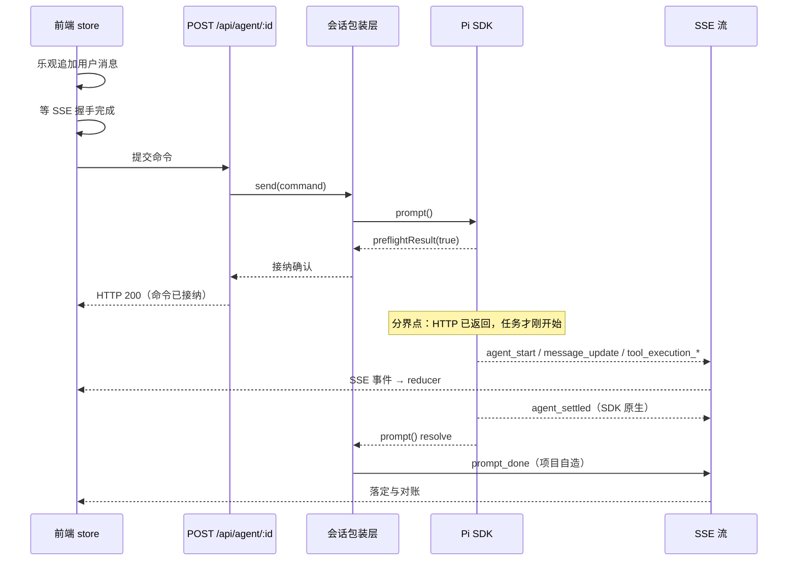

# 01 项目定位与选型

> 对应简历：**「在 Node 服务端集成 Pi Agent SDK，封装会话实例管理与命令分发，将模型文本、思考及工具调用等事件适配为前端事件，通过 SSE 持续推送；区分命令接纳与整轮任务完成两个时点。」**
>
> 本篇回答「这是什么项目、链路怎么走、职责怎么划、为什么这样选型」。机制层的设计取舍见 [02 核心设计的取舍](./02-design-tradeoffs)，故障与架构题见 [03 场景与综合](./03-scenarios)。

## 一、项目与整体链路

### 1. 这个项目是什么？为什么给 pi 做 Web 界面，而不是继续用 CLI？

**考察点**：能否把动机说成「呈现形态不适配」而不是「CLI 做不到」。说成后者会被当场纠正——CLI 的功能是齐的。

**回答**

pi 是跑在终端里的 coding agent。本项目是它的 Web 工作台：Node 服务端嵌入 Pi Agent SDK，把 SDK 的事件流适配成前端事件，经 SSE 推给浏览器，前端把流式内容、工具调用、执行状态渲染成结构化视图。

动机不是 CLI 缺功能。会话树导航 `/tree`、分叉 `/fork`、克隆 `/clone`、`/resume`、分支摘要，CLI 全都有。真正的差异在呈现模型：

| | 终端（TUI） | Web 端 |
| --- | --- | --- |
| 模型 | 流式追加 + 有限回滚 | 可随机访问的结构化视图 |
| 适合 | 盯着它跑完 | 跑一会儿再回来看看做了什么 |
| 工具调用 | 文本流里插几行，往上翻很累 | 可折叠卡片，参数与结果同卡，带耗时 |
| 执行状态 | 看最后一行是否还在刷新 | 常驻状态条显示「正在跑哪个工具」 |
| 长输出 | 受终端回滚缓冲限制 | 结果区独立展开 |
| 文件 | 只能看模型贴出来的片段 | 文件树 + 语法高亮预览 |
| 多会话 | 一个终端窗口一个会话 | 侧栏列表 + 运行中标记，可同时订阅 |

Agent 任务的真实用法是后者——一次任务可能跑十几分钟，人是跑一会儿回来看一眼，而不是全程盯着。

- **取舍**：Web 端补呈现层，不碰执行内核，所以 CLI 和 Web 共用同一套执行逻辑，只是消费同一个事件流。
- **边界**：能力层面 CLI 完整，这句话必须主动说。否则「既然 CLI 有 `/tree`，你为什么还做 Web」会直接打穿整个项目动机。
- **代价**：会话文件格式由 SDK 决定；必须兼容 CLI 的配置目录和文件锁行为；与 SDK 同进程，SDK 的异常可能影响服务端进程。

### 2. 发一条消息，到界面出现结果，完整链路是什么？

**考察点**：能否把「接纳」和「执行」分开讲。把这条链路讲成一条直线的人，后面解释不了为什么前端要在 HTTP 返回后还挂着运行态。

**回答**

整条链路分两段，分界点是 SDK 的 `preflightResult` 回调：HTTP 在命令被接纳后立即返回，之后所有执行进度走 SSE。

前端在发请求之前要做两件事，顺序不能反：

- **乐观追加**：先把用户消息放进列表、把运行状态置为 true。冷启动要打开会话文件、初始化服务，可能要几秒，不这样做界面像卡住。
- **等握手完成再发请求**：反过来先发请求，服务端推的第一批事件没有订阅者，短回复会偶尔不出现。

服务端收到命令后查存活实例，没有就创建，交给 SDK 执行。SDK 先做同步校验——模型配置、密钥、扩展预检——通过后回一个回调，HTTP 从这个回调返回。

- **关键认知**：HTTP 返回只代表命令被接纳，不代表任务完成。任务才刚开始跑。
- **结束信号有两个，顺序容易搞错**：先是 SDK 原生的 `agent_settled`（执行阶段结束），后是包装层发的 `prompt_done`（这次调用彻底完成）。前端主要认前者。
- **异常路径**：纯斜杠命令不进执行循环，SDK 提前返回，不发 `agent_settled`。只等前者会导致界面永远停在运行中，所以 `prompt_done` 里要检查执行有没有起来过，没起来就由它兜底落定。两个信号不是冗余，是覆盖正常路径和特殊路径。

**追问**

- **为什么不只保留一个结束信号？** 执行语义和调用语义不同。只留 `agent_settled` 会漏掉斜杠命令；只留 `prompt_done` 会在正常 Agent Run 时提前落定——一个逻辑 run 里可能有重试和压缩，`agent_end` 会来多次。
- **乐观追加的消息怎么去重？** 用 role + 文本 + 时间戳取整到秒组成 key，`message_end` 到达时比对列表末尾，key 相同就跳过。

### 3. Agent 为什么必须放在 Node 服务端执行？这个约束推出了什么设计？

**考察点**：能否从「三个硬约束」推到「前端不能是事实来源」这个架构结论。只答约束不答推论，说明只背了结论。

**回答**

三个约束，任何一个单独成立就够了：

| 约束 | 内容 | 浏览器为什么不行 |
| --- | --- | --- |
| 工具执行 | `read`/`write`/`edit` 要任意路径读写，`bash` 要起子进程 | File System Access API 只给用户授权过的几个文件，与「整个工作区」差几个量级 |
| 凭证 | 模型 API Key 必须在服务端 | 浏览器直连模型，打开 DevTools 就能拿走 |
| 任务生命周期 | 任务可能跑几分钟 | 关标签页、刷新、被系统回收，任务都会消失 |

这三个约束推出一个比约束本身更重要的结论：**前端不能是事实来源，只能做投影**。体现在两处——

- **前端不做业务决策**，只回答「这个异步结果还算不算数」。真正的业务判断在 SDK 里：一条消息是入队还是开新轮，依赖服务端当前执行状态，前端手里那份是可能过期的副本，不能自己猜。
- **前端状态都是派生的**，权威数据在服务端和会话文件里。这条直接决定了后面所有设计——为什么要对账、为什么需要多层身份校验。

- **边界**：要做成多人服务，当前设计不支持，得补鉴权、工作区隔离、执行隔离、凭证保护、操作审计。
- **必须主动划清**：文件接口的路径校验**不等于**命令执行已被沙箱隔离。前者只保护「通过接口读文件」，后者保护「通过命令行做任何事」，两者不能互相替代。

### 4. 这个项目里，哪些是 SDK 的、哪些是移植的、哪些是你写的？

**考察点**：是否敢主动划清归属。把移植说成自研，一追问就露馅；把 SDK 能力说成自研，更致命。

**回答**

分四类，每一类都有据可查：

| 类别 | 内容 |
| --- | --- |
| **SDK 提供** | Agent 执行循环、模型调用、工具注册与执行、会话文件 JSONL 读写与 entry 树、**上下文压缩算法**、上下文占用估算、分支导航 `navigateTree`、原生事件（`agent_settled` / `queue_update` / `compaction_*` / `auto_retry_*`）、运行中消息队列、`preflightResult` 钩子 |
| **从 pi-web 移植** | 28 个文件，含 `shared/lib/` 下的纯函数模块（流式消息组装、事件连接、事件适配、归一化、会话统计）与 server 侧的事件流、会话读取、会话管理器 |
| **改写或新增** | 会话实例注册与并发合并、两个完成时点的拆分与自造事件（`prompt_done` / `prompt_error` / `connected` / `startup_error`）、接纳串行链、前端三层判据与队列版本、编辑历史的分支流程、停止前撤回队列、图片三层防护、空闲回收与文件锁重试 |
| **未实现** | `fork` / `clone`（抛错占位）、事件重放、任务级恢复、任务持久化、结果验证层、MCP 接入、RAG、多用户、多 Worker |

移植不等于照抄，程度分三种：原样复制（只改注释）、去掉 SDK 类型依赖以便进浏览器产物、大幅简化重写（服务端会话管理器上游两千余行，这里是 520 行）。

**怎么区分**：看目录不可靠——`server/utils/event-stream.ts` 在服务端目录下，但它是移植的。可靠的两条是查第三方来源声明，以及看事件名能不能在 SDK 里搜到（`prompt_done` 搜不到就是项目自造，`agent_settled` 搜得到就是 SDK 原生）。

- **必须主动说的一条边界**：压缩算法是 SDK 的，项目只做事件对接和状态展示。这一条决定了「压缩怎么设计的」这类问题该怎么答。

**追问**

- **移植的代码你改了什么？** 三种程度：只改注释；去掉 SDK 类型依赖，因为 `shared` 层不能 import pi 包，否则进不了浏览器产物；简化重写，去掉上游的扩展 UI、子代理、工具预设、模型作用域、推送通知。

### 5. 为什么在 Node 进程里嵌入 SDK，而不是起子进程走 RPC？

**考察点**：能否说出判断依据（读运行态的频次），而不是「这样比较简单」。

**回答**

四条路都能走，代价不同：

| 路线 | 做法 | 代价 |
| --- | --- | --- |
| **直接嵌入 `AgentSession`**（当前） | Node 进程内 `import` SDK，直接调 API、订阅事件 | 与 SDK 同进程，升级要跟适配 |
| 子进程 + RPC | `pi --mode rpc`，stdin/stdout 走 JSON 协议 | 多一层进程管理与协议解析；进程崩溃要自己恢复；调试链路更长 |
| 子进程 + 解析终端输出 | 解析 CLI 的文本输出 | 输出格式不是契约，极不稳定 |
| 改 SDK 源码 | 能解决所有限制 | 与上游脱钩，升级困难 |

选嵌入的判断依据是**读运行态的频次**：`isStreaming`、`queuedMessages`、`getContextUsage()` 这些状态要频繁读。同进程直接读属性；走 RPC 每次都要一次请求响应往返，延迟和复杂度都不划算。

- **代价**：SDK 升级时要重新验证适配层；SDK 的异常可能带崩服务端进程。
- **边界**：如果以后的首要目标是隔离稳定性，RPC 是可行替代方案，SDK 本身也提供了这个模式。

### 6. 请求结束、连接关闭、任务结束有什么区别？

**考察点**：能否把三个概念拆到不同层。混成一个「结束了」的人，解释不了「为什么请求成功了界面还在转」。

**回答**

三个完全独立的事件，分属三层，可以任意组合：

| 概念 | 层次 | 含义 |
| --- | --- | --- |
| 请求结束 | HTTP | 命令被接纳了 |
| 连接关闭 | 传输 | 前端收不到后续事件了 |
| 任务结束 | 业务 | SDK 执行完了 |

常见组合与正确反应：

| 组合 | 前端该怎么做 |
| --- | --- |
| 请求结束，任务进行中 | 保持运行态，等 SSE 事件 |
| 请求结束，连接关闭，任务进行中 | 重连，靠快照恢复流式气泡 |
| 请求结束，连接关闭，任务已结束 | 重连后从握手包的 `isStreaming: false` 推断 |
| 请求失败，任务未启动 | 回滚乐观消息 |
| **请求失败，任务可能已启动** | **不能自动重试**——任务可能已执行 |

最后一行是重点：连接错误可能发生在服务端已接纳之后，重试会导致重复执行。正确处理是保留用户输入、提示先核对状态、主动拉一次权威数据对账。

- **必须区分的两件事**：SSE 自动重连 ≠ 业务事件恢复。重连能做的是重建传输通道、区分可重试错误、补发握手前缓冲的事件；**不能**补发断线期间丢失的事件，因为服务端没有事件缓冲也没有序号。
- **补偿逻辑**：断线期间任务若正好结束，`agent_settled` 是在没有连接时发出的，永久丢失。所以处理重连信号时要判断——服务端说没在跑、但本地仍认为在跑，就主动合成一次落定，避免界面永远卡在运行中。
- **边界**：`isStreaming` 只反映「有没有活跃执行」，不覆盖压缩状态。它说没在跑，不代表会话完全空闲。

## 本篇小结

| 决策 | 解决什么 | 代价 |
| --- | --- | --- |
| 服务端执行 + Web 呈现 | 工具要碰本机、凭证不能下发、任务要比页面活得久 | 必须做跨进程协议、处理并发、只能单机 |
| 嵌入 SDK 而非 RPC | 频繁读运行态不用往返 | 与 SDK 同进程，升级要跟适配 |
| 呈现层补位而非补能力 | 复用 CLI 同一套执行内核 | 价值容易被低估成「套了个壳」 |
| 接纳与完成分离 | 长任务不阻塞 HTTP | 前端要正确理解多个信号 |

**最容易讲错的三处**：把动机说成「CLI 做不到」；把移植说成自研；把「请求结束」当成「任务结束」。
