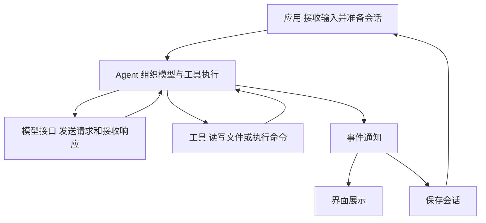

# Doc 01：一次编码任务如何经过 Agent 系统

用户提交“修复配置文件中的错误，并检查修改结果”后，系统需要完成的不只是一次模型调用。它还要提供文件内容、执行修改、把结果交回模型，并让用户知道任务进展。**Agent Harness 就是组织这一过程的运行程序。**

本章用这项任务说明三个问题：模型与程序分别做什么；消息和执行状态怎样保存；为什么 Pi 把这些工作拆在不同的包里。先理解过程，再用少量代码核对实现。

## 一、从任务到动作：谁负责决定，谁负责执行

假设模型先请求读取 `config.json`。一次完整过程是：

1. 应用接收用户输入，准备系统指令、历史消息和可用工具。
2. 程序请求模型。模型返回读取文件的工具调用，包含工具名、调用 ID 和参数。
3. 程序检查调用并执行读取，将文件内容作为工具结果加入消息。
4. 程序再次请求模型。模型根据文件内容提出修改，程序执行修改并记录结果。
5. 模型根据后续检查结果决定是否还需工作，或返回最终说明。

这里有两种决定。模型根据任务和已知信息选择下一步动作；程序根据明确规则决定调用是否可执行、什么时候继续、怎样处理中止和失败。模型要求写文件时，程序仍可以因参数错误或策略限制而拒绝。

这解释了简单 `while` 循环为什么很快变得不够用：

- 它能描述“有工具就执行”，却没有说明工具失败、用户插话和取消时怎么办。
- 它若把模型接口、文件操作和界面显示全部写在一起，换模型或换界面时就容易影响执行过程。
- 它若只返回最终字符串，界面无法可靠地区分“模型在输出”“工具在运行”和“任务结束”。

解决办法不必一开始就引入复杂框架。先把三个责任分开：**准备请求、组织执行、完成实际动作**，再为过程提供事件通知。

## 二、为什么历史消息和“正在运行”要分别管理

执行到“读取文件已经完成，模型还在生成修改方案”时，系统至少保存着三类信息：

| 信息 | 此时的内容 | 主要用途 |
|---|---|---|
| 消息记录 | 用户要求、读取请求、文件内容 | 让后续模型请求知道已经发生什么 |
| 当前运行信息 | 正在等待模型、使用的取消信号 | 控制是否允许新任务和怎样停止 |
| 页面显示 | 已显示的文本、工具卡片、加载状态 | 呈现过程，响应用户交互 |

这些信息有关联，却不能直接共用一个判断。例如：

1. 有消息历史不代表仍在运行；任务完成后历史仍然保留。
2. 没有文字输出不代表空闲；系统可能正在执行命令。
3. 页面切换到另一会话，不代表旧任务自动停止；旧事件需要继续关联旧会话。

持久化会话还要记录分支、模型变更和压缩等内容。**模型上下文**指本次请求实际发给模型的信息，它通常从会话记录中选取、转换而来。界面通知可以不发给模型；历史被压缩成摘要后，原始记录也可以继续保留。

这类似前端根据完整数据计算某个页面需要的视图：同一份历史可以有不同展示方式和不同模型请求方式。两者分开后，改变显示或上下文组织方式，不必删除原始历史。

## 三、把一次执行拆成可复用的部分

下面是职责示意，不是精确的包依赖图：



这套分工的价值在具体变化中才会显现：

- **换模型服务**：主要改变模型请求和响应的适配。Agent 仍然处理消息、工具调用与结果。
- **换成 Web 界面**：保留运行过程，根据事件更新页面；还需处理会话选择和连接状态。
- **增加应用规则**：在执行前检查工具调用，不必把团队规则写入模型协议实现。
- **增加会话保存方式**：由保存逻辑接收完成消息，不要求循环知道磁盘文件的位置。

把通用执行能力和具体应用规则分开，常被称为“机制与策略分离”。例如“能执行工具”是能力，“当前只允许读文件”是规则。这个说法只描述软件分工，不代表扩展代码被隔离在另一个安全进程中。

分开也有代价：应用必须显式传入模型、工具和处理函数；扩展之间需要约定顺序；异步事件需要明确什么时候算处理完成。因此分层应服务于实际变化，不是层数越多越好。

## 四、失败和停止：执行过程还有哪些约束

任务中途出错时，先区分出错位置：

1. **模型请求失败**：没有获得下一步有效输出，程序需要报告失败或按规则重试。
2. **工具执行失败**：例如文件不存在，程序可以把错误作为工具结果交给模型，让它调整下一步。
3. **动作已完成，但结果丢失**：例如文件已写入、进程随后崩溃。再次执行前需要确认实际结果，不能因缺少记录就认定什么都没发生。

第三种情况说明“保存对话”不等于“完整恢复执行”。如果同一动作重复执行会产生重复通知或重复提交，系统还需要防重复或结果查询机制。Doc 01 先明确这个区别，不把所有可靠性问题都塞进基本循环。

用户取消时也一样：程序可以要求模型请求和工具停止，但已经完成的修改不会自动撤销。工具是否及时停止，取决于它是否响应取消信号，或应用能否终止对应进程。

## 五、Pi 如何组织这些工作

Pi 的三个核心包对应上述分工：

| 包 | 在任务中承担什么 |
|---|---|
| `pi-coding-agent` | 处理用户输入、配置、会话、工具与界面，组装运行环境 |
| `pi-agent-core` | 管理当前运行、消息队列、模型与工具循环，并发出事件 |
| `pi-ai` | 定义统一消息和模型事件，适配不同模型服务 |

工具由产品层提供，再交给 Agent 调用。TUI、MCP、Codemode 等也由应用组合；默认启用哪些工具与仓库实现了哪些工具不是同一问题。

代码片段中的中文注释为教学补充。循环接收的上下文很小：

```typescript title="packages/agent/src/types.ts · AgentContext"
export interface AgentContext {
  // 已有消息，包括系统指令和对话内容。
  messages: AgentMessage[];
  // 当前运行可执行的工具；工具函数不会原样发送给模型。
  tools?: AgentTool<any>[];
}
```

它没有终端对象或会话文件路径，所以这些工作由应用处理。源码中的 `any` 用于在同一列表中存放参数类型不同的工具，不表示跳过工具参数检查。

应用通过 SDK 创建会话时，建立模型、会话管理和资源加载能力，再创建 Agent。以下只保留请求函数的装配，其他选项省略：

```typescript title="packages/coding-agent/src/core/sdk.ts · createAgentSession（删节）"
streamFn: async (model, context, options) => {
  const requestOptions = buildRequestOptions(options);
  // 此处省略缓存处理；模型运行时负责具体请求与认证路由。
  return modelRuntime.streamSimple(model, context, requestOptions);
},
```

Agent 不必自己读取账号配置或创建厂商客户端，只需调用传入的函数。测试也可以传入模拟函数，专门验证工具执行和消息处理，不调用真实模型。

运行入口则保护同一实例不被重复启动：

```typescript title="packages/agent/src/agent.ts · prompt（关键逻辑摘录）"
if (this.activeRun) {
  throw new Error(
    "Agent is already processing a prompt. Use steer() or followUp() to queue messages, or wait for completion.",
  );
}
// 将输入统一为消息，再进入具有开始、取消和清理逻辑的执行过程。
const messages = this.normalizePromptInput(input, images);
await this.runPromptMessages(messages);
```

因此，一次任务的实际链路可以概括为：应用准备会话 → Agent 接受消息 → 循环请求模型并执行工具 → 事件更新界面和历史 → 等待处理完成后清理运行状态。CLI 从命令行参数和运行模式进入；SDK 从应用代码进入，不能简单将两条路径视为同一个入口函数。

## 六、怎样选择集成方式

比较时先问“运行在哪里、如何控制”，而不是笼统评价谁更先进：

- **Pi** 提供进程内 SDK 和 JSONL RPC。前者方便 TypeScript 应用直接控制会话；后者通过独立进程通信，但仍需处理进程退出和事件读取。
- **DeepSeek Harness** 以插件和服务组合能力，适合研究如何替换与扩展运行组件。[架构文档](https://github.com/deepseek-ai/deepseek-harness/blob/master/docs/architecture.md)
- **OpenCode V1** 提供 HTTP 服务和事件流，适合多个客户端连接统一运行服务。[Server 文档](https://opencode.ai/v1/docs/server/)
- **Claude Code** 提供 CLI 和 Agent SDK。集成以其公开运行接口为依据，不从接口推测其私有实现。[编程接入文档](https://code.claude.com/docs/en/headless)

如果目的是理解和控制自己的执行过程，Pi 的代码与 SDK 是直接入口；如果目的是多个客户端共享运行服务，就需要额外考虑连接、任务标识和同步。上述判断针对集成方式，不代表执行效果或性能排名。

## 七、本地验证：工具结果确实进入后续执行

依赖安装后，在 `packages/agent` 下运行现有模拟测试：

```text title="PowerShell · D:/project/pi/packages/agent"
node ../../node_modules/vitest/dist/cli.js --run test/agent-loop.test.ts -t "should handle tool calls and results"
```

测试先让模拟模型请求 `echo` 工具，再返回文本；它检查工具实际执行、事件发出和结果用量。它验证预设响应下的程序行为，不判断真实模型是否会正确选工具。

:::details 首次准备环境与源码 CLI

```text title="PowerShell · D:/project/pi"
npm install --ignore-scripts
npm run hydrate:model-data
node --import ./packages/coding-agent/src/experimental/source-resolver.ts ./packages/coding-agent/src/cli.ts --help
```

依赖安装和模型目录准备需要网络。`--help` 验证入口能否加载，真实对话另需配置模型账号。仅运行上面的 `agent-loop.test.ts` 模拟用例，不需要真实账号。

:::

下一篇：[Doc 02：模型响应怎样形成完整消息](./doc_02_model_streaming)。
