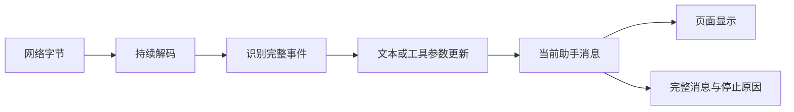

# Doc 02：模型响应怎样形成完整消息

模型请求读取 `config.json` 时，工具参数可能分几次到达。页面已经显示路径的一部分，程序却还不能读取文件。**看到部分内容、收到完整消息、允许执行工具，是三个不同的时刻。**

本章跟随这条响应，解释数据如何从网络进入界面，为什么工具必须等待完整参数，以及 Pi 怎样实现这一过程。理解顺序是：到达的数据是什么 → 怎样组成消息 → 何时可以执行 → 最后对照代码。

## 一、先分清两层 JSON

假设工具参数文本依次到达：

```text title="示意 · 同一次工具调用的两段参数文本"
第 1 段：{"path":"con
第 2 段：fig.json"}
完整结果：{"path":"config.json"}
```

第一段不是完整 JSON，直接 `JSON.parse()` 会失败。但这并不表示模型输出错误，它可能只是尚未生成完。

在真实流式接口里，这段文本通常又放在外层事件中。外层 JSON 可能完全合法，其中的“参数增量”字段却只保存半段工具参数。于是要分别处理：

1. **协议事件**：用于说明“哪条消息、哪个内容块有新数据”。
2. **工具参数文本**：需要跨多个协议事件累积，等工具块结束后再检查完整结果。

如果把这两层混为一谈，就会把正常分段误报成 JSON 错误，或者误以为外层事件可解析就能执行工具。

## 二、网络读取到的数据还不一定是一条事件

即使模型服务使用 SSE，也不能假设每次读取网络响应都得到一个完整事件。SSE 是一种按文本事件持续推送数据的格式；事件通常以空行结束，数据行以 `data:` 开头。

例如网络可能先返回 `data: {"type":"text_del`，下一次才返回剩余内容。程序需要按顺序完成以下工作：

1. **解码字节**：UTF-8 字符可能被拆在两次读取中，解码器需要保留未完成部分。
2. **找到完整事件**：累积文本，按 SSE 格式分隔事件，多行 `data:` 也需要按协议处理。
3. **解析事件内容**：读取事件类型、块位置和本次新增内容。
4. **更新消息**：将新增内容放入正确的文本块或工具调用。

厂商 SDK 往往已经处理前两步。Pi 的 Anthropic 实现消费的就是 SDK 提供的事件对象，不是在每个分支里手工拆网络字节。学习时需要分清底层约束与本项目实际负责的层次。



## 三、一条助手消息如何逐步形成

一条响应不一定只是一段文本。它可以先解释，再提出两个工具调用。程序因此需要按内容块分别保存，而不是把所有新增字符串拼到一个变量中。

| 收到的数据 | 应该做什么 |
|---|---|
| 消息开始 | 建立当前助手消息 |
| 文本块开始、更新 | 找到对应文本块，追加内容 |
| 工具块开始、参数更新 | 记录调用 ID、工具名，为该调用累积参数 |
| 某个块结束 | 得到该块的最终内容，但整条消息可能还没结束 |
| 整条消息结束 | 保存最终内容、停止原因和使用量，交给后续执行逻辑 |

这和前端根据事件更新页面相似，但有两个容易出错的地方。

### 1. 新增内容与当前完整内容不能一起追加

假设两次文本更新分别新增“你”和“好”，当前完整内容分别是“你”和“你好”：

- 用新增内容更新页面，应依次追加“你”“好”。
- 用当前内容重绘页面，应依次替换为“你”“你好”。
- 若每次把当前完整内容追加到旧文本，就会显示成“你你好”。

所以事件同时提供新增字符串和当前消息时，调用方要选择一致的更新方式。

### 2. 保存对象引用不等于保存当时内容

模型适配器可能持续修改同一个消息对象。把它存进 `events` 数组，稍后读取时，看到的可能是更新后的内容。需要回看逐时刻状态时，可以记录独立的新增字符串和顺序，或复制实际需要保存的字段。

复制也有代价：每个 token 都深复制整段消息，会随着响应增长产生大量工作。仅用于实时展示时，维护当前状态通常更合适；审计或回放则需要另行设计记录方式。

## 四、为什么 JSON 能解析，也不能直接执行

工具执行前需要依次确认三件事：

1. **模型是否已经完整返回**：长度截断或网络中断可能留下半段意图。
2. **参数是否正确**：最终文本能否形成对象，字段是否符合工具声明。
3. **动作是否允许**：一个合法路径仍可能指向不允许修改的文件。

例如模型原本打算写入较长内容，但输出在 `"hel` 处截断。为了显示进度，解析器可能提供 `{ value: "hel" }` 这样的预览对象。它符合“value 是字符串”的要求，却不是最终内容。此时执行工具，会把预览当成真实动作。

因此程序可以对展示宽容，对执行严格：

- 生成过程中允许预览不完整对象，方便用户观察。
- 工具块结束后重新解析完整文本，记录解析错误。
- 助手消息结束后检查停止原因；若响应被截断，即使已有参数对象也不能据此执行。

错误结果可以交回模型，让它重新提出完整调用。代价是可能多一次请求；收益是避免对不完整动作产生文件写入等实际影响。

## 五、下一次请求为什么不直接发送整个会话文件

任务继续时，模型需要看到用户要求、自己的工具调用和工具结果。但会话可能还记录页面通知、分支和压缩信息。这些内容并非全部都是模型输入。

一种清晰做法是：

1. 从当前会话选择有效历史。
2. 按应用规则处理内容，例如去掉仅用于页面的通知。
3. 转换成统一模型消息。
4. 由具体模型服务的实现转换为它接受的请求格式。

这样更换服务时，内部历史不必全部变成某家 API 的专用格式；代价是必须明确转换规则，保留继续对话所需的调用 ID、结果和服务元数据。

请求稳定性还影响成本。模型生成时会缓存已处理 token 的部分计算结果，通常称为 KV-Cache；某些服务还能在后续请求中复用匹配的提示词前缀。频繁重排系统指令、工具声明或早期历史，可能让可复用部分减少，但具体规则由服务决定。

这里要分别权衡：保留历史有利于信息完整和前缀稳定，却占用上下文窗口；压缩历史能腾出空间，却可能损失细节并改变前缀。缓存不会让请求绕过窗口上限，不能为了命中缓存而无限保留历史。

## 六、用 Pi 源码核对这些过程

Pi 的 `Message` 包含系统、用户、助手和工具结果四种消息。助手消息再包含文本、思考和工具调用等内容块。`AssistantMessageEvent` 描述这些块如何开始、更新和结束。

下列源码摘录中的中文注释为教学补充。请求前的转换顺序是：

```typescript title="packages/agent/src/agent-loop.ts · streamAssistantResponse（摘录）"
let messages = context.messages;
if (config.transformContext) {
  // 应用先在自己的消息类型上处理本次请求内容。
  messages = await config.transformContext(messages, signal);
}
// 转为模型消息，再整理成模型适配器使用的统一上下文。
const llmMessages = await config.convertToLlm(messages);
const llmContext = normalizeContext({ messages: llmMessages });
```

随后调用应用提供的请求函数。返回事件中的 `start` 创建部分助手消息；更新事件替换当前消息并发出 `message_update`；最终结果通过 `message_end` 交给外层处理。

这里的 `partial` 是共享的当前消息，不是已经冻结的历史快照；Agent 转发时的 `{ ...partialMessage }` 也只是浅拷贝，嵌套内容仍可能共享。

Anthropic 的参数更新实现把每个调用交给独立的参数流处理：

```typescript title="packages/ai/src/api/anthropic-messages.ts · 参数更新分支"
if (open?.block.type === "toolCall" && open.arguments !== undefined) {
  // 只更新当前调用的参数预览，避免与其他工具块混合。
  open.block.arguments = open.arguments.append(event.delta.partial_json);
  stream.push({
    type: "toolcall_delta",
    contentIndex: open.contentIndex,
    delta: event.delta.partial_json,
    partial: output,
  });
}
```

工具块结束时调用 `finish()`，对完整参数文本做最终解析。解析失败会保留 `argumentsError`；对部分转义错误可尝试修复，但不会把任意未闭合的预览当作最终对象。Loop 再依据整条消息的 `length` 停止原因，拒绝执行截断响应中的工具调用。

解析器也考虑了性能：`StreamingJsonParser` 持续处理新文本，而不是每片都重新解析整个前缀；生成快照时只复制仍打开的容器，并限制总复制工作。因此大对象的展示预览可能稍落后于到达文本，最终解析仍使用完整原文。

最后一个接口差别是：`result()` 完成只说明最终结果已产生，事件队列可能还没有被消费者全部处理。事件流内部会缓存尚无人读取的事件，`for await` 本身不保证生产者等待慢消费者。如果把每个事件写入数据库，需要另外考虑处理速度和缓冲增长。

## 七、其他产品能比较什么

- Pi 在进程内提供统一模型事件与 Agent 事件，便于直接观察和控制。
- DeepSeek Harness 文档区分模型流、临时助手流与会话记录，可用来对照“展示过程”与“保存事实”的分工。[LLM Streaming](https://github.com/deepseek-ai/deepseek-harness/blob/master/docs/subsystems/llm-streaming.md)
- OpenCode V1 的 `/event` 是服务面向客户端的 SSE；Claude Code 的 `stream-json` 是产品面向调用程序的输出。它们可用于集成比较，不能直接当作其内部模型事件类型。[OpenCode Server](https://opencode.ai/v1/docs/server/)、[Claude Code 输出说明](https://code.claude.com/docs/en/headless)

选择接口时先确定需要控制模型请求本身，还是只消费一个已经运行的产品会话。后者能减少自己实现的工作，但可修改的内部行为由产品公开接口决定。

## 八、本地观察：预览正确不代表可以执行

下面两个现有测试分别检查增量参数解析和截断响应，不调用真实模型：

```text title="PowerShell · 分别在相应包目录执行"
cd D:\project\pi\packages\ai
node ../../node_modules/vitest/dist/cli.js --run test/streaming-json.test.ts
cd D:\project\pi\packages\agent
node ../../node_modules/vitest/dist/cli.js --run test/agent-loop.test.ts -t "should not execute tool calls from a length-truncated assistant message"
```

第二个用例给模型响应设置 `length`，同时提供表面合法的 `{ value: "hel" }`。它检查工具未执行、产生失败结果，且循环再次请求模型。第二次响应由测试预设，不代表真实模型一定能自行纠正。

:::details 对照源码时观察的三个位置

1. `ToolCallArgumentsStream.append()`：原始文本增加，当前可展示参数随之更新。
2. `ToolCallArgumentsStream.finish()`：完整文本形成最终参数或解析错误。
3. `failToolCallsFromTruncatedMessage()`：不执行工具，而是形成失败结果。

首次需在仓库根目录执行 `npm install --ignore-scripts`。这些模拟用例不验证网络、真实账号和模型效果。

:::

下一篇：[Doc 03：运行中的输入、取消与结束](./doc_03_agent_runtime)。
