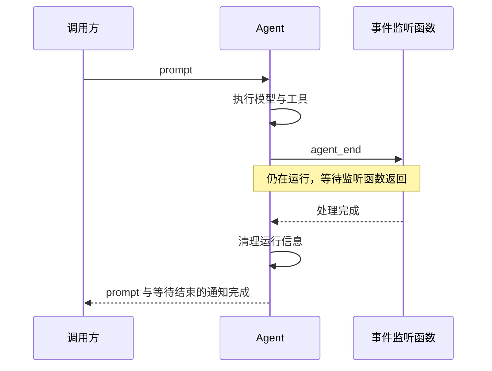

# Doc 03：运行中的输入、取消与结束

Agent 正在修改文件时，用户又输入一句“先别修改，只告诉我原因”，随后点击停止。程序需要判断新消息怎样交给模型、当前工具是否还能继续，以及什么时候可以开始下一项任务。

本章围绕这段过程讲清：一个实例为什么不能同时运行两次；中途输入为什么需要排队；取消请求和真正结束为什么有时间差。最后再用 Pi 的实现核对这些规则。

## 一、先判断当前任务是否真的结束

执行期间，“没有文字在输出”可能有几种原因：模型还没返回、工具正在运行、结束事件正在被处理。页面若仅根据文字流判断是否空闲，就可能过早接受新任务。

程序需要分开保存：

- **历史消息**：用户要求、助手输出和工具结果，为后续请求保留上下文。
- **当前运行信息**：是否仍有任务、取消控制器，以及等待结束的 Promise。
- **当前显示内容**：部分助手消息、工具进度等，用来更新页面。
- **待处理输入**：用户中途提交但尚未交给模型的消息。

例如工具执行已经完成、助手也返回最终说明，但一个监听函数还在保存结果。程序可以选择等待它，或让它独立处理；选择不同，任务完成的含义就不同。

这也是为什么单个 `loading` 标志不够表达全部过程。它可以表示“当前还不允许启动另一个任务”，但不能同时精确说明模型、工具和保存逻辑各处于什么阶段。

## 二、为什么单线程仍然会重复启动

假设开始任务的代码先检查空闲，再等待读取配置，最后标记正在运行。第一项任务等待配置时，第二项也能读到“空闲”，于是两项任务同时使用同一段消息历史。

具体会出现：

1. A 请求模型读取文件，B 请求模型修改另一个文件。
2. A、B 的工具结果写入同一数组，模型可能看到不属于自己任务的内容。
3. A 先结束并清除正在运行标志，B 却仍未完成。

避免这一问题，不需要先引入线程锁：在第一次 `await` 之前，同步记录“当前已有任务”；所有退出路径都负责清理。这样其他调用即使在等待期间到达，也能看到正在运行。

繁忙时，新输入有三种合理处理方式：

- 拒绝，让调用方等结束后再提交。
- 排队，在当前执行的合适时机加入。
- 创建独立 Agent 实例，但共享文件和其他外部资源仍需要协调。

Pi 对直接再次调用 `prompt()` 采用拒绝方式，中途消息则通过队列处理。这个规则保护单个实例的消息和执行状态，不保证多个实例同时改同一文件时安全。

## 三、插话应该什么时候交给模型

“只分析，不修改”和“完成后帮我写测试”的时间要求不同：

1. 前者希望尽早影响**后续**决策。
2. 后者希望当前任务先完成，再开始另一项工作。

Pi 分别提供 `steer()` 与 `followUp()`：

| 调用 | 加入什么 | 什么时候交给循环 |
|---|---|---|
| `steer()` | 中途纠偏消息 | 在当前助手轮及其工具处理完成后，准备后续请求时 |
| `followUp()` | 后续任务消息 | 当前工作原本可以结束时 |

入队不会启动另一次并发请求，也不是给已经发出去的请求追加网络内容。模型只能在下一次请求中读到新消息，已经开始的写文件动作不会自动撤销。

一次取一条还是取全部，也是设计选择：

- 一次一条，处理顺序更明确，但可能增加模型请求次数。
- 一次全部，等待更少，但模型需要同时理解更多意图。

Pi 默认一次取一条。`peekQueuedMessages()` 只预览下一次选中的输入，不会消费，也不返回全部队列。队列被读取后，消息才正式进入执行；只有入队而没有新运行，不会自动产生答案。

## 四、停止按钮为什么不是立即完成

`AbortController` 是 JavaScript 的协作式取消机制：调用 `abort()` 将信号设为已取消，下游操作再根据它退出。它不会替任意函数强制返回。

因此停止过程有三个阶段：

1. 程序发出取消请求。
2. 模型请求、工具和相关异步工作响应取消并返回。
3. 程序处理结束事件、清理当前运行信息，并通知等待者。

如果工具不处理取消信号，它可能继续运行；如果已写入文件，取消不会自动回滚。真正需要强制终止命令时，还要由工具或应用控制对应进程。

在 Pi 的底层 Agent 中，`abort()` 不会自动清空待处理消息，结束清理也不会。应用可以选择保留、恢复到编辑器，或显式清空。不能从停止按钮的外观推断底层已经删除队列。

调用方通常这样等待：

```typescript title="教学示例 · 在外层调用方停止任务"
agent.abort();
await agent.waitForIdle();
// 当前运行已结束，再检查最终结果，决定怎样处理未消费输入。
```

`waitForIdle()` 等待调用时的当前运行，不保证之后不会有新任务提交，也不返回任务业务结果。它适合控制执行顺序；判断成功失败还需要查看最终消息和错误信息。

## 五、结束事件为什么早于恢复空闲

Pi 会依次等待注册的监听函数。收到 `agent_end` 只是循环通知结束；监听函数仍可能在处理这个事件。



这种方式让“任务完成”包含被等待的保存或事件处理逻辑，顺序清楚；代价是慢监听函数会拖慢整个任务。监听函数也不能等待自己的任务变为空闲：

1. Agent 在等监听函数返回。
2. 监听函数在等 `waitForIdle()`。
3. `waitForIdle()` 又需要 Agent 先处理完监听函数。

这会一直互相等待。后续任务应由外层在完成后提交，或使用队列接口安排，而不是在结束监听函数里等待当前任务结束。

## 六、状态更新与复制：页面会读到什么

Agent 先根据事件更新状态，再通知监听函数。例如处理 `message_end` 时，将完成消息加入历史，再通知外部。这样监听函数读取状态时已能看到该消息。

需要理解的更新规则包括：

- `message_start`、`message_update` 更新当前消息；`message_end` 将完成消息加入记录并清除当前消息。
- 工具开始和结束事件更新待处理工具 ID。
- `agent_end` 清除当前消息，但此时不立即将实例标记为空闲。
- 普通状态赋值不自动产生 Agent 事件；这不是完整的前端响应式 store。

数组复制也只保护数组本身。Pi 在初始化、消息赋值和创建循环上下文时复制顶层数组；消息对象与工具对象仍共享引用。调用方不能以为读到 `state` 就拥有了一份独立历史快照，后续任意修改嵌套对象可能影响其他使用者。

浅复制避免每次运行都复制大量消息和函数对象，但要求明确由谁修改内容。实际集成时，应让执行过程负责消息更新，UI 负责展示，避免两者任意修改同一消息。

## 七、用三个源码片段验证

以下中文注释为教学补充。`activeRun` 保存当前任务的完成 Promise 和取消控制器。

```typescript title="packages/agent/src/agent.ts · runWithLifecycle（关键顺序摘录）"
const abortController = new AbortController();
let resolvePromise = () => {};
const promise = new Promise<void>((resolve) => {
  resolvePromise = resolve;
});
// 先记录当前任务，然后才进入异步执行。
this.activeRun = { promise, resolve: resolvePromise, abortController };
```

该函数在建立任务前还会检查是否繁忙，并在 `finally` 中调用 `finishRun()`。失败处理即使抛错，清理也会执行。

```typescript title="packages/agent/src/agent.ts · processEvents（分发摘录）"
// 此处之前已根据事件更新公开状态，并取得当前 signal。
for (const listener of this.listeners) {
  // 依次等待，故监听函数的耗时也是运行的一部分。
  await listener(event, signal);
}
```

完成事件处理后，清理函数才允许下一次运行：

```typescript title="packages/agent/src/agent.ts · finishRun"
private finishRun(): void {
  this._state.isStreaming = false;
  this._state.streamingMessage = undefined;
  this._state.pendingToolCalls = new Set<string>();
  // Promise 的后续回调会在当前同步清理完成后执行。
  this.activeRun?.resolve();
  this.activeRun = undefined;
}
```

`isStreaming` 这个名字容易误导：它在模型请求、工具执行和被等待的结束监听期间都为真，不只表示有文字正在输出。

异常还需要区分两条路径：运行中的异常可被转换为失败助手消息；如果处理这些失败事件的监听函数又抛错，`prompt()` 仍可能拒绝。结束等待本身不等于业务成功，UI 和服务端都需要处理最终错误。

`continue()` 也不能无条件调用。消息为空或只有系统消息时无法继续；尾部是助手回答时，Pi 会先寻找排队消息，没有则拒绝。它不会凭空创造用户的新要求。队列具体怎样推动下一轮，留到 Doc 04。

## 八、和其他集成方式对照

- Pi 的进程内接口让应用直接等待运行和订阅事件，但监听函数的错误与耗时也直接影响任务。
- DeepSeek Harness 公开文档也定义 Agent 交付、取消和事件接口，研究时要按它自己的等待规则理解。[Core 文档](https://github.com/deepseek-ai/deepseek-harness/blob/master/docs/subsystems/core.md)
- OpenCode V1 通过服务管理会话；客户端断连与请求中止需要分别判断。[Server 文档](https://opencode.ai/v1/docs/server/)
- Claude Code 的 CLI 和 Agent SDK 定义停止与退出行为，不能把其所有后台工作都看作一个 Pi Agent 对象。[编程运行文档](https://code.claude.com/docs/en/headless)

这些接口解决类似问题，但不能因名称相近就假定生命周期完全一样。集成时最重要的是确认：停止请求发给谁、怎样确认它返回、确认范围是否包含子任务。

## 九、本地实验：让结束监听函数暂时不返回

实验使用模拟响应，不依赖模型目录或账号，依次观察：

1. `agent_end` 已到达，但监听函数仍在等待时，第二次 `prompt()` 被拒绝。
2. 释放监听函数后，实例才恢复空闲。
3. 模拟模型请求响应取消信号后，任务结束。

将折叠区脚本保存到 Pi 仓库根目录，再执行：

```text title="PowerShell · D:/project/pi"
node --import ./packages/coding-agent/src/experimental/source-resolver.ts ./doc03-runtime-lab.ts
```

:::details 完整实验脚本

```typescript title="doc03-runtime-lab.ts · 保存到 Pi 仓库根目录"
import assert from "node:assert/strict";
import { Agent } from "./packages/agent/src/agent.ts";
import type { AssistantMessage } from "./packages/ai/src/types.ts";
import { createAssistantMessageEventStream } from "./packages/ai/src/utils/event-stream.ts";

function message(stopReason: "stop" | "aborted"): AssistantMessage {
  return {
    role: "assistant", content: [{ type: "text", text: stopReason }],
    api: "openai-responses", provider: "openai", model: "mock",
    usage: { input: 0, output: 0, cacheRead: 0, cacheWrite: 0, totalTokens: 0,
      cost: { input: 0, output: 0, cacheRead: 0, cacheWrite: 0, total: 0 } },
    stopReason, timestamp: Date.now(),
  };
}

// 两个独立通知：结束事件已到达；允许结束监听器完成。
let release = () => {};
const barrier = new Promise<void>((resolve) => { release = resolve; });
let reachedEnd = () => {};
const endObserved = new Promise<void>((resolve) => { reachedEnd = resolve; });
const agent = new Agent({ streamFn: () => {
  const stream = createAssistantMessageEventStream();
  queueMicrotask(() => {
    stream.push({ type: "start", partial: message("stop") });
    stream.push({ type: "done", reason: "stop", message: message("stop") });
  });
  return stream;
} });
agent.subscribe(async (event) => {
  if (event.type === "agent_end") {
    reachedEnd();
    await barrier;
  }
});
// 在监听器被 barrier 阻塞时，观察运行互斥及 idle 通知。
const run = agent.prompt("hello");
await endObserved;
assert.equal(agent.state.isStreaming, true);
await assert.rejects(agent.prompt("second"), /already processing/);
let idle = false;
const idlePromise = agent.waitForIdle().then(() => { idle = true; });
await Promise.resolve();
assert.equal(idle, false);
console.log("agent_end listener held: busy=true, second prompt rejected, idle=false");
// 只有释放监听器后，生命周期清理才会执行。
release();
await Promise.all([run, idlePromise]);
assert.equal(agent.state.isStreaming, false);
console.log("listener released: busy=false, idle=true");

// 第二个 Agent 的模拟适配器显式响应 signal，验证协作式取消。
let started = () => {};
const startedPromise = new Promise<void>((resolve) => { started = resolve; });
const cancellable = new Agent({ streamFn: (_model, _context, options) => {
  const stream = createAssistantMessageEventStream();
  stream.push({ type: "start", partial: message("stop") });
  options?.signal?.addEventListener("abort", () => {
    stream.push({ type: "error", reason: "aborted", error: message("aborted") });
  }, { once: true });
  started();
  return stream;
} });
const cancelRun = cancellable.prompt("wait");
await startedPromise;
const signal = cancellable.signal;
cancellable.abort();
assert.equal(signal?.aborted, true);
await Promise.all([cancelRun, cancellable.waitForIdle()]);
assert.equal(cancellable.state.isStreaming, false);
console.log("abort observed by adapter: aborted=true, busy=false after settlement");
```

:::

脚本用 Promise 控制时间顺序，不靠固定睡眠猜测任务是否结束。它证明的是主动响应 signal 的模拟请求行为，不证明任意工具都会立即停止。

:::details 对应仓库测试与环境要求

```text title="PowerShell · D:/project/pi/packages/agent"
node ../../node_modules/vitest/dist/cli.js --run test/agent.test.ts -t "should await async subscribers before prompt resolves|waitForIdle should wait for async subscribers|should throw when prompt|should pass the active abort signal"
```

测试虽然使用模拟响应，但该文件导入了模型目录。需先完成依赖安装和 `npm run hydrate:model-data`，否则可能在加载阶段因缺少 Provider JSON 而失败，尚未执行断言。

:::

下一篇：[Doc 04：循环怎样继续，又怎样结束](./doc_04_agent_loop)。
