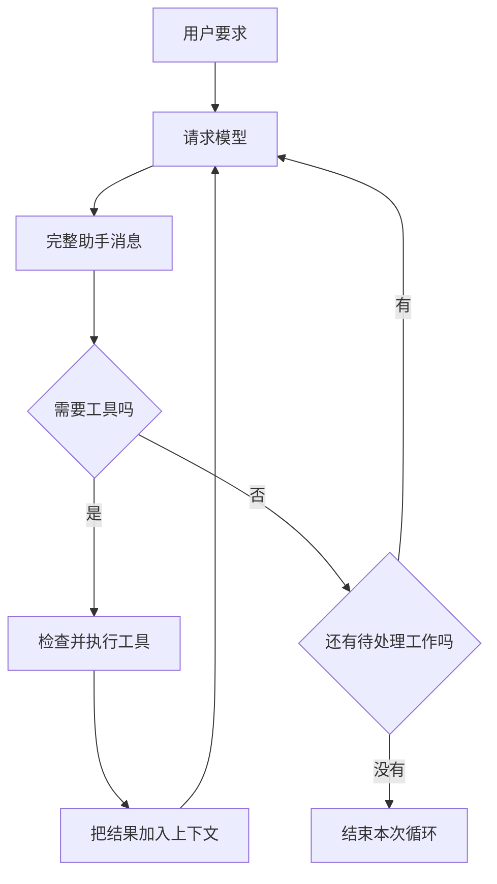
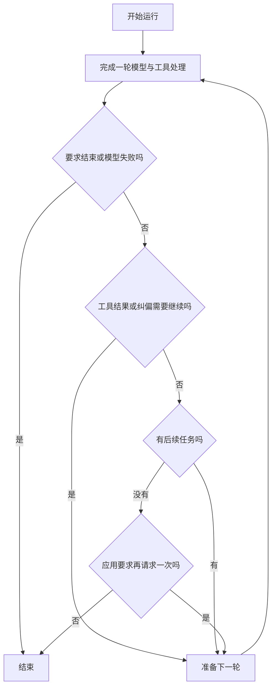

# Doc 04：循环怎样继续，又怎样结束

Agent 读取文件后，要根据内容决定怎样修改；修改后，还要根据检查结果决定是否继续。**下一步依赖上一步的实际结果**，所以程序需要反复请求模型，而不是一次生成所有操作后机械执行。

本章用“读取配置、修正错误、检查结果”的过程解释循环。重点是每轮看见什么、为什么继续、什么时候停止，以及新消息在什么时刻加入。源码放在过程讲清之后，完整实验放在末尾折叠区。

## 一、先把一项任务按时间展开

假设模型依次选择 `read`、`edit` 和检查命令。一个可能的执行过程如下，具体工具选择由模型决定：

1. 请求模型：上下文包含用户任务和工具声明。
2. 模型返回 `read` 调用；程序读取配置，把结果加入上下文。
3. 再请求模型：它现在知道实际配置，提出 `edit` 调用。
4. 修改完成，程序加入修改结果，再请求模型。
5. 模型提出检查调用；检查结果失败，程序把错误交回模型。
6. 模型根据错误继续修改，或在验证通过后返回最终说明。

每次模型响应及其相关工具执行，称为一轮，也就是源码中的 **turn**。从一次输入开始，直到循环结束，是一次运行；一次运行可以包含多轮。



这是普通路径的概念图。真实实现还会处理模型失败、取消和应用显式要求结束等情况。

## 二、工具结果为什么能推动下一轮

模型不是在自己的内部自动获得文件读取结果。必须由程序将助手的工具请求和对应结果保留在消息中，再作为后续请求的输入。

```text title="示意 · 三次请求看到的消息"
请求 1：用户任务
请求 2：用户任务 → 助手请求 read → read 结果
请求 3：上述消息 → 助手请求 edit → edit 结果
```

这里有三个必须保持的关系：

- **请求和结果能对应**：工具调用 ID 与结果里的 `toolCallId` 关联，同名工具调用多次也不能混淆。
- **结果先加入，才能继续**：下一次请求若缺少结果，模型仍不知道实际发生了什么。
- **完整消息再进入执行**：流式参数还在生成时不能执行，具体原因见 Doc 02。

这也解释了工具失败为什么不一定结束 Agent。文件不存在、命令检查失败等错误，可以作为一次工具结果交回模型。模型有机会换路径、修改命令或解释失败。

但“可以继续”不等于“应无条件重试”。写文件或提交外部请求可能已经产生影响；程序不能简单重复同一动作。循环负责传递结果，工具设计和应用规则负责判断重试是否安全。

## 三、没有工具调用，为什么还可能继续

最小循环常在“模型没有提出工具调用”时结束，但交互应用还会收到中途消息。例如执行过程中用户说：

- “后面的修改只限这个文件。”这是纠偏，希望影响当前任务后续步骤。
- “这件事完成后，再补一段使用说明。”这是后续任务，不应抢在当前工作之前。

Pi 分别使用 steering 和 follow-up 队列保存两种输入。它们不会打断已经发出的模型响应，也不会自动撤销正在执行的修改。

一个具体时间过程：

1. 当前助手消息要求执行两个工具。
2. 用户提交纠偏消息，程序先入队。
3. 当前轮工具处理结束后，程序读取纠偏消息，将它加入下一次模型请求。
4. 模型根据新要求继续当前任务。
5. 当前任务没有工具和纠偏消息需要处理时，再检查后续任务队列。

在轮次之间接收输入，可以避免将当前工具请求和结果拆开。代价是纠偏不能立即阻止已经开始的动作；需要立即停止时，应使用取消能力并等待执行结束。

## 四、双层循环表达两种继续原因

Pi 的内层循环处理“当前工作还没做完”：工具结果需要模型继续处理，或者有纠偏消息。内层可以结束时，外层再检查是否有后续任务。



用两个循环不是唯一正确实现，也可以写成一个循环和明确的分支。这里的价值是把优先关系放在结构中：先完成当前工作，再取后续输入。

理解变量时不要只看名字。`hasMoreToolCalls` 并不是预测下一次模型是否会调工具，而是记录当前工具处理之后是否应保持循环继续。工具结果通常要求再请求模型，所以它会让下一轮发生；如果整批工具结果满足终止条件，则不因此继续。

队列也不会被不停地实时扫描。只有程序执行到读取位置，消息才被取出。某个回调耗时较长时，新输入需要等待到后面的读取机会。

## 五、应用应该在什么时机介入

循环不仅接收模型输出，也允许应用在明确时机参与。源码提供三个相关回调，回调就是执行到指定位置时调用的函数：

| 回调 | 什么时候发生 | 用来做什么 |
|---|---|---|
| `finishTurn` | 助手及工具结果完成之后、`turn_end` 之前 | 让应用决定结束、再请求一次，或保留普通调度 |
| `prepareNextTurn` | 已确定继续，下一轮开始前 | 根据上一轮结果准备上下文、消息、模型或推理级别 |
| `prepareRequest` | 每次对话模型请求之前，包括第一次 | 检查或调整即将发送请求使用的状态 |

这些位置并不等价：

1. 没决定继续之前，不该花时间做下一轮的准备；因此 `prepareNextTurn` 不是每次收尾都运行。
2. 第一次请求没有上一轮结果，但仍可能需要调整，所以另有 `prepareRequest`。
3. 当前轮的工具结果还没完整加入时，就判断是否结束，会得到不完整依据；所以 `finishTurn` 在结果完成之后。

回调越灵活，顺序约定越重要。若所有钩子都能任意发请求或读取队列，就难以判断一条输入会被处理几次。Pi 把队列消费留在循环中的明确位置；应用回调只在各自约定的时机返回决定或更新。

### 要求“继续一次”，不能平白增加第二次

假设应用的 `finishTurn` 返回 `{ action: "continue" }`，同一轮恰好也有工具结果。

- 正确含义是保证再发一次请求；工具结果本来就引起的那次请求已经满足它。
- 若把这两个原因分别记成两次请求，就可能在模型已经回答后，再多发一次没有新输入的请求。

Pi 用 `explicitContinuation` 记录应用的继续要求；当工具、纠偏或后续任务已经安排下一次请求时，就清除该要求。只有其他原因都没有产生请求时，才使用当前上下文再请求一次。

这是一次性的要求。如果应用每轮都返回 continue，仍可能持续运行；程序不会因此自动获得合理的业务结束条件。

## 六、结束不是只有一种情况

| 情况 | 当前循环怎么处理 | 对应用的含义 |
|---|---|---|
| 普通回复，没有后续工作 | 发出结束事件 | 可以结束本次运行 |
| `finishTurn` 要求 end | 不再读取队列或准备下一轮 | 队列可能仍有消息，不等于被删除 |
| 模型 `error` 或 `aborted` | 结束本轮和循环 | 不由 finishTurn 的 continue 覆盖这一失败退出 |
| 响应 `length` 且有工具调用 | 不执行这些工具，形成失败结果 | 可以让模型在后续请求中重新提出完整调用 |
| 整批工具结果要求终止 | 不因该工具批次继续 | 仍要考虑其他消息或继续决定 |

整批工具终止要求所有最终结果都带 `terminate: true`。只有一个工具要求终止，而同批其他结果没有要求时，不能直接把整个批次当作结束。工具的具体串并行执行留到下一篇。

还要区分两种“停止”：

- 循环停止发送新事件。
- Agent 等完监听函数、清理运行信息后恢复空闲。

这一区别已在 Doc 03 说明。完整应用还可能在底层循环结束后做重试或压缩后重跑，不能仅从一次 `agent_end` 推断整个产品任务永久结束。

## 七、让源码验证上述顺序

以下片段保留实际关键逻辑，中文注释为教学补充。`runAgentLoop()` 先将新消息加入已有上下文并发出初始事件，再进入 `runLoop()`；后者执行本章讨论的继续和结束规则。

工具结果加入上下文的位置，直接决定下一次请求能否看见它：

```typescript title="packages/agent/src/agent-loop.ts · runLoop（工具结果摘录）"
for (const result of toolResults) {
  // 更新后续模型请求使用的消息。
  currentContext.messages.push(result);
  // 同时收集本次运行新产生的消息，供返回和结束事件使用。
  newMessages.push(result);
}
```

`currentContext` 包含本次运行需要的已有和新增消息，`newMessages` 只收集这次产生的内容。把两者分开，continuation 就不必把先前历史再次作为新结果报告。

完成本轮后，先询问应用，再处理队列：

```typescript title="packages/agent/src/agent-loop.ts · runLoop（轮次完成摘录）"
const decision = await config.finishTurn?.(lastCompletedTurn, signal);
await emit({ type: "turn_end", message, toolResults });

if (decision?.action === "end") {
  // 显式结束优先，不读取后续队列。
  await emit({ type: "agent_end", messages: newMessages });
  return;
}

explicitContinuation = decision?.action === "continue";
pendingMessages = (await config.getSteeringMessages?.()) || [];
if (hasMoreToolCalls || pendingMessages.length > 0) {
  // 已有自然继续的原因，不再额外安排一次空请求。
  explicitContinuation = false;
}
```

外层随后检查 follow-up；若取到了后续消息，同样清除额外继续要求。都没有时，才考虑 `explicitContinuation`。

还有一个容易遗漏的细节：下一轮准备可能很慢，用户恰好在这期间提交纠偏。Pi 会在先前没取到纠偏消息时，再读取一次；已经取到则不重复读取，避免默认“一次一条”变成同轮两条。这个判断兼顾响应新输入和既定队列数量，不是增加无条件轮询。

## 八、几种实现方式怎样取舍

选择简单循环还是完整产品运行接口，取决于需要控制到哪一步：

- 只处理后台固定任务时，一个带明确错误处理和预算的循环可能足够，不必先实现交互队列。
- 有中途纠偏和排队任务时，必须定义何时读取、先处理哪类输入以及结束时怎样保留它们。Pi 源码直接展示了这些规则。
- DeepSeek Harness 的公开架构通过 Agent、循环服务与插件事件组织执行；可以对照其轮次和事件定义，但不能直接套用 Pi 的双层循环结论。[架构文档](https://github.com/deepseek-ai/deepseek-harness/blob/master/docs/architecture.md)
- OpenCode V1 服务接口和 Claude Code CLI/SDK 更适合比较如何控制已有产品任务，不能仅凭其事件流推断内部 while 结构。[OpenCode](https://opencode.ai/v1/docs/server/)、[Claude Code](https://code.claude.com/docs/en/headless)

额外功能不是越多越好。为了单个固定任务实现复杂交互队列会增加维护成本；为了快速做交互产品而忽略队列和停止顺序，又会让输入丢失、重复处理或无法明确结束。先根据真实使用场景决定需要哪些规则。

## 九、本地实验：观察一次继续要求产生几次请求

下面的独立脚本使用可控模型响应，不读写真实文件，也不访问模型服务。依赖安装后，将折叠区代码保存到 Pi 仓库根目录执行：

```text title="PowerShell · D:/project/pi"
node --import ./packages/coding-agent/src/experimental/source-resolver.ts ./doc04-loop-lab.ts
```

观察三种情况：普通工具结果使模型再请求一次；没有其他工作时应用的 continue 使请求增加一次；应用 end 即使遇到工具结果，也不再请求。脚本同时检查下一次请求确实能看到工具结果。

本实验的预期输出如下，`requests` 是模型请求次数，`tools` 是工具执行次数：

```text title="实验输出"
tool-and-continue: requests=2, tools=1, turns=2
continue-only: requests=2, tools=0, turns=2
end-after-tool: requests=1, tools=1, turns=1
```

:::details 完整实验脚本

```typescript title="doc04-loop-lab.ts · 保存到 Pi 仓库根目录"
import assert from "node:assert/strict";
import { runAgentLoop } from "./packages/agent/src/agent-loop.ts";
import type { AgentEvent, AgentTool } from "./packages/agent/src/types.ts";
import type { AssistantMessage, Model } from "./packages/ai/src/types.ts";
import { createAssistantMessageEventStream } from "./packages/ai/src/utils/event-stream.ts";
import { obj, str } from "./packages/schema/src/index.ts";

const model: Model<"openai-responses"> = {
  id: "mock", name: "mock", api: "openai-responses", provider: "openai",
  baseUrl: "https://example.invalid", reasoning: false, input: ["text"],
  cost: { input: 0, output: 0, cacheRead: 0, cacheWrite: 0 },
  contextWindow: 8192, maxTokens: 1024,
};

// 每条助手消息都由脚本生成，不发送真实请求。
function response(content: AssistantMessage["content"], stopReason: "stop" | "toolUse"): AssistantMessage {
  return {
    role: "assistant", content, api: model.api, provider: model.provider, model: model.id,
    usage: { input: 0, output: 0, cacheRead: 0, cacheWrite: 0, totalTokens: 0,
      cost: { input: 0, output: 0, cacheRead: 0, cacheWrite: 0, total: 0 } },
    stopReason, timestamp: Date.now(),
  };
}

async function runCase(kind: "tool-and-continue" | "continue-only" | "end-after-tool") {
  let requests = 0;
  let turns = 0;
  let executions = 0;
  const events: AgentEvent[] = [];
  const schema = obj({ value: str() });
  const tool: AgentTool<typeof schema, { value: string }> = {
    name: "echo", label: "Echo", description: "Returns its argument", parameters: schema,
    async execute(_id, params) {
      executions++;
      return { content: [{ type: "text", text: params.value }], details: params };
    },
  };

  await runAgentLoop(
    [{ role: "user", content: "demo", timestamp: Date.now() }],
    { messages: [], tools: [tool] },
    {
      model,
      // 本实验只生成标准模型消息，转换仅保留标准角色。
      convertToLlm: (messages) => messages.filter((m) =>
        m.role === "system" || m.role === "user" || m.role === "assistant" || m.role === "toolResult"),
      finishTurn: () => {
        turns++;
        // 只在第一轮作决定，第二轮保持普通调度，防止人为无限继续。
        if (turns !== 1) return;
        return { action: kind === "end-after-tool" ? "end" : "continue" };
      },
    },
    (event) => { events.push(event); },
    undefined,
    (_model, context) => {
      requests++;
      if (requests > 3) throw new Error("Unexpected extra request");
      // 第二次请求必须包含第一次执行的工具结果。
      if (requests === 2 && kind === "tool-and-continue") {
        assert(context.messages.some((m) => m.role === "toolResult" && m.toolCallId === "call-1"));
      }
      const stream = createAssistantMessageEventStream();
      const usesTool = requests === 1 && kind !== "continue-only";
      const message = usesTool
        ? response([{ type: "toolCall", id: "call-1", name: "echo", arguments: { value: "ok" } }], "toolUse")
        : response([{ type: "text", text: "done" }], "stop");
      queueMicrotask(() => {
        stream.push({ type: "start", partial: message });
        stream.push({ type: "done", reason: usesTool ? "toolUse" : "stop", message });
      });
      return stream;
    },
  );

  assert.equal(requests, kind === "end-after-tool" ? 1 : 2);
  assert.equal(executions, kind === "continue-only" ? 0 : 1);
  assert.equal(events.filter((e) => e.type === "turn_end").length, requests);
  assert.equal(events.at(-1)?.type, "agent_end");
  console.log(`${kind}: requests=${requests}, tools=${executions}, turns=${requests}`);
}

await runCase("tool-and-continue");
await runCase("continue-only");
await runCase("end-after-tool");
```

:::

进一步运行现有针对性测试：

```text title="PowerShell · D:/project/pi/packages/agent"
node ../../node_modules/vitest/dist/cli.js --run test/agent-loop.test.ts -t "makes exactly one context-only request|lets a natural tool-result request satisfy continuation|action:end skips queue polling|should inject queued messages after all tool calls complete"
```

这些测试验证预设响应下的顺序和次数，不证明真实模型会完成用户任务，也不覆盖外部工具的重试安全性。
